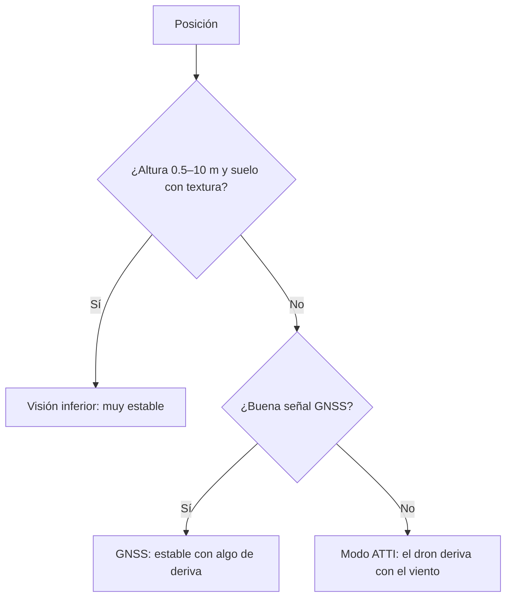

# GPS, calibración y sensores del dron

Parte de: [[35-Drones/02 Pilotaje/_Índice Pilotaje|Pilotaje]]

> [!info] Cómo avanzar
> `progreso`: **pendiente** → **viendo** (estudiando) → **visto** (contestaste la autoevaluación sin abrir las respuestas) → **dominado** (hiciste el laboratorio o lo aplicaste de verdad).

## Contenido

### Qué es
Para mantenerse quieto en el aire, saber dónde está y volver a casa, el Mini 4K combina **navegación satelital (GNSS)**, una **brújula**, una **unidad inercial (IMU)** y un **sistema de visión hacia abajo**. Cuando alguno falla o recibe datos malos, el dron deriva, avisa errores o no regresa bien. Saber qué hace cada uno te permite entender los avisos y reaccionar.

### Cómo funciona
Según la [ficha](https://www.dji.com/mini-2-se/specs) y el [manual](https://dl.djicdn.com/downloads/DJI_Mini_4K/20260427/DJI_Mini_4K_User_Manual_v1.0_zh-cn.pdf):

| Sistema | Qué hace | Límite |
|---|---|---|
| GNSS: GPS + GLONASS + Galileo | Posición global, Home Point, RTH | Necesita cielo abierto; mala señal entre edificios |
| Brújula | Hacia dónde apunta la nariz | Interferencia de metal, imanes, varillas |
| IMU | Inclinación y aceleración | Necesita calibración ocasional |
| Visión inferior + sensor infrarrojo | Flotar preciso cerca del suelo y aterrizar | 0.5–10 m de altura; superficies con textura y luz |

**No tiene detección de obstáculos** al frente, atrás ni a los lados.

**Precisión de flotación** (ficha): con visión, ±0.1 m vertical y ±0.3 m horizontal; solo con GNSS, ±0.5 m y ±1.5 m.

**Visión inferior.** Funciona sobre superficies con **patrón**, reflectividad mayor al 20 % y más de 15 lux. Sobre agua, concreto liso y uniforme, vidrio o con poca luz, no puede fijar la posición.

**Calibrar la brújula.** Hazlo si vuelas a **más de 50 km** del último lugar calibrado, si pasaron **más de 30 días** sin volar o si la app avisa interferencia. En exterior, lejos de autos, rejas, varillas e imanes: **DJI Fly > Seguridad > Calibración de brújula**, gira el dron 360° en horizontal y luego 360° con la nariz hacia abajo. Despega pronto después.

### Ejemplo
Estás en la playa, despegas desde una banqueta de concreto liso junto al mar. El dron flota a 2 m y empieza a irse de lado. Lo que pasa: el concreto uniforme y, al moverte, el agua no dan textura al sensor inferior, y la señal GNSS todavía es débil. El dron pasa a algo cercano a **modo ATTI** y el viento lo empuja.

Qué haces: tomas el control con suavidad, lo subes a 5–10 m sobre arena (que sí tiene textura) y esperas a tener buena señal. La próxima vez despegas desde una base de aterrizaje con patrón, lejos del agua, y esperas a que el Home Point quede registrado.

En otro viaje, a 300 km de casa, DJI Fly pide calibrar la brújula: te alejas del auto, giras el dron como indica la app y despegas.

### Cuándo preocuparte y cuándo no
- **Calibra** la brújula cuando la app lo pida o en las condiciones de arriba; no la calibres junto al auto ni sobre varilla.
- **No calibres la IMU** sin motivo: solo si la app lo indica, sobre una superficie plana.
- **Desconfía** del dron entre edificios altos, bajo puentes o en interiores: poca señal GNSS.

### Errores comunes
- **Calibrar junto a metal**: la brújula queda peor.
- **Despegar sobre agua o superficies lisas** esperando que flote fijo.
- **Ignorar avisos de brújula o IMU** y despegar igual.
- **Despegar sin Home Point** (ver [[Revisión antes de despegar (checklist)]]).
- **Volar de noche** confiando en la visión: con poca luz no funciona, y además la norma limita al horario diurno.

### Para profundizar
- [DJI: especificaciones del Mini 4K](https://www.dji.com/mini-2-se/specs)
- [Manual de usuario del DJI Mini 4K (PDF)](https://dl.djicdn.com/downloads/DJI_Mini_4K/20260427/DJI_Mini_4K_User_Manual_v1.0_zh-cn.pdf)

## Autoevaluación

Contesta primero en voz alta o en papel; luego despliega la respuesta.

> [!question]- ¿Qué sistemas de navegación y sensores tiene el Mini 4K?
> GNSS **GPS + GLONASS + Galileo** y un sistema de visión **hacia abajo** (con sensor infrarrojo de altura) para flotar con precisión entre ~0.5 y 10 m del suelo. **No tiene detección de obstáculos** frontal, trasera ni lateral ([ficha](https://www.dji.com/mini-2-se/specs) · [manual](https://dl.djicdn.com/downloads/DJI_Mini_4K/20260427/DJI_Mini_4K_User_Manual_v1.0_zh-cn.pdf)).

> [!question]- ¿Cuándo calibrar la brújula y cómo se hace?
> Si vuelas a **más de 50 km** del último lugar calibrado, si pasaron **más de 30 días** sin volar o si la app avisa interferencia. En exterior, lejos de metal e imanes (y sin el celular en la mano del dron): **DJI Fly > Seguridad > Calibración de brújula**, gira el dron 360° horizontal y luego 360° vertical. Despega dentro de los 3 min siguientes.

> [!question]- Caso: el dron se va de lado al flotar sobre una banqueta de concreto o sobre agua. ¿Qué pasa?
> Sobre superficies **sin textura, reflejantes o con poca luz** el sensor inferior no puede fijar la posición, y con poco GPS el dron deriva (modo ATTI). Aléjate de esas superficies o súbelo, y corrige tú con las palancas.

