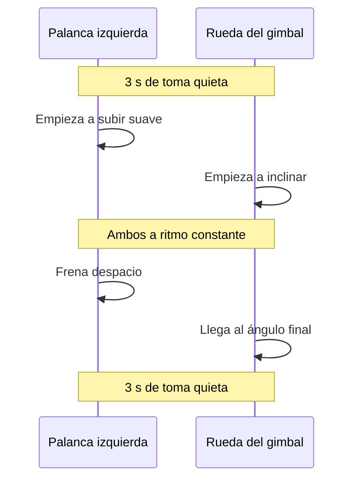

# Ascenso con inclinación de cámara con dron

Parte de: [[Maniobras básicas con dron]]

> [!info] Cómo avanzar
> `progreso`: **pendiente** → **viendo** (estudiando) → **visto** (contestaste la autoevaluación sin abrir las respuestas) → **dominado** (hiciste el laboratorio o lo aplicaste de verdad).

## Contenido

### Qué es
El ascenso con inclinación de cámara combina dos movimientos: el dron **sube en vertical** (pedestal) mientras el **gimbal se inclina** (tilt). Por ejemplo, empiezas viendo al frente a la altura de un árbol y terminas mirando hacia abajo en vista cenital (−90°), o empiezas en cenital y subes la cámara hasta descubrir el horizonte. Es la sexta y más fina de las [[Maniobras básicas con dron]] y la base del **reveal vertical**.

### Cómo funciona
- **Pedestal**: palanca izquierda hacia arriba. En modo Cine el Mini 4K sube como máximo a 2 m/s; para video conviene mucho menos.
- **Tilt**: rueda del gimbal en el hombro izquierdo del control. El gimbal inclina de 0° (al frente) a −90° (hacia abajo); en modo extendido puede mirar algo hacia arriba (hasta 20°) según la [ficha](https://www.dji.com/mini-2-se/specs).
- **Coordinación**: lo difícil es que ambos movimientos empiecen juntos, vayan a ritmo constante y terminen juntos. Si el tilt llega antes que el ascenso (o al revés), el final se ve cortado.

En DJI Fly puedes ajustar la **velocidad máxima del gimbal** y su **suavidad**: una velocidad baja y suavidad alta hacen que la rueda no dé saltos.

### Ejemplo
Reveal de un lago detrás de una línea de árboles:

1. Te colocas con el dron a 5 m, frente a los árboles de 15 m, en modo Cine, cámara a 0°.
2. Grabas 3 s quietos.
3. Empiezas a subir muy despacio. Cuando la copa de los árboles cruza el cuadro, el lago aparece detrás.
4. Al mismo tiempo inclinas ligeramente la cámara hacia abajo (−10° a −20°) para que el lago quede en el tercio inferior.
5. Frenas despacio a unos 25 m y dejas 3 s quietos.

Variante cenital: empiezas a 30 m mirando hacia abajo a una persona, subes lentamente mientras subes la cámara a 0° y aparece el paisaje. Ensaya 2–3 veces antes de grabar la buena.

### Cuándo usarla y cuándo no
- **Úsala** para aperturas de video, reveals de paisaje, transiciones entre escenas y para mostrar escala.
- **No la uses** cerca de cables o ramas sobre el dron: al subir no hay sensores hacia arriba.
- Si necesitas una toma muy precisa y repetible, considera el QuickShot **Rocket** (ver [[QuickShots y modos automáticos]]), aunque te da menos control.

### Errores comunes
- **Subir y mover el gimbal a velocidades distintas o con saltos**: ajusta velocidad y suavidad del gimbal y practica en Cine.
- **Arrancar o frenar de golpe**: el inicio y el final son lo más visible.
- **Subir sin mirar arriba**: no hay detección hacia arriba.
- **Pasar el límite de altura**: respeta 122 m (o 100 m cerca de aeródromos).
- **No dejar margen** antes y después: en la edición necesitas esos segundos.

### Para profundizar
- [DJI: especificaciones del Mini 4K (gimbal)](https://www.dji.com/mini-2-se/specs)
- [Manual de usuario del DJI Mini 4K (PDF)](https://dl.djicdn.com/downloads/DJI_Mini_4K/20260427/DJI_Mini_4K_User_Manual_v1.0_zh-cn.pdf)
- Laboratorio: [[Lab 3 - Reveal cinematográfico de 15 segundos]]

## Autoevaluación

Contesta primero en voz alta o en papel; luego despliega la respuesta.

> [!question]- ¿Cómo se hace la toma de ascenso con inclinación (pedestal + tilt)?
> Sube despacio (palanca izquierda) mientras **inclinas el gimbal** con la rueda del control: por ejemplo, empiezas viendo al frente y terminas en vista cenital (−90°), o al revés. Es la base del reveal vertical.

> [!question]- Error común: subir y mover el gimbal a velocidades distintas o con saltos. ¿Cómo lo corriges?
> Ajusta en DJI Fly la **velocidad y suavidad del gimbal** y practica en modo Cine; ensaya la toma 2–3 veces antes de grabar la buena.

## Práctica

- [[Lab 2 - Seis maniobras básicas en simulador y en campo abierto]]
- [[Lab 3 - Reveal cinematográfico de 15 segundos]]

