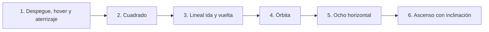

# Maniobras básicas con dron

Parte de: [[35-Drones/02 Pilotaje/_Índice Pilotaje|Pilotaje]]

> [!info] Cómo avanzar
> `progreso`: **pendiente** → **viendo** (estudiando) → **visto** (contestaste la autoevaluación sin abrir las respuestas) → **dominado** (hiciste el laboratorio o lo aplicaste de verdad).

## Contenido

### Qué es
Las maniobras básicas son seis ejercicios que entrenan, en orden, cada habilidad que necesitas para volar con seguridad y conseguir tomas suaves. Las tomas "de cine" que ves en redes son estas mismas maniobras, ejecutadas **lentas, combinadas y sin tirones**. Esta nota es el mapa del entrenamiento; cada maniobra tiene su propia nota con el detalle.

### Cómo funciona
El orden va de lo simple a lo complejo: primero un eje, luego varios, y al final coordinación de palancas con gimbal.



| # | Maniobra | Qué entrena |
|---|---|---|
| 1 | [[Despegue, vuelo estacionario y aterrizaje con dron]] | Control fino de altura y precisión en el suelo |
| 2 | [[Vuelo en cuadrado con dron]] | Palanca derecha en cuatro direcciones y orientación |
| 3 | [[Vuelo lineal de ida y vuelta con dron]] | Velocidad constante, arranque y frenado suaves |
| 4 | [[Órbita alrededor de un punto con dron]] | Combinar dos palancas a la vez |
| 5 | [[Ocho horizontal con dron]] | Giros continuos a ambos lados y dron de frente |
| 6 | [[Ascenso con inclinación de cámara con dron]] | Palancas más rueda del gimbal |

**Dónde practicar**: primero en un **simulador** (ver [[Simuladores de vuelo de drones]]) y luego en **campo abierto**, sin personas ni obstáculos, a **5–10 m** de altura y en **modo Cine**. Siempre con el checklist previo y respetando la NOM-107.

**Por qué despacio**: a baja velocidad cometes errores pequeños y fáciles de corregir, aprendes la respuesta proporcional de las palancas y gastas menos batería en correcciones. La suavidad que entrenas aquí es la que hará que cada toma salga a la primera.

**Cómo saber que dominas una maniobra**: la repites **tres veces seguidas** sin correcciones bruscas, sin perder la orientación, manteniendo la altura dentro de ±1 m y la velocidad constante.

### Ejemplo
Plan de cuatro sesiones con dos baterías cada una:

- **Sesión 1**: maniobra 1 (diez despegues y aterrizajes, hover de frente y de lado) y maniobra 2 sin girar.
- **Sesión 2**: cuadrado girando en las esquinas y vuelo lineal de 50 m en Cine.
- **Sesión 3**: órbita a mano alrededor de una mochila en ambos sentidos, a 10–15 m de radio.
- **Sesión 4**: ocho entre dos conos separados 15–20 m y ascenso con inclinación de cámara.

En cada sesión **grabas** todo: al revisar el video en casa ves los tirones que no notaste en vivo. Todo esto está en el [[Lab 2 - Seis maniobras básicas en simulador y en campo abierto]].

### Cuándo pasar a la siguiente y cuándo no
- **Avanza** cuando pases la prueba de las tres repeticiones limpias.
- **Regresa** a una maniobra anterior si en la nueva pierdes la orientación o haces correcciones grandes.
- **No practiques** con viento cerca del límite, cerca de personas o en zonas restringidas.

### Errores comunes
- **Saltarse el simulador y el hover**: la mayoría de los choques vienen de no reaccionar bien con el dron de frente.
- **Practicar solo hacia adelante**.
- **Buscar tomas bonitas antes de dominar el control**: gastas batería y te frustras.
- **Practicar a gran altura**: el dron se ve pequeño y pierdes la orientación. 5–10 m es mejor para aprender.
- **No grabar las prácticas** para revisar.

### Para profundizar
- [Manual de usuario del DJI Mini 4K (PDF)](https://dl.djicdn.com/downloads/DJI_Mini_4K/20260427/DJI_Mini_4K_User_Manual_v1.0_zh-cn.pdf)
- [DJI Flight Simulator](https://www.dji.com/downloads/softwares/dji-flightsimulator-launcher)

## Subtemas

- [[Despegue, vuelo estacionario y aterrizaje con dron]]
- [[Vuelo en cuadrado con dron]]
- [[Vuelo lineal de ida y vuelta con dron]]
- [[Órbita alrededor de un punto con dron]]
- [[Ocho horizontal con dron]]
- [[Ascenso con inclinación de cámara con dron]]

## Autoevaluación

Contesta primero en voz alta o en papel; luego despliega la respuesta.

> [!question]- ¿Cuáles son las 6 maniobras básicas y en qué orden practicarlas?
> 1) Despegue, estacionario y aterrizaje; 2) vuelo en cuadrado; 3) vuelo lineal de ida y vuelta; 4) órbita alrededor de un punto; 5) ocho horizontal; 6) ascenso con inclinación de cámara. Primero en **simulador**, luego en **campo abierto** a 5–10 m de altura en modo Cine.

> [!question]- ¿Por qué practicar a baja velocidad antes de buscar tomas bonitas?
> Porque las tomas cinematográficas son estas maniobras combinadas y lentas. Si dominas el control fino (sin tirones), cada toma sale a la primera y gastas menos batería.

> [!question]- ¿Cómo sabes que dominas una maniobra?
> La repites **3 veces seguidas** sin corregir bruscamente, sin perder la orientación y manteniendo la altura (± 1 m) y la velocidad constantes.

## Práctica

- [[Lab 2 - Seis maniobras básicas en simulador y en campo abierto]]

## Progreso de los subtemas

```base
filters:
  and:
    - file.inFolder("35-Drones/02 Pilotaje/Maniobras básicas con dron")
    - file.name != "Maniobras básicas con dron"
views:
  - type: table
    name: Progreso
    order:
      - file.name
      - progreso
      - nivel
```
