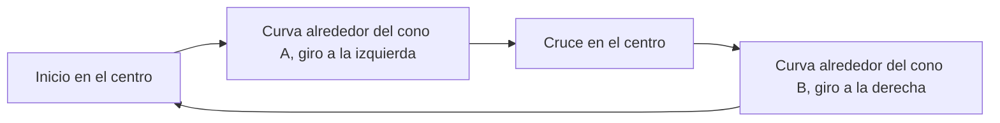

# Ocho horizontal con dron

Parte de: [[Maniobras básicas con dron]]

> [!info] Cómo avanzar
> `progreso`: **pendiente** → **viendo** (estudiando) → **visto** (contestaste la autoevaluación sin abrir las respuestas) → **dominado** (hiciste el laboratorio o lo aplicaste de verdad).

## Contenido

### Qué es
El ocho horizontal consiste en volar una figura de "8" acostado sobre el suelo, rodeando dos puntos en sentidos opuestos y manteniendo la altura. Es la quinta de las [[Maniobras básicas con dron]] y la más completa: obliga a coordinar las dos palancas a la vez, a girar continuamente hacia ambos lados y a volar con el dron dándote el frente.

### Cómo funciona
En cada mitad del ocho el dron avanza (palanca derecha adelante) mientras gira de forma continua (palanca izquierda hacia un lado). En el cruce del centro **cambias el sentido del giro**: lo que era izquierda pasa a derecha. Con eso el dron recorre en algún momento todas las orientaciones respecto a ti, incluida la difícil: viniendo hacia ti, con los controles laterales aparentemente invertidos.

Para que salga limpio:

- **Altura constante**: la palanca izquierda arriba/abajo se queda quieta; solo usas su eje lateral para girar.
- **Velocidad constante**: la palanca derecha con presión fija.
- **Curvas redondas**: el radio depende de la proporción entre avance y giro. Más giro con poco avance = curva cerrada.
- **Simetría**: las dos mitades deben verse iguales.

Variante avanzada: hacer el ocho **sin girar el dron** (nariz siempre en la misma dirección), usando solo la palanca derecha en movimientos circulares. Entrena coordinación de los dos ejes de la misma palanca.

### Ejemplo
En un campo de fútbol vacío:

1. Pones dos conos o mochilas separados **15–20 m**. Te paras a unos 15 m del centro, de lado.
2. Modo **Cine**, altura de 5 m.
3. Empiezas en el centro, avanzas hacia el cono A y giras rodeándolo por la izquierda.
4. Al volver al centro, cambias el giro y rodeas el cono B por la derecha.
5. Repites tres ochos seguidos sin detenerte.

Revisa el video del dron: si la altura cambia, si las curvas se ven "cuadradas" o si hay frenazos en el cruce, sabes qué practicar. La prueba de dominio es la de siempre: tres repeticiones seguidas sin correcciones bruscas y con la altura dentro de ±1 m.

### Cuándo practicarlo y cuándo no
- **Practícalo** después de dominar el cuadrado, el vuelo lineal y la órbita.
- Primero en **simulador** (ver [[Simuladores de vuelo de drones]]): ahí un error no cuesta nada.
- **No lo practiques** con viento fuerte (desarma las curvas y gasta batería) ni cerca de personas, árboles o postes: durante los giros es fácil perder la referencia.

### Errores comunes
- **Perder altura en los giros**: al concentrarte en el giro, mueves sin querer el acelerador. Vigila la altura en la pantalla.
- **Confundirte en el cruce** cuando el dron viene de frente: practica primero orientaciones sueltas en el simulador.
- **Conos demasiado cerca**: las curvas se vuelven tan cerradas que no hay tiempo de corregir. 15–20 m es buen inicio.
- **Velocidad excesiva**: en Normal o Sport el error crece más rápido de lo que reaccionas.
- **Mirar solo la pantalla**: mantén la línea de vista con el dron, como pide la norma, y usa la pantalla de apoyo.

### Para profundizar
- [Manual de usuario del DJI Mini 4K (PDF)](https://dl.djicdn.com/downloads/DJI_Mini_4K/20260427/DJI_Mini_4K_User_Manual_v1.0_zh-cn.pdf)
- [DJI Flight Simulator](https://www.dji.com/downloads/softwares/dji-flightsimulator-launcher)
- Laboratorio: [[Lab 2 - Seis maniobras básicas en simulador y en campo abierto]]

## Autoevaluación

Contesta primero en voz alta o en papel; luego despliega la respuesta.

> [!question]- ¿Por qué el ocho es la maniobra más completa?
> Combina avance, giro continuo a ambos lados y cambio de orientación: obliga a coordinar las dos palancas a la vez y a volar con el dron de frente.

> [!question]- ¿Qué referencia usas en campo para hacer un ocho limpio?
> Dos objetos (conos, mochilas) separados 15–20 m; vuela alrededor de cada uno en sentidos opuestos manteniendo la altura constante.

## Práctica

- [[Lab 2 - Seis maniobras básicas en simulador y en campo abierto]]

