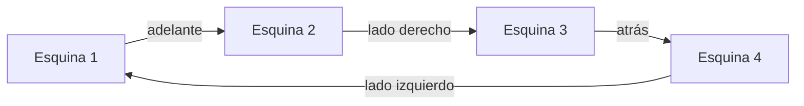

# Vuelo en cuadrado con dron

Parte de: [[Maniobras básicas con dron]]

> [!info] Cómo avanzar
> `progreso`: **pendiente** → **viendo** (estudiando) → **visto** (contestaste la autoevaluación sin abrir las respuestas) → **dominado** (hiciste el laboratorio o lo aplicaste de verdad).

## Contenido

### Qué es
El vuelo en cuadrado consiste en recorrer los cuatro lados de un cuadrado imaginario, a altura constante, deteniéndote en cada esquina. Es la segunda de las [[Maniobras básicas con dron]] y tiene dos versiones: **sin girar el dron** (la nariz apunta siempre al mismo lado) y **girando en cada esquina** (la nariz apunta siempre hacia donde vas). Cada versión entrena algo distinto.

### Cómo funciona
**Versión 1: sin girar.** Solo usas la **palanca derecha** en sus cuatro direcciones: adelante, lado, atrás, lado. La nariz no cambia. Entrenas:
- El control proporcional de la palanca derecha en ambos ejes.
- Mantener la altura sin tocar el acelerador.
- Detenerte suave en cada esquina.
- La base de los desplazamientos laterales (*trucks*), muy usados en video.

**Versión 2: girando en cada esquina.** Avanzas un lado, te detienes, giras 90° con la **palanca izquierda** (guiñada) y avanzas el siguiente. Ahora entrenas:
- La guiñada controlada.
- La **orientación**: en algún lado el dron viene hacia ti y los controles laterales se ven invertidos.

En la versión 2 cambia: en cada esquina giras 90° y siempre avanzas con la palanca derecha hacia adelante.

### Ejemplo
En un campo abierto:

1. Marca cuatro esquinas con conos, mochilas o piedras visibles, a **10–15 m** de lado.
2. Modo **Cine**, altura de 5 m, tú parado a un lado del cuadrado (no en el centro).
3. **Versión 1**: recorre el cuadrado en sentido horario, deteniéndote 2 s en cada esquina. Luego en sentido antihorario.
4. **Versión 2**: repite girando en cada esquina, primero horario y luego antihorario.
5. Revisa la altura en pantalla: debe quedar dentro de ±1 m.

Cuando lo domines, quita las paradas: recorre el cuadrado de forma continua, con frenadas suaves en las esquinas. Ese movimiento es exactamente el que harás al grabar un desplazamiento lateral frente a un edificio.

### Cuándo practicarlo y cuándo no
- **Practícalo** después de dominar despegue, hover y aterrizaje.
- **Haz primero la versión sin girar**: es más fácil mantener la orientación.
- Pasa a la versión con giros cuando la primera salga tres veces seguidas limpia.
- **No lo practiques** con viento fuerte: te desarma los lados y no sabrás si el error es tuyo o del viento.

### Errores comunes
- **Lados curvos**: estás moviendo un poco la palanca derecha en diagonal. Toques pequeños y en un solo eje.
- **Perder altura**: no tocas el acelerador, pero lo estás rozando con el pulgar al girar. Relaja la mano.
- **Girar más o menos de 90°**: usa una referencia en el horizonte para cada lado.
- **Confundir izquierda y derecha** en el lado donde el dron viene de frente: piensa "hacia donde apunta la nariz", no "mi izquierda".
- **Pararte en el centro del cuadrado**: tendrás que girar tú también y pierdes la referencia.

### Para profundizar
- [Manual de usuario del DJI Mini 4K (PDF)](https://dl.djicdn.com/downloads/DJI_Mini_4K/20260427/DJI_Mini_4K_User_Manual_v1.0_zh-cn.pdf)
- [DJI Flight Simulator](https://www.dji.com/downloads/softwares/dji-flightsimulator-launcher)
- Laboratorio: [[Lab 2 - Seis maniobras básicas en simulador y en campo abierto]]

## Autoevaluación

Contesta primero en voz alta o en papel; luego despliega la respuesta.

> [!question]- ¿Qué entrenas al volar un cuadrado sin girar el dron?
> El control de la **palanca derecha** en sus cuatro direcciones (adelante, lado, atrás, lado) manteniendo la nariz siempre en la misma dirección: base para recorridos laterales (*trucks*).

> [!question]- Variante: ¿qué cambia si haces el cuadrado girando el dron en cada esquina?
> Ahora la nariz siempre apunta en la dirección de avance: entrenas la **guiñada** y aprendes a orientarte cuando el dron viene hacia ti (controles laterales invertidos).

## Práctica

- [[Lab 2 - Seis maniobras básicas en simulador y en campo abierto]]

