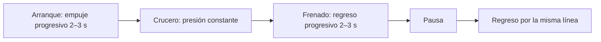

# Vuelo lineal de ida y vuelta con dron

Parte de: [[Maniobras básicas con dron]]

> [!info] Cómo avanzar
> `progreso`: **pendiente** → **viendo** (estudiando) → **visto** (contestaste la autoevaluación sin abrir las respuestas) → **dominado** (hiciste el laboratorio o lo aplicaste de verdad).

## Contenido

### Qué es
El vuelo lineal de ida y vuelta es volar en línea recta de un punto a otro, a velocidad y altura constantes, y regresar. Es la tercera de las [[Maniobras básicas con dron]]. Parece lo más simple, pero es la base del **dolly** aéreo (acercarse o alejarse de un sujeto) y del **tracking**, dos de los movimientos más usados en video. Lo que entrena es la **suavidad**: arrancar, mantener y frenar sin tirones.

### Cómo funciona
Tres fases en cada tramo:

- **Arranque**: empujas la palanca derecha poco a poco hasta la velocidad deseada.
- **Crucero**: mantienes la misma presión. Cualquier temblor de tu pulgar se ve en el video.
- **Frenado**: regresas la palanca al centro **gradualmente**. Si la sueltas de golpe, el dron frena brusco, se inclina hacia atrás y la imagen "cabecea" o rebota.

**Velocidad**: en modo Cine el Mini 4K llega a 6 m/s; para video suave, entre 2 y 4 m/s suele verse mejor. En DJI Fly puedes suavizar la respuesta de la palanca (curva EXP) para que el arranque y el frenado sean más graduales.

**Regreso**: puedes volver **en reversa** (palanca atrás, cámara mirando al punto de inicio, un "dolly out") o **girando 180°** y avanzando (practicas la guiñada y la orientación de frente).

### Ejemplo
En un camino de tierra recto:

1. Marca un punto de inicio y otro a **50 m**. Modo **Cine**, altura de 5–8 m, cámara al frente.
2. Grabas 3 s quieto en el inicio.
3. Arrancas en 2–3 s hasta ~3 m/s, mantienes, y frenas en 2–3 s antes del segundo punto.
4. Pausa de 3 s y regresas en reversa por la misma línea.
5. Repites girando 180° para el regreso.

En casa revisa el video: si al final de cada tramo la imagen se inclina o rebota, frenaste de golpe. Repite hasta que el frenado se vea como un "aterrizaje" suave de la velocidad.

**Toma real**: ese mismo movimiento hacia una persona en un mirador es un dolly in; alejándote de ella y subiendo un poco, es casi un Dronie hecho a mano (ver [[Movimientos cinematográficos con dron]]).

### Cuándo practicarlo y cuándo no
- **Practícalo** después del cuadrado: ya controlas la palanca derecha y la altura.
- **Úsalo en tomas** de acercamiento, alejamiento y seguimiento.
- **No lo practiques** hacia obstáculos: en reversa el dron no ve lo que hay detrás; revisa todo el recorrido antes.
- Con viento lateral, el dron se desviará: corriges con toques laterales mínimos.

### Errores comunes
- **Frenar soltando la palanca de golpe**: el video muestra un cabeceo y un rebote al final.
- **Velocidad irregular**: el pulgar se cansa; apoya la mano y usa la yema, no la uña.
- **Desviarse de la línea**: elige una referencia lejana en el horizonte y apunta a ella.
- **Volar en reversa sin revisar detrás**: el Mini 4K no detecta obstáculos.
- **Tramos muy cortos**: no da tiempo de estabilizar la velocidad; 50 m es buen inicio.

### Para profundizar
- [Manual de usuario del DJI Mini 4K (PDF)](https://dl.djicdn.com/downloads/DJI_Mini_4K/20260427/DJI_Mini_4K_User_Manual_v1.0_zh-cn.pdf)
- [DJI: especificaciones del Mini 4K](https://www.dji.com/mini-2-se/specs)
- Laboratorio: [[Lab 2 - Seis maniobras básicas en simulador y en campo abierto]]

## Autoevaluación

Contesta primero en voz alta o en papel; luego despliega la respuesta.

> [!question]- ¿Cómo se practica el vuelo lineal y para qué toma sirve?
> Avanza en línea recta 30–50 m a velocidad constante, frena suave, gira 180° y regresa. Es la base del **dolly in/out** y del **travelling** sobre un camino o costa.

> [!question]- Error común: frenar soltando la palanca de golpe. ¿Qué se ve en el video?
> Un tirón y un cabeceo del gimbal. Suelta la palanca **gradualmente** (en modo Cine el frenado ya es más suave).

## Práctica

- [[Lab 2 - Seis maniobras básicas en simulador y en campo abierto]]

