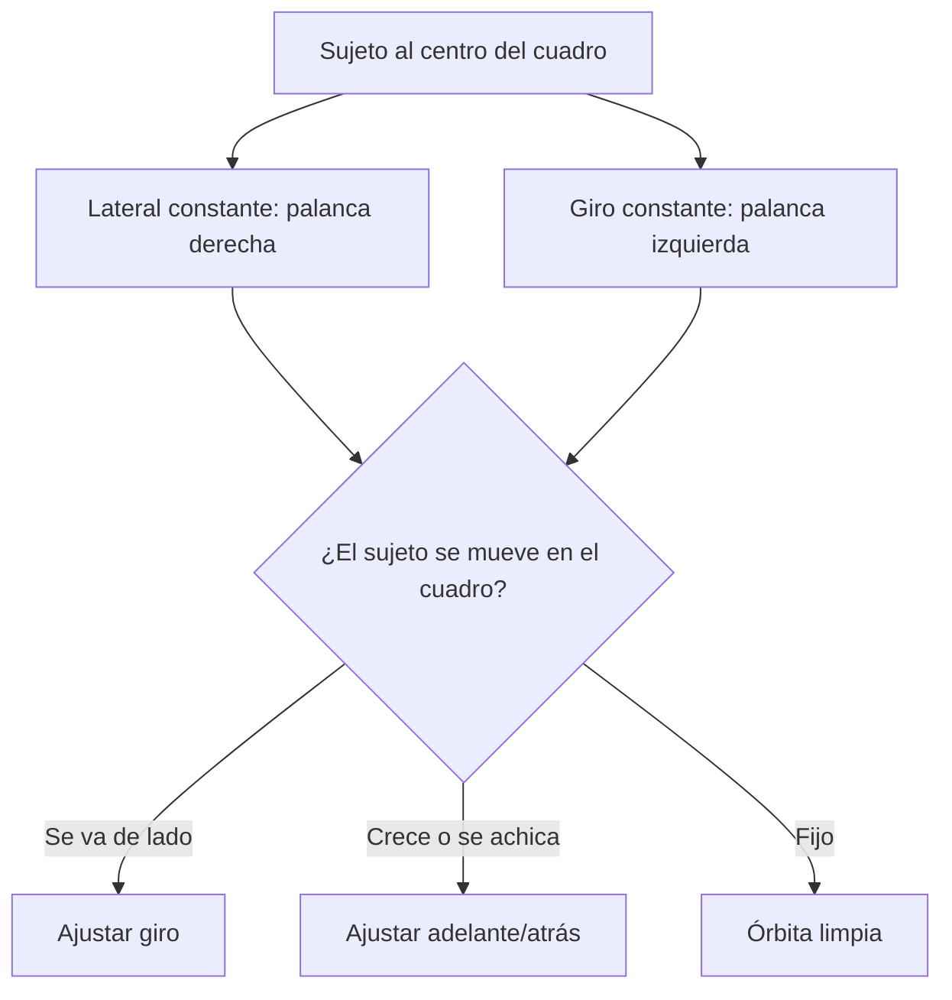

# Órbita alrededor de un punto con dron

Parte de: [[Maniobras básicas con dron]]

> [!info] Cómo avanzar
> `progreso`: **pendiente** → **viendo** (estudiando) → **visto** (contestaste la autoevaluación sin abrir las respuestas) → **dominado** (hiciste el laboratorio o lo aplicaste de verdad).

## Contenido

### Qué es
La órbita es volar en círculo alrededor de un sujeto (una persona, una estatua, un árbol) manteniendo la cámara apuntada hacia él. Es la cuarta de las [[Maniobras básicas con dron]] y una de las tomas más usadas para **resaltar un sujeto**, porque el fondo se mueve detrás de él y da una sensación de profundidad. Hacerla a mano obliga a combinar dos palancas a la vez.

### Cómo funciona
Para orbitar en sentido antihorario (el dron se mueve hacia su derecha):

- **Palanca derecha a la derecha**: desplazamiento lateral (alabeo).
- **Palanca izquierda a la izquierda**: giro de la nariz hacia el sujeto (guiñada).

Para el sentido contrario, inviertes ambas. La proporción entre las dos define el **radio**: más desplazamiento con poco giro = círculo grande; más giro = círculo cerrado. Si el sujeto se te sale del centro del cuadro, ajusta el giro; si te acercas o alejas, corrige con un toque de palanca derecha hacia adelante o atrás.

**Tiempo de una vuelta**: la circunferencia es 2πr. Con radio de 20 m son unos **126 m**; a 2 m/s, unos 63 s por vuelta. Para video, un cuarto o media vuelta suele bastar.

**Órbita automática**: el QuickShot **Circle** hace la órbita sola alrededor de un sujeto que seleccionas (ver [[QuickShots y modos automáticos]]). Es más regular, pero no puedes cambiar el radio ni la velocidad sobre la marcha, y el dron sigue **sin detectar obstáculos**.

### Ejemplo
Alrededor de una mochila en un campo:

1. Altura de 8–10 m, radio de **10–15 m**, modo **Cine**, cámara ligeramente hacia abajo (−20° a −30°) con la mochila al centro.
2. Empiezas el lateral muy suave y añades el giro hasta que la mochila se quede quieta en el cuadro.
3. Das media vuelta, frenas suave, y repites en sentido contrario.
4. Cuando salga limpia, haz la vuelta completa y luego prueba bajando 1–2 m durante la órbita (órbita descendente).

Revisa el video: la mochila debe quedarse en el mismo lugar del cuadro y el horizonte, estable.

### Cuándo hacerla a mano y cuándo automática
- **A mano**: cuando quieres controlar radio, velocidad, altura y duración, o cambiar de dirección; también para combinarla con un ascenso.
- **Automática (Circle)**: cuando quieres una órbita perfectamente regular y estás solo, por ejemplo grabándote a ti mismo. Revisa antes todo el círculo: ramas, postes, cables.
- **No la hagas** alrededor de personas que no participan ni cerca de árboles con ramas en el recorrido.

### Errores comunes
- **Mover solo una palanca**: el sujeto sale del cuadro o el dron se aleja.
- **Radio irregular**: no corriges adelante/atrás.
- **Perder altura**: el pulgar izquierdo baja sin querer al girar.
- **Órbita automática sin revisar el recorrido**: no detecta obstáculos.
- **Ir muy rápido**: la órbita se ve mejor lenta.

### Para profundizar
- [Manual de usuario del DJI Mini 4K (PDF)](https://dl.djicdn.com/downloads/DJI_Mini_4K/20260427/DJI_Mini_4K_User_Manual_v1.0_zh-cn.pdf)
- [DJI: especificaciones del Mini 4K (QuickShots)](https://www.dji.com/mini-2-se/specs)
- Laboratorio: [[Lab 2 - Seis maniobras básicas en simulador y en campo abierto]]

## Autoevaluación

Contesta primero en voz alta o en papel; luego despliega la respuesta.

> [!question]- ¿Qué palancas combinas para orbitar a mano un objeto?
> Palanca derecha **hacia un lado** (desplazamiento lateral) y palanca izquierda **girando hacia el lado contrario** (guiñada) para mantener el objeto al centro. Ajusta la proporción hasta que el radio sea constante.

> [!question]- ¿Cuándo usar la órbita automática (QuickShot Circle) en lugar de hacerla a mano?
> Cuando el lugar es abierto y quieres un círculo perfecto rápido. A mano controlas mejor la velocidad, el radio y el inicio/fin de la toma; recuerda que ningún modo esquiva obstáculos en el Mini 4K.

## Práctica

- [[Lab 2 - Seis maniobras básicas en simulador y en campo abierto]]

