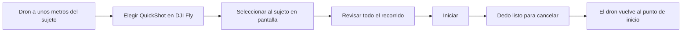

# QuickShots y modos automáticos

Parte de: [[35-Drones/02 Pilotaje/_Índice Pilotaje|Pilotaje]]

> [!info] Cómo avanzar
> `progreso`: **pendiente** → **viendo** (estudiando) → **visto** (contestaste la autoevaluación sin abrir las respuestas) → **dominado** (hiciste el laboratorio o lo aplicaste de verdad).

## Contenido

### Qué es
Los **QuickShots** son tomas automáticas que el dron ejecuta solo: seleccionas un sujeto en la pantalla, eliges el tipo de toma y el dron hace un movimiento predefinido mientras graba un clip corto. Sirven para conseguir tomas dinámicas cuando estás solo (por ejemplo, para grabarte a ti mismo en un viaje) o cuando aún no dominas el movimiento a mano.

### Cómo funciona
Según la [ficha de DJI](https://www.dji.com/mini-2-se/specs), el Mini 4K tiene cinco:

| QuickShot | Movimiento | Uso típico |
|---|---|---|
| Dronie | Se aleja hacia atrás y hacia arriba, mirando al sujeto | "Despedida" o apertura de vlog |
| Rocket | Sube en vertical con la cámara mirando hacia abajo | Revelar el entorno desde arriba |
| Circle | Orbita alrededor del sujeto a altura constante | Resaltar un sujeto |
| Helix | Orbita mientras se aleja y sube en espiral | Toma épica de cierre |
| Boomerang | Recorre un óvalo alejándose y regresando | Movimiento dinámico alrededor del sujeto |

(El manual también menciona Comet; la ficha no lo lista: (Pendiente de confirmar) si está disponible en tu firmware.)

**Flujo**:

El clip resultante dura unos segundos; DJI Fly puede además generar un video corto editado. El dron **no detecta obstáculos**, así que no "ve" el árbol que está atrás o arriba: tú eres responsable de que el recorrido esté libre.

### Ejemplo
**Vlog de viaje: toma "alejándote de ti" en un mirador.**

1. Te paras en el borde seguro del mirador; el dron a unos 5 m frente a ti, a la altura de tu pecho.
2. Miras **detrás y arriba del dron**: el Dronie se moverá en esa dirección. Si hay un poste o un árbol, mueves el punto de inicio.
3. Eliges **Dronie** (o **Rocket** si quieres que suba en vertical con la cámara hacia abajo), seleccionas tu figura en pantalla e inicias.
4. Mientras el dron se aleja, tienes el control en la mano y el dedo listo para pausar o mover las palancas (con eso se cancela).
5. Revisas el clip y, si sirve, lo usas como apertura o cierre del video.

Comprueba que el recorrido no te lleve a más de 457 m ni sobre zonas restringidas, y que no pase sobre personas que no participan.

### Cuándo usarlos y cuándo no
- **Úsalos** cuando estás solo, en campo abierto, con un sujeto claro y sin obstáculos en todo el recorrido.
- **Prefiere hacerlo a mano** cuando necesitas controlar radio, velocidad o duración, o cuando el entorno tiene árboles, cables o edificios cerca.
- **No los uses** con viento fuerte (el dron se desvía), cerca de personas, ni en zonas con señal GNSS débil.

### Errores comunes
- **No revisar el recorrido**: Dronie y Helix se mueven hacia atrás y arriba, donde no estás mirando.
- **Soltar el control**: siempre ten el dedo listo para cancelar.
- **Sujeto mal seleccionado**: el dron sigue otra cosa y el encuadre se pierde.
- **Usarlos en lugares estrechos**: el movimiento necesita espacio.
- **Abusar**: si todos tus videos abren con un Dronie, se vuelve repetitivo.

### Para profundizar
- [DJI: especificaciones del Mini 4K (QuickShots)](https://www.dji.com/mini-2-se/specs)
- [Manual de usuario del DJI Mini 4K (PDF)](https://dl.djicdn.com/downloads/DJI_Mini_4K/20260427/DJI_Mini_4K_User_Manual_v1.0_zh-cn.pdf)
- Nota relacionada: [[Órbita alrededor de un punto con dron]]

## Autoevaluación

Contesta primero en voz alta o en papel; luego despliega la respuesta.

> [!question]- ¿Qué QuickShots tiene el Mini 4K?
> **Dronie, Helix, Rocket, Circle y Boomerang** según la [ficha de DJI](https://www.dji.com/mini-2-se/specs) (el manual también menciona Comet). Graban clips cortos automáticos alrededor o alejándose de un sujeto.

> [!question]- ¿Qué precaución tienes que tomar al lanzar un QuickShot?
> El dron se mueve solo hacia atrás, arriba o en círculo **sin detectar obstáculos**: revisa todo el recorrido (detrás y arriba del dron) y ten el dedo listo para cancelar (pausa o mover palancas).

> [!question]- Caso: quieres una toma "alejándote de ti" para un vlog de viaje. ¿Cuál eliges?
> **Dronie** (se aleja hacia atrás y arriba mirándote) o **Rocket** (sube en vertical con la cámara hacia abajo). Úsalos en campo abierto.

