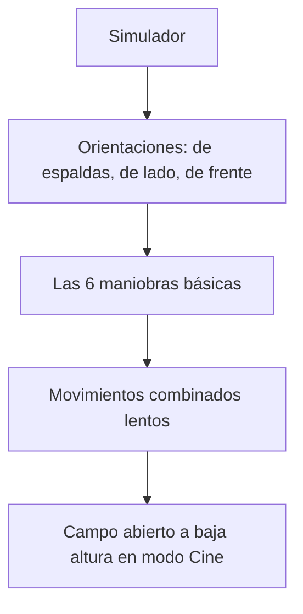

# Simuladores de vuelo de drones

Parte de: [[35-Drones/02 Pilotaje/_Índice Pilotaje|Pilotaje]]

> [!info] Cómo avanzar
> `progreso`: **pendiente** → **viendo** (estudiando) → **visto** (contestaste la autoevaluación sin abrir las respuestas) → **dominado** (hiciste el laboratorio o lo aplicaste de verdad).

## Contenido

### Qué es
Un simulador de vuelo es un programa que reproduce el comportamiento de un dron en un entorno virtual, para practicar con un control real sin arriesgar el equipo, sin batería y sin restricciones de clima ni de espacio aéreo. Es donde conviene cometer los errores de principiante: confundir controles con el dron de frente, reaccionar tarde, frenar de golpe.

### Cómo funciona
**DJI Flight Simulator.** Es el simulador oficial de DJI para Windows, descargable en el [centro de descargas de DJI](https://www.dji.com/downloads/softwares/dji-flightsimulator-launcher). Según la [reseña de Droneblog](https://www.droneblog.com/dji-flight-simulator/), tiene una **edición de prueba gratuita** para Windows de 64 bits, se usa con un control DJI conectado por USB o con un gamepad, y no incluye modelos Mini, aunque sirve para entrenar las palancas. Que la edición gratuita siga disponible hoy está (Pendiente de confirmar).

Requisitos aproximados según la misma reseña: GPU tipo **GTX 1050 Ti con 4 GB**, **16 GB de RAM** y **80 GB** libres. Tu GTX 1660 Ti de 6 GB supera esa GPU; revisa tu RAM y espacio libre.

**DJI Simulator para iPhone.** En el App Store hay una app [DJI Simulator](https://apps.apple.com/us/app/dji-simulator/id6757897210), gratuita y publicada por DJI, que lista modelos como el Mini 5 Pro y controles RC-N2 y RC-N3. Si funciona con el control y el dron del Mini 4K está (Pendiente de confirmar).

**Si tu PC no alcanza**: el "simulador real" es un campo abierto, sin gente ni obstáculos, a 5–10 m de altura y en modo Cine.

### Ejemplo
Plan de 20 minutos al día durante una semana:

1. **Días 1–2**: hover con el dron de espaldas, de lado y **de frente**. Lo que más cuesta en campo es el dron dándote el frente, con los controles laterales invertidos a la vista.
2. **Días 3–4**: cuadrado sin girar y girando, y vuelo lineal con arranques y frenados suaves.
3. **Días 5–6**: órbita a mano en ambos sentidos y ocho horizontal.
4. **Día 7**: movimientos **combinados** (avanzar mientras giras, subir mientras inclinas la cámara) y aterrizajes de precisión en un punto.

Al terminar, pasas al campo con las mismas maniobras (ver [[Lab 2 - Seis maniobras básicas en simulador y en campo abierto]]).

### Cuándo usarlo y cuándo no
- **Úsalo** antes del primer vuelo, después de semanas sin volar, para practicar orientaciones difíciles y para ensayar maniobras nuevas.
- **No sustituye** el campo: no simula exactamente el viento, la latencia de la señal ni el comportamiento de tu dron. Tampoco enseña normativa.
- Si el simulador no tiene tu modelo, ajusta la sensibilidad y la velocidad para que se parezca al modo Cine del Mini 4K.

### Errores comunes
- **Practicar solo volando hacia adelante**: entrena el dron de frente, los movimientos combinados y los aterrizajes precisos.
- **Volar rápido** porque "no pasa nada": entrenas malos hábitos.
- **Usar el teclado** en vez de un control con palancas: no desarrollas el tacto proporcional.
- **Saltarte el campo** creyendo que el simulador basta.

### Para profundizar
- [DJI Flight Simulator: descarga](https://www.dji.com/downloads/softwares/dji-flightsimulator-launcher)
- [Droneblog: reseña de DJI Flight Simulator](https://www.droneblog.com/dji-flight-simulator/)
- [DJI Simulator en el App Store](https://apps.apple.com/us/app/dji-simulator/id6757897210)
- Mapa del entrenamiento: [[Maniobras básicas con dron]]

## Autoevaluación

Contesta primero en voz alta o en papel; luego despliega la respuesta.

> [!question]- ¿Qué simulador gratuito oficial existe para practicar con controles tipo DJI?
> **DJI Flight Simulator**, descargable en el [centro de descargas de DJI](https://www.dji.com/downloads/softwares/dji-flightsimulator-launcher). Tiene una **edición de prueba gratuita** para Windows de 64 bits; se usa con un control DJI por cable USB o un gamepad. No incluye modelos Mini, pero sirve para entrenar las palancas ([reseña](https://www.droneblog.com/dji-flight-simulator/)). Que la edición gratuita siga disponible hoy está (Pendiente de confirmar).

> [!question]- ¿Qué requisitos de PC pide (según la reseña) y qué haces si tu PC no alcanza?
> Mínimo aproximado: GPU tipo **GTX 1050 Ti con 4 GB**, **16 GB de RAM** y **80 GB** libres. Si no alcanza, practica en campo abierto **a baja altura y en modo Cine**, como un "simulador real" (sin gente ni obstáculos).

> [!question]- Error común: practicar en el simulador solo volando hacia adelante. ¿Qué entrenar?
> Lo que más cuesta en campo: el **dron de frente a ti** (controles invertidos), movimientos **combinados** (avanzar y girar a la vez) y aterrizajes precisos. Haz las 6 maniobras de [[Maniobras básicas con dron]].

## Práctica

- [[Lab 2 - Seis maniobras básicas en simulador y en campo abierto]]

