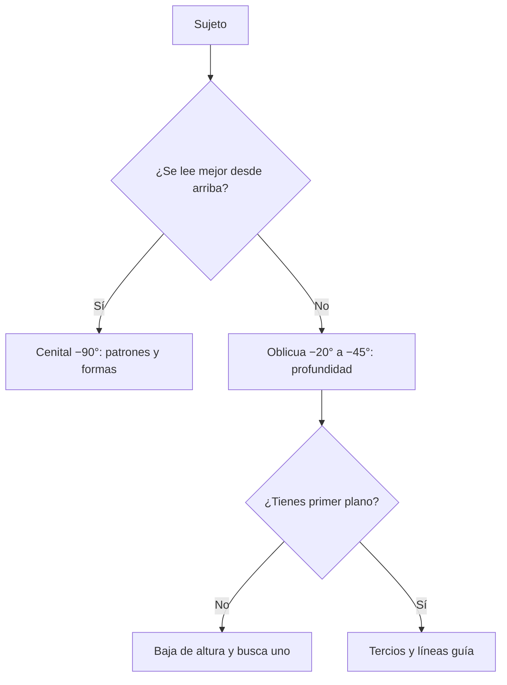

# Composición aérea y cenital

Parte de: [[35-Drones/03 Foto y video aéreo/_Índice Foto y video aéreo|Foto y video aéreo]]

> [!info] Cómo avanzar
> `progreso`: **pendiente** → **viendo** (estudiando) → **visto** (contestaste la autoevaluación sin abrir las respuestas) → **dominado** (hiciste el laboratorio o lo aplicaste de verdad).

## Contenido

### Qué es
La composición aérea es cómo organizas los elementos del cuadro cuando la cámara está en el aire. El dron te da dos puntos de vista que no tienes en el suelo: la **vista oblicua** (cámara inclinada, con horizonte) y la **vista cenital** (cámara a −90°, mirando recto hacia abajo). Las reglas clásicas de composición siguen valiendo, pero la altura y el ángulo cambian qué funciona.

### Cómo funciona
**Vista cenital (−90°).** Desaparece el horizonte y la perspectiva: el paisaje se convierte en **patrones, formas, líneas y texturas**. Funciona con sujetos que "se leen" desde arriba: campos de cultivo, calles en cuadrícula, olas sobre la arena, una persona acostada en el pasto, coches estacionados, la sombra de un árbol. La **luz rasante** (temprano por la mañana o al final de la tarde) alarga las sombras y da volumen a lo que, con sol del mediodía, se ve plano.

**Vista oblicua (−20° a −45°).** Conserva el horizonte y da **profundidad**. Aquí trasladas las reglas del suelo:

- **Regla de tercios**: el horizonte en el tercio superior o inferior, no en medio.
- **Líneas guía**: caminos, ríos, costas, bardas que llevan la mirada al sujeto.
- **Simetría**: puentes, plazas, edificios vistos de frente o cenitales.
- **Capas de profundidad**: primer plano, plano medio y fondo.
- **Espacio negativo**: un sujeto pequeño en un fondo amplio (un bote en el mar).

**La altura es parte de la composición.** Desde muy alto todo se aplana y se pierde la escala: una casa y una caja de zapatos se ven igual. A menudo la mejor toma está entre **20 y 60 m**, con algo en primer plano que dé referencia. Recuerda el límite legal de 122 m (o 100 m cerca de aeródromos).

El gimbal del Mini 4K inclina de 0° a −90° (hasta +20° en modo extendido, según la [ficha](https://www.dji.com/mini-2-se/specs)), así que tienes todo el rango.

### Ejemplo
En la costa al atardecer:

1. **Cenital**: subes a ~30 m sobre la orilla, cámara a −90°. Colocas la línea donde la ola rompe en diagonal (líneas guía), con tu sombra o la de una palmera alargada por la luz rasante.
2. **Oblicua**: bajas a ~20 m, cámara a −30°, con rocas en primer plano, la playa en el plano medio y el sol en el tercio superior. El horizonte, nivelado.
3. **Escala**: una persona caminando en la arena le da tamaño a la escena.

Haz de cada lugar al menos una cenital y una oblicua: en la edición tendrás variedad.

### Cuándo usar cada vista
- **Cenital**: patrones, geometría, sombras largas, transiciones entre escenas.
- **Oblicua**: paisajes, ubicaciones, tomas de apertura que muestran dónde estás.
- **Baja altura (5–20 m)**: cuando quieres intimidad o seguir a alguien.
- **No compongas** sobre personas que no participan ni hacia ventanas y patios ajenos (ver [[Zonas restringidas y privacidad al volar]]).

### Errores comunes
- **Subir siempre al máximo**: se aplana todo y se pierde la escala.
- **Horizonte torcido**: revísalo en pantalla o corrígelo en la edición.
- **Cenital sin sujeto claro**: solo "textura" no sostiene la toma.
- **Sol de mediodía** en cenitales: sin sombras, la imagen se ve plana.
- **Horizonte en medio** en oblicuas: decide si importa más el cielo o el suelo.

### Para profundizar
- [DJI: especificaciones del Mini 4K (gimbal)](https://www.dji.com/mini-2-se/specs)
- Nota relacionada: [[Movimientos cinematográficos con dron]]
- Laboratorio: [[Lab 3 - Reveal cinematográfico de 15 segundos]]

## Autoevaluación

Contesta primero en voz alta o en papel; luego despliega la respuesta.

> [!question]- ¿Qué hace especial a la toma cenital (cámara a −90°)?
> Convierte el paisaje en **patrones, formas y líneas** (campos, calles, olas, sombras). Funciona con sujetos que se leen desde arriba y con luz rasante (mañana o tarde) que alarga las sombras.

> [!question]- ¿Qué reglas de composición se trasladan del suelo al aire?
> Regla de tercios, líneas guía (caminos, ríos), simetría, **capas de profundidad** (primer plano, medio, fondo) y espacio negativo. En el aire, inclina un poco la cámara (−20° a −45°) para no perder el horizonte y dar profundidad.

> [!question]- Error común: subir siempre al máximo. ¿Por qué no siempre conviene?
> Desde muy alto todo se aplana y se pierde la escala. A menudo la mejor toma está a **20–60 m**, con algo en primer plano.

## Práctica

- [[Lab 3 - Reveal cinematográfico de 15 segundos]]

