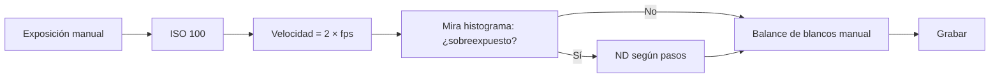

# Exposición en video aéreo (ND y 180 grados)

Parte de: [[35-Drones/03 Foto y video aéreo/_Índice Foto y video aéreo|Foto y video aéreo]]

> [!info] Cómo avanzar
> `progreso`: **pendiente** → **viendo** (estudiando) → **visto** (contestaste la autoevaluación sin abrir las respuestas) → **dominado** (hiciste el laboratorio o lo aplicaste de verdad).

## Contenido

### Qué es
Exponer bien el video aéreo es lograr que la imagen tenga el brillo correcto **y** un movimiento natural. En el Mini 4K es especialmente delicado porque la apertura es **fija** y la cámara solo graba con perfil de color **Normal**: no hay diafragma para bajar la luz ni un perfil plano para recuperar cielos quemados. La solución es combinar exposición manual, la regla de 180° y filtros ND.

### Cómo funciona
**Controles del Mini 4K** ([ficha](https://www.dji.com/mini-2-se/specs)):

| Control | Rango | Comentario |
|---|---|---|
| Apertura | ƒ/2.8 fija | No se puede cambiar |
| ISO | 100–3200 | Usa el más bajo posible: menos ruido |
| Obturación | 4 s a 1/8000 s (electrónica) | Atada a la cadencia por la regla de 180° |
| Perfil de color | Normal | Sin D-Log: poca latitud |

**Regla de 180°.** La velocidad de obturación es aproximadamente el doble de los cuadros por segundo: **4K30 → 1/60**; **2.7K60 → 1/120** (≈1/125). Da un desenfoque de movimiento natural. Detalle en [[Regla de los 180 grados del obturador]].

**El problema del sol.** Con ISO 100 y ƒ/2.8, a pleno sol la exposición correcta está alrededor de 1/2000–1/3200 s. Para bajar a 1/60 sin sobreexponer necesitas un **filtro ND**:

**pasos = log₂(velocidad correcta ÷ velocidad deseada)**

- Sol: log₂(2000/60) ≈ 5.1 → **ND32**.
- Nublado: log₂(500/60) ≈ 3.1 → **ND8**.

**Perfil Normal.** Como no hay perfil plano, **protege las luces**: expón para que el cielo no se pegue al extremo derecho del histograma, aunque las sombras queden un poco oscuras. En la edición puedes subir sombras con algo de ruido; un cielo blanco no se recupera. Fija también el **balance de blancos** en manual: si cambia durante la toma, se nota.

Equivalencias y tipos de filtros en [[Filtros ND y Black Mist para video]].

### Ejemplo
Mañana despejada, quieres un reveal en 4K30:

1. Exposición **manual**, ISO 100, obturación 1/60.
2. Sin filtro, todo sale blanco. Calculas: la cámara expondría bien a ~1/2000 → 5 pasos → montas el **ND32**.
3. Revisas el histograma: el cielo queda justo antes del extremo derecho. Bien.
4. Balance de blancos en 5500 K (día).
5. Al girar hacia el sol la imagen se aclara: aceptas un poco de sobreexposición en el sol mismo, no en todo el cielo.

Si a media mañana se nubla, cambias a ND8 o ND16 y revisas otra vez.

### Cuándo aplicar 180° y cuándo no
- **Aplícala** en video narrativo y tomas con movimiento visible.
- **Puedes romperla** para tomas cenitales lentas o paisaje casi estático, donde el desenfoque de movimiento no se nota, si no tienes el ND adecuado.
- **Para foto** no aplica: usa velocidad rápida y quita el ND si quieres nitidez.

### Errores comunes
- **Poner un ND y dejar la exposición en automático**: la cámara compensa subiendo la velocidad o el ISO, y el ND no sirve.
- **Quemar el cielo** confiando en recuperarlo: con perfil Normal y H.264 de 8 bits, no hay latitud.
- **ISO alto** para compensar un ND demasiado fuerte: ruido.
- **Balance automático**: cambia al girar el dron.
- **Filtros de terceros pesados**: pueden afectar al gimbal y al peso total de 250 g.

### Para profundizar
- [DJI: especificaciones del Mini 4K (cámara)](https://www.dji.com/mini-2-se/specs)
- [Manual de usuario del DJI Mini 4K (PDF)](https://dl.djicdn.com/downloads/DJI_Mini_4K/20260427/DJI_Mini_4K_User_Manual_v1.0_zh-cn.pdf)

## Ejercicios

Resuélvelos en papel o en la herramienta; la solución está plegada.

> [!question]- Con sol, a ISO 100 y ƒ/2.8 la exposición correcta es ~1/2000 s. Quieres 1/60. ¿Qué ND?
> log₂(2000 / 60) ≈ **5.1 pasos** → **ND32** (5 pasos).

> [!question]- Día nublado: correcto a 1/500 s. ¿Qué ND para 1/60?
> log₂(500 / 60) ≈ **3.1 pasos** → **ND8** (3 pasos).

## Autoevaluación

Contesta primero en voz alta o en papel; luego despliega la respuesta.

> [!question]- ¿Qué controles de exposición tiene el Mini 4K y cuál no?
> Apertura **fija ƒ/2.8**; puedes mover **ISO 100–3200** y **obturación electrónica de 4 s a 1/8000** ([ficha](https://www.dji.com/mini-2-se/specs)). Sin diafragma, la única forma de bajar la luz para usar 180° con sol es un **filtro ND**.

> [!question]- ¿Qué velocidad buscas en 4K30 y en 2.7K60 con la regla de 180°?
> 4K30 → **1/60**; 60 fps → **1/120** (≈1/125). Ver [[Regla de los 180 grados del obturador]].

> [!question]- El Mini 4K graba solo con perfil de color Normal. ¿Qué implica para exponer?
> No hay perfil plano (D-Log): casi no puedes recuperar luces quemadas. Expón para **proteger el cielo** (histograma sin pegarse a la derecha) y fija el balance de blancos manual.

> [!question]- Error común: poner un ND y dejar la exposición en automático. ¿Qué pasa?
> La cámara compensa subiendo la velocidad o el ISO por su cuenta y pierdes el efecto del ND. Pon **exposición manual**: ISO 100 y la velocidad que busca la regla de 180°, y elige el ND que dé la exposición correcta.

## Práctica

- [[Lab 3 - Reveal cinematográfico de 15 segundos]]

