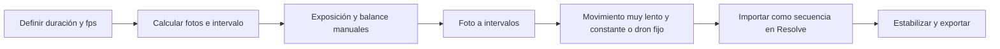

# Hyperlapse con dron

Parte de: [[35-Drones/03 Foto y video aéreo/_Índice Foto y video aéreo|Foto y video aéreo]]

> [!info] Cómo avanzar
> `progreso`: **pendiente** → **viendo** (estudiando) → **visto** (contestaste la autoevaluación sin abrir las respuestas) → **dominado** (hiciste el laboratorio o lo aplicaste de verdad).

## Contenido

### Qué es
Un **hyperlapse** es un timelapse en movimiento: la cámara se desplaza lentamente mientras toma fotos a intervalos, y al unir las fotos el tiempo se acelera **y** la cámara parece viajar. Con dron da tomas espectaculares de nubes pasando sobre una ciudad o de sombras recorriendo un valle. Importante: el **Mini 4K no tiene un modo Hyperlapse automático**; su [ficha](https://www.dji.com/mini-2-se/specs) lista foto con **intervalo en JPEG y JPEG+RAW**, y con eso lo haces a mano. Si una actualización de firmware lo agregara, está (Pendiente de confirmar).

### Cómo funciona
**Matemática del clip**:

- Fotos necesarias = **segundos de clip × cuadros por segundo**.
- Tiempo de captura = **fotos × intervalo**.
- Velocidad del dron = **distancia ÷ tiempo de captura**.

Ejemplos:
- 10 s a 30 fps con foto cada 2 s → 300 fotos → 600 s = **10 min**.
- 15 s a 24 fps con foto cada 3 s → 360 fotos → 1080 s = **18 min**: demasiado para una batería de 31 min con margen de regreso. Baja el intervalo a 2 s (12 min) o el clip a 10 s.
- Recorrer 120 m en 12 min → 120 ÷ 720 s ≈ **0.17 m/s**: muy lento, empuje mínimo y constante en modo Cine.

**Intervalo según el sujeto**: nubes rápidas o tráfico, 2 s; nubes lentas, 3–5 s. Intervalos largos dan más aceleración pero exigen más tiempo de vuelo.

**Variante más fácil**: un **timelapse con dron fijo** (flotando quieto). Si el viento es bajo, el dron mantiene la posición y solo cambian las nubes o las luces.

### Ejemplo
Atardecer sobre la ciudad, desde un punto legal y abierto (lejos de aeródromos y helipuertos):

1. Batería llena, día con poco viento. Altura de ~60 m, cámara a −10°.
2. Exposición **manual** (ISO 100 y velocidad fija), balance de blancos fijo, enfoque fijo. Si dejas la exposición en automático, cada foto sale con brillo distinto y el clip parpadea.
3. Intervalo de 2 s en JPEG (o JPEG+RAW si vas a editar mucho, con más espacio en la tarjeta).
4. Empujas la palanca derecha lo mínimo para avanzar ~0.15–0.2 m/s en Cine, o dejas el dron fijo.
5. A los 10 minutos detienes la captura y regresas con margen de batería.
6. En casa importas las fotos como secuencia en DaVinci Resolve a 30 fps y estabilizas (ver [[Edición de material aéreo]]).

### Cuándo usarlo y cuándo no
- **Úsalo** con cielos con nubes, atardeceres, ciudades con tráfico, sombras moviéndose.
- **No lo intentes** con viento fuerte (saltos), cerca del límite de batería, ni con cielos despejados sin nada que cambie.
- Si el movimiento a mano te sale irregular, haz primero timelapses con dron fijo.

### Errores comunes
- **Saltos en el clip**: viento, movimiento irregular o exposición automática. Usa exposición y balance manuales, movimiento constante y estabiliza.
- **Calcular sin el regreso**: el tiempo de captura más el regreso no debe agotar la batería.
- **Tarjeta lenta o llena**: las fotos en RAW ocupan mucho.
- **Movimiento demasiado rápido**: en el clip parece un vuelo frenético.
- **Volar de noche** para un hyperlapse nocturno: la norma limita al horario diurno.

### Para profundizar
- [DJI: especificaciones del Mini 4K (modos de foto)](https://www.dji.com/mini-2-se/specs)
- [Manual de usuario del DJI Mini 4K (PDF)](https://dl.djicdn.com/downloads/DJI_Mini_4K/20260427/DJI_Mini_4K_User_Manual_v1.0_zh-cn.pdf)
- Nota relacionada: [[Time-lapse e hyperlapse en video]]

## Ejercicios

Resuélvelos en papel o en la herramienta; la solución está plegada.

> [!question]- Quieres 15 s a 24 fps. ¿Cuántas fotos necesitas y cuánto tarda con intervalo de 3 s?
> 15 × 24 = **360 fotos**; 360 × 3 s = **1080 s = 18 min**: demasiado para una batería de ~31 min con margen de regreso → baja a intervalo de 2 s (12 min) o a 10 s de clip.

> [!question]- En 12 min el dron debe recorrer 120 m en línea recta. ¿A qué velocidad?
> 120 m / 720 s ≈ **0.17 m/s**: muy lento; usa modo Cine y un empuje mínimo y constante en la palanca.

## Autoevaluación

Contesta primero en voz alta o en papel; luego despliega la respuesta.

> [!question]- ¿Tiene el Mini 4K un modo Hyperlapse automático?
> La [ficha de DJI](https://www.dji.com/mini-2-se/specs) **no lo lista**: tiene foto temporizada / **intervalo JPEG y JPEG+RAW**. Si una actualización de firmware lo agrega está (Pendiente de confirmar). Por eso el hyperlapse se hace **a mano**: fotos a intervalos y unión en la edición.

> [!question]- ¿Cuántas fotos y cuánto tiempo necesitas para 10 s de hyperlapse a 30 fps con fotos cada 2 s?
> 10 s × 30 fps = **300 fotos**; × 2 s = **600 s = 10 min** de vuelo (más despegue y regreso): cabe en una batería si no hay viento.

> [!question]- Caso: el hyperlapse sale con saltos. ¿Qué lo causa y cómo se corrige?
> Viento, movimiento irregular del dron o exposición/balance automáticos (parpadeo). Usa **exposición y balance manuales**, movimiento muy lento y constante (o dron fijo para un timelapse), y estabiliza en la edición. Ver [[Time-lapse e hyperlapse en video]].

## Práctica

- [[Lab 4 - Panorámica y hyperlapse con el Mini 4K]]

