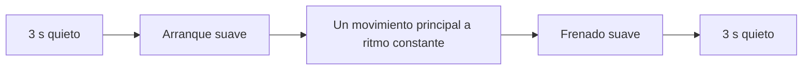

# Movimientos cinematográficos con dron

Parte de: [[35-Drones/03 Foto y video aéreo/_Índice Foto y video aéreo|Foto y video aéreo]]

> [!info] Cómo avanzar
> `progreso`: **pendiente** → **viendo** (estudiando) → **visto** (contestaste la autoevaluación sin abrir las respuestas) → **dominado** (hiciste el laboratorio o lo aplicaste de verdad).

## Contenido

### Qué es
Los movimientos cinematográficos son desplazamientos de cámara con una **intención narrativa**: presentar un lugar, revelar algo, seguir a alguien, resaltar un sujeto. Con dron son los mismos movimientos del cine (dolly, pedestal, órbita, tracking) pero en el aire. Se construyen combinando las [[Maniobras básicas con dron]], ejecutadas lentas y limpias.

### Cómo funciona
**Cinco movimientos clásicos**:

| Movimiento | Cómo se hace | Efecto |
|---|---|---|
| Dolly in / out | Avanzar o retroceder hacia/desde el sujeto | Introducir (in) o cerrar y dar contexto (out) |
| Pedestal | Subir o bajar en vertical | Mostrar escala, revelar lo que hay detrás |
| Órbita | Círculo alrededor del sujeto | Resaltarlo; el fondo se mueve detrás |
| Tracking | Seguir algo en movimiento (paralelo, detrás o delante) | Acompañar la acción |
| Truck lateral / parallax | Desplazarse de lado con algo en primer plano | Profundidad: el primer plano pasa más rápido que el fondo |

**El reveal.** Es una toma que **oculta y luego descubre** al sujeto. Variantes: avanzar o subir por detrás de un árbol o edificio hasta que aparece el paisaje; retroceder desde un detalle hasta mostrar el lugar completo; empezar en cenital e inclinar la cámara hasta el horizonte (ver [[Ascenso con inclinación de cámara con dron]]).

**Principios**:
- **Un movimiento principal** por toma; como mucho, uno secundario (avanzar + inclinar).
- **Lento**, en modo Cine.
- **Margen**: 3–5 s antes y después de la parte útil para tener de dónde cortar.
- **Primer plano** para dar sensación de velocidad y profundidad.

El vocabulario general de cámara está en [[Movimientos de cámara]].

### Ejemplo
**Reveal de 15 segundos de una iglesia detrás de árboles** (es el [[Lab 3 - Reveal cinematográfico de 15 segundos]]):

1. Exploración: vuelas el recorrido sin grabar, revisas cables y ramas, y verificas que no hay helipuerto ni zona restringida cerca y que no pasarás sobre personas.
2. Posición inicial: dron a 8 m, detrás de la línea de árboles, cámara al frente viendo las copas.
3. Grabas 3 s quietos.
4. Subes despacio (pedestal) mientras avanzas un poco (dolly in): aparece la cúpula sobre los árboles.
5. Al final, frenas suave con la iglesia en el tercio derecho y 3 s quietos.
6. Ensayas 2–3 veces y grabas la buena.

Si quieres más dinamismo, añade un ligero giro hacia el campanario, pero solo cuando la versión simple salga perfecta.

### Cuándo usar cada movimiento
- **Dolly in**: abrir una secuencia, acercar al espectador.
- **Dolly out / Dronie**: cerrar o mostrar contexto.
- **Pedestal y reveal**: sorprender, mostrar escala.
- **Órbita**: un sujeto fijo e importante.
- **Tracking**: autos, ciclistas, personas caminando (con su permiso y sin volar sobre terceros).
- **Truck lateral**: paisajes con elementos cercanos (árboles, rocas).

### Errores comunes
- **Combinar tres movimientos a la vez sin ensayar**: empieza con uno limpio y agrega uno más.
- **No dejar margen**: en la edición no tienes de dónde cortar.
- **Ir rápido**: la toma se ve nerviosa.
- **Tracking muy cerca**: sin sensores laterales, un error es un choque.
- **Olvidar el horizonte**: torcido arruina la toma.

### Para profundizar
- [Manual de usuario del DJI Mini 4K (PDF)](https://dl.djicdn.com/downloads/DJI_Mini_4K/20260427/DJI_Mini_4K_User_Manual_v1.0_zh-cn.pdf)
- [DJI: especificaciones del Mini 4K](https://www.dji.com/mini-2-se/specs)
- Nota relacionada: [[Composición aérea y cenital]]

## Autoevaluación

Contesta primero en voz alta o en papel; luego despliega la respuesta.

> [!question]- ¿Qué es un reveal y cómo se hace con dron?
> Una toma que **oculta y luego descubre** el sujeto: p. ej. volar hacia atrás o subir detrás de un árbol/edificio mientras aparece el paisaje, o empezar en cenital e ir inclinando la cámara al horizonte. Lento, en modo Cine, y con un movimiento principal claro.

> [!question]- Nombra 5 movimientos clásicos con dron y su efecto.
> **Dolly in/out** (acercarse/alejarse: introducir o cerrar), **órbita** (resaltar un sujeto), **pedestal** (subir/bajar en vertical), **tracking** (seguir algo en movimiento), **parallax/truck lateral** (desplazarse de lado con algo en primer plano para dar profundidad).

> [!question]- Error común: combinar tres movimientos a la vez sin ensayar. ¿Qué recomendarías?
> Empieza con **un movimiento** limpio; luego agrega uno más (p. ej. avanzar + inclinar la cámara). Ensaya, y graba 3–5 s antes y después de la parte útil para tener margen al editar. Ver [[Movimientos de cámara]].

## Práctica

- [[Lab 3 - Reveal cinematográfico de 15 segundos]]

