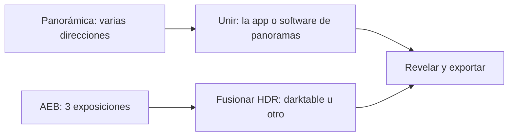

# Panorámicas y HDR con dron

Parte de: [[35-Drones/03 Foto y video aéreo/_Índice Foto y video aéreo|Foto y video aéreo]]

> [!info] Cómo avanzar
> `progreso`: **pendiente** → **viendo** (estudiando) → **visto** (contestaste la autoevaluación sin abrir las respuestas) → **dominado** (hiciste el laboratorio o lo aplicaste de verdad).

## Contenido

### Qué es
Son dos técnicas de foto que combinan **varias fotos** en una sola imagen final:

- La **panorámica** une fotos tomadas en distintas direcciones para cubrir un ángulo más amplio que la lente (de 83° en el Mini 4K).
- El **HDR** (alto rango dinámico) une fotos de la misma escena con **distinta exposición** para conservar luces y sombras que una sola foto no puede captar.

El Mini 4K las hace con modos automáticos de captura; la unión (en el dron, en la app o en la computadora) es la otra mitad del trabajo.

### Cómo funciona
**Modos del Mini 4K** según la [ficha](https://www.dji.com/mini-2-se/specs): **panorámica** (esférica, 180° y gran angular) y **AEB** (*Auto Exposure Bracketing*) de **3 fotos con paso de 2/3 EV**. Formatos: JPEG y DNG (RAW). Foto máxima de 4000×3000.

| Modo | Qué hace | Uso |
|---|---|---|
| Esférica | Cubre casi todo alrededor y hacia abajo | Imagen "planeta" o 360° |
| 180° | Barrido horizontal amplio | Paisaje, horizonte, costa |
| Gran angular | Varias filas para un ángulo más amplio | Escenas cercanas que no caben |
| AEB | 3 exposiciones: normal, −2/3 y +2/3 EV | Contraluz, amaneceres |

**HDR con AEB.** Con 3 fotos a 2/3 EV cubres unos ±0.67 pasos alrededor de la exposición central. Ayuda en escenas con contraste moderado-alto; en contraluces extremos quizá necesites más rango, que puedes conseguir revelando el DNG central con cuidado.

**Unir sin pagar**: para HDR, dispara AEB en **DNG** y fusiona en un programa gratuito como [darktable](https://www.darktable.org/) (tiene creación de HDR a partir de varias fotos). Para panorámicas, [Hugin](https://hugin.sourceforge.io/) es gratuito y de código abierto. DJI Fly puede generar la panorámica directamente, aunque en baja resolución para compartir (resolución exacta: (Pendiente de confirmar)). El flujo general está en [[Unir HDR y panorámicas]].

### Ejemplo
**Amanecer en un valle**, con el sol saliendo detrás de las montañas y el valle en sombra:

1. Altura de ~50 m, cámara a −10°, poco viento.
2. **AEB en DNG**: tres fotos; repites para tener respaldo.
3. **Panorámica 180°** del mismo lugar, en DNG.
4. En casa: fusionas las tres del AEB en darktable, ajustas y exportas. Para la panorámica, revelas los DNG con el mismo ajuste y los unes en Hugin.

### Cuándo usarlas y cuándo no
- **Panorámica**: paisajes amplios, costas, ciudades; cuando la escena no cabe en una foto.
- **AEB/HDR**: amaneceres, atardeceres, contraluces, interiores con ventanas vistos desde fuera.
- **No las uses** con viento fuerte o sujetos moviéndose: el dron se desplaza entre fotos y los objetos cambian de lugar, y aparecen uniones rotas y "fantasmas".
- **Con luz pareja** (día nublado), una sola foto basta.

### Errores comunes
- **Viento fuerte**: el dron se mueve entre disparos.
- **Sujetos en movimiento**: gente, autos, olas generan fantasmas.
- **Revelar cada foto de la panorámica con ajustes distintos**: aparecen franjas de color.
- **Solo JPEG**: pierdes margen para fusionar y corregir.
- **Mover el control durante la captura**: cancelas o desordenas la secuencia.

### Para profundizar
- [DJI: especificaciones del Mini 4K (modos de foto)](https://www.dji.com/mini-2-se/specs)
- [darktable](https://www.darktable.org/)
- [Hugin: unión de panorámicas](https://hugin.sourceforge.io/)
- Laboratorio: [[Lab 4 - Panorámica y hyperlapse con el Mini 4K]]

## Autoevaluación

Contesta primero en voz alta o en papel; luego despliega la respuesta.

> [!question]- ¿Qué modos de panorámica y de bracketing tiene el Mini 4K?
> Panorámica **esférica, 180° y gran angular**, y **AEB de 3 fotos a 2/3 EV**; formatos JPEG y DNG ([ficha](https://www.dji.com/mini-2-se/specs)).

> [!question]- ¿Cuándo usarías AEB y cómo unirías las fotos sin pagar software?
> Con mucho contraste (amanecer con sombras profundas). Dispara AEB en **DNG** y únelas en un programa gratuito (darktable u otra herramienta de HDR). Ver [[Unir HDR y panorámicas]].

> [!question]- Error común: hacer una panorámica con viento fuerte o con sujetos moviéndose. ¿Qué sale mal?
> El dron se desplaza entre fotos y los objetos cambian de lugar: uniones rotas y "fantasmas". Hazla con poco viento y paisaje estático.

## Práctica

- [[Lab 4 - Panorámica y hyperlapse con el Mini 4K]]

