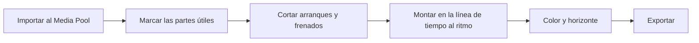

# Edición de material aéreo

Parte de: [[35-Drones/04 Edición y mantenimiento/_Índice Edición y mantenimiento|Edición y mantenimiento]]

> [!info] Cómo avanzar
> `progreso`: **pendiente** → **viendo** (estudiando) → **visto** (contestaste la autoevaluación sin abrir las respuestas) → **dominado** (hiciste el laboratorio o lo aplicaste de verdad).

## Contenido

### Qué es
Editar material aéreo es convertir tus clips y fotos del Mini 4K en secuencias que funcionen dentro de un video: configurar bien el proyecto, elegir y cortar las tomas, corregir color y horizonte, y montar las fotos de hyperlapse. Lo harás en [[DaVinci Resolve (versión gratuita)]]. El material del Mini 4K tiene sus particularidades: H.264 de 8 bits a 100 Mbps y perfil de color **Normal**, sin Log.

### Cómo funciona
**1. Configurar el proyecto.** Antes de importar, en *File > Project Settings*:
- Resolución de la línea de tiempo: **3840×2160** si grabaste 4K.
- Cadencia de la línea de tiempo: **la misma que grabaste** (por ejemplo 29.97 o 30 fps, o 24). Fíjala **antes** de crear la línea de tiempo: una vez que el proyecto tiene una línea de tiempo con clips, ya no puedes cambiarla.

Si mezclas con tomas del iPhone o la a6700, decide una cadencia común para todo el proyecto desde el principio.

**2. Seleccionar y cortar.**

Las tomas aéreas funcionan como **planos de ubicación y transición**: 3–6 s cada una suele bastar. Corta los arranques y frenados (por eso grabas con margen) y monta al ritmo de la música.

**3. Color con perfil Normal.** El material ya viene con contraste y saturación, así que los ajustes son moderados:
- Balance de blancos (si no lo fijaste al grabar).
- Bajar un poco las **luces** para recuperar el cielo (lo que quede).
- Contraste suave y algo de saturación.
- No esperes recuperar cielos quemados: el H.264 de 8 bits tiene poca latitud.

**4. Horizonte.** Si salió torcido, corrígelo en el **Inspector** con *Rotation Angle* y sube un poco el *Zoom* para que no aparezcan bordes negros. En 4K tienes margen para recortar un poco.

**5. Hyperlapse (fotos).** Si las fotos están numeradas consecutivamente, Resolve las reconoce como **secuencia de imágenes** (un solo clip) en el Media Pool. Ponlas en la línea de tiempo a la cadencia del proyecto. Las fotos del Mini 4K son de 4000×3000 (4:3): ajusta el encuadre a 16:9 y, si hubo saltos, estabiliza en la página Color (panel *Tracker > Stabilizer*) o con el estabilizador del Inspector.

### Ejemplo
Video de viaje de 2 minutos con 12 tomas aéreas:

1. Proyecto a 3840×2160 y 29.97 fps (igual que tus clips).
2. Importas, ves cada clip y marcas solo la parte central de cada movimiento.
3. Montas: apertura con un dolly in de 5 s, dos tomas cenitales de 3 s como transiciones y un hyperlapse de 8 s a mitad del video.
4. Color: un nodo con balance y luces, copiado a todas las tomas aéreas (son del mismo equipo y hora parecida) y ajustes finos donde haga falta.
5. Rotas dos tomas con el horizonte torcido 1–2°.
6. Exportas en H.264 o H.265 4K para YouTube.

Practica todo esto en el [[Lab 5 - Edición de material aéreo en DaVinci Resolve]].

### Cuándo hacer más y cuándo menos
- **Más color** cuando mezclas el dron con otras cámaras y necesitas que coincidan.
- **Menos** cuando el material ya se ve bien: el perfil Normal se diseñó para eso.
- **Proxies** si tu PC se traba con 4K (ver [[Proxies y rendimiento al editar]]).

### Errores comunes
- **Usar todas las tomas completas**: aburren. 3–6 s y al ritmo.
- **Cadencia incorrecta del proyecto**: no se puede cambiar después.
- **Forzar el color** en H.264 de 8 bits: aparecen bandas en el cielo.
- **Dejar el horizonte torcido**.
- **Importar las fotos del hyperlapse sueltas** en vez de como secuencia.

### Para profundizar
- [DJI: especificaciones del Mini 4K (video y foto)](https://www.dji.com/mini-2-se/specs)
- [Blackmagic: notas de la versión 21.1.1 de DaVinci Resolve](https://www.blackmagicdesign.com/support/content/readme/dfbb6e4233c144d1b328c109c7ebc11e)

## Autoevaluación

Contesta primero en voz alta o en papel; luego despliega la respuesta.

> [!question]- ¿Cómo configuras el proyecto de DaVinci Resolve para material del Mini 4K?
> Resolución de línea de tiempo **3840×2160** y la misma cadencia que grabaste (p. ej. 29.97 o 30 fps). Fija la cadencia **antes** de crear la línea de tiempo: una vez que el proyecto tiene clips en una línea de tiempo ya no puedes cambiarla. Ver [[DaVinci Resolve (versión gratuita)]].

> [!question]- ¿Qué ajustes de color básicos aplican a tomas aéreas en perfil Normal?
> Balance de blancos, bajar un poco las luces para recuperar el cielo, contraste suave y algo de saturación; corrige el **horizonte torcido** (Zoom/Rotation en el Inspector). No esperes recuperar cielos quemados: el H.264 de 8 bits tiene poca latitud.

> [!question]- ¿Qué haces con el material de hyperlapse (fotos)?
> Importa las fotos como **secuencia de imágenes** (Resolve las reconoce como un clip si están numeradas), ponlas en la línea de tiempo a la cadencia del proyecto y estabiliza si hace falta.

> [!question]- Error común: usar todas las tomas aéreas completas. ¿Qué recomendaría un editor?
> Las tomas aéreas funcionan como **planos de ubicación y transición**: 3–6 s cada una suele bastar. Corta los arranques y frenados, y monta al ritmo de la música.

## Práctica

- [[Lab 5 - Edición de material aéreo en DaVinci Resolve]]

