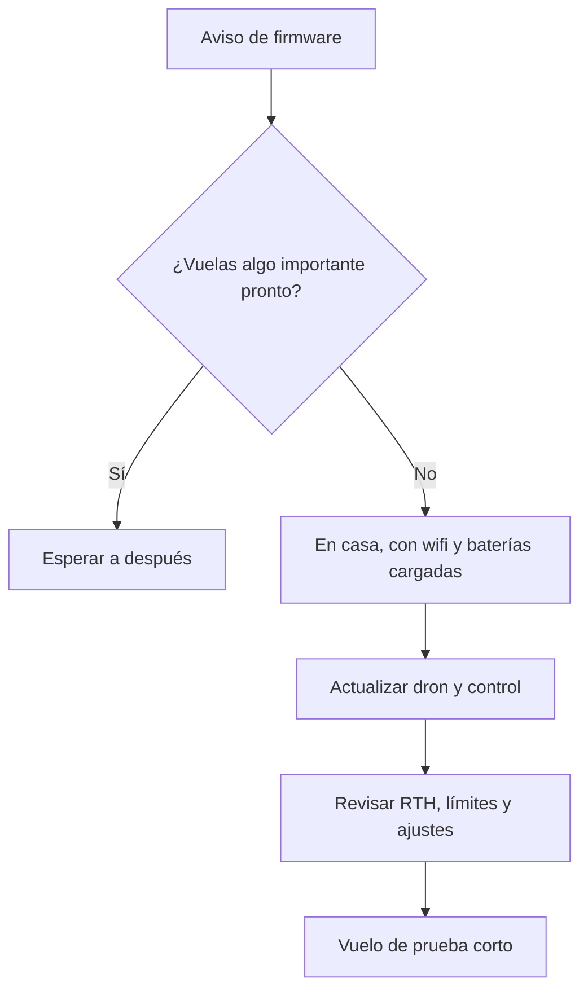

# Mantenimiento del dron (firmware y hélices)

Parte de: [[35-Drones/04 Edición y mantenimiento/_Índice Edición y mantenimiento|Edición y mantenimiento]]

> [!info] Cómo avanzar
> `progreso`: **pendiente** → **viendo** (estudiando) → **visto** (contestaste la autoevaluación sin abrir las respuestas) → **dominado** (hiciste el laboratorio o lo aplicaste de verdad).

## Contenido

### Qué es
El mantenimiento del Mini 4K es la rutina para que el dron siga siendo seguro y confiable: mantener el **firmware** al día, revisar y cambiar **hélices**, y limpiar y revisar el resto (motores, gimbal, sensores, baterías). Un dron de 246 g tiene poco margen: una hélice con una muesca o un firmware que falló a medias pueden terminar en una caída.

### Cómo funciona
**Firmware.** Es el software interno del dron y del control. Las actualizaciones corrigen fallas, mejoran el vuelo y a veces agregan funciones. Según el [manual](https://dl.djicdn.com/downloads/DJI_Mini_4K/20260427/DJI_Mini_4K_User_Manual_v1.0_zh-cn.pdf):

- Se actualiza desde **DJI Fly**, con internet, con el dron encendido y conectado al control.
- Batería del dron **mayor a 15 %** y del control **mayor a 20 %**.
- Tarda alrededor de **10 minutos** y el dron se apaga y reinicia solo al terminar. No lo apagues ni desconectes durante el proceso.
- Después de actualizar se pueden **restablecer parámetros** como la altura de RTH o los límites de distancia: vuelve a configurarlos antes de volar.

**Hélices.**
- **Revísalas antes de cada vuelo**: grietas, muescas, puntas dobladas o desgastadas. Si una está dañada, cambia **las dos de ese motor** con un par del mismo paquete.
- **Las hélices marcadas van en los motores marcados**: las otras, en los no marcados. Si las inviertes, el dron no puede despegar o se voltea.
- Revisa que los **tornillos** estén bien apretados antes de cada vuelo, y haz una revisión a fondo de hélices y tornillos cada ~30 h de vuelo (~60 vuelos), como indica el manual.
- Usa **solo hélices DJI** para el Mini 4K: otras pueden cambiar el peso y el comportamiento.

**Revisión general** (cada pocas sesiones):
- Motores: que giren libres, sin arena ni pelos; sopla con aire.
- Gimbal: que se mueva suave y sin ruidos; coloca siempre su protector al guardar.
- Sensores inferiores y lente: limpios, con paño de microfibra.
- Baterías: sin golpes ni hinchazón (ver [[Baterías de dron (cuidado y viajes)]]).
- Brazos: que abran y cierren firmes.

### Ejemplo
**Una semana antes de un viaje:**

1. DJI Fly avisa de una actualización. En casa, con wifi y las baterías arriba de 50 %, actualizas dron y control.
2. Revisas en la app la altura de RTH (la regresas a 50 m), los límites de altura y distancia (122 m y 457 m) y la acción ante pérdida de señal.
3. Revisas hélices: una tiene una pequeña muesca en la punta. Cambias el par de ese motor por uno nuevo, cuidando marcadas con marcadas, y aprietas los tornillos con el destornillador del kit.
4. Vuelo de prueba de 5 minutos en un campo cercano: hover, cuadrado, regreso con RTH.
5. Empacas hélices de repuesto y el destornillador.

### Cuándo actualizar y cuándo no
- **Actualiza** en casa, con tiempo, días antes de algo importante.
- **No actualices** justo antes de una grabación importante: puede tardar, fallar sin buena conexión y restablecer tus ajustes.
- **Cambia hélices** ante cualquier daño visible, aunque sea pequeño: el costo es mínimo comparado con una caída.

### Errores comunes
- **Actualizar en el lugar de la grabación** con datos móviles débiles.
- **Volar con una hélice con muesca**: vibra, pierde eficiencia y puede romperse.
- **Cambiar solo una hélice** del par.
- **Montar hélices en el motor equivocado**.
- **No revisar los ajustes después de actualizar**: la altura de RTH puede haber vuelto al valor por defecto.

### Para profundizar
- [Manual de usuario del DJI Mini 4K (PDF)](https://dl.djicdn.com/downloads/DJI_Mini_4K/20260427/DJI_Mini_4K_User_Manual_v1.0_zh-cn.pdf)
- [DJI: especificaciones del Mini 4K](https://www.dji.com/mini-2-se/specs)

## Autoevaluación

Contesta primero en voz alta o en papel; luego despliega la respuesta.

> [!question]- ¿Cómo actualizas el firmware del Mini 4K y qué cuidados tienes?
> Con **DJI Fly** e internet, con el dron conectado al control; tarda ~10 min y el dron se apaga al terminar. Batería del dron **> 15 %** y del control **> 20 %**. Tras actualizar se **restablecen parámetros** (altura de RTH, límites de distancia): vuelve a configurarlos ([manual](https://dl.djicdn.com/downloads/DJI_Mini_4K/20260427/DJI_Mini_4K_User_Manual_v1.0_zh-cn.pdf)).

> [!question]- ¿Cuándo cambias las hélices y cómo?
> Si una hélice tiene grietas, muescas o está doblada, cambia **las dos de ese motor** con un par del mismo paquete; las hélices **marcadas van en los motores marcados**. Revisa los tornillos antes de cada vuelo y cada **30 h de vuelo (~60 vuelos)**. Usa solo hélices DJI.

> [!question]- Error común: actualizar el firmware justo antes de una grabación importante. ¿Por qué no?
> Puede tardar, fallar sin buena conexión y restablecer tus ajustes. Actualiza en casa días antes y haz un vuelo de prueba.

## Práctica

- [[Lab 5 - Edición de material aéreo en DaVinci Resolve]]

