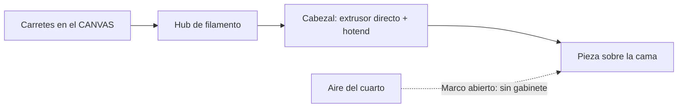

# Elegoo Centauri 2 Combo

Parte de: [[36-Impresion-3D/01 Fundamentos/_Índice Fundamentos|Fundamentos]]

> [!info] Cómo avanzar
> `progreso`: **pendiente** → **viendo** (estudiando) → **visto** (contestaste la autoevaluación sin abrir las respuestas) → **dominado** (hiciste el laboratorio o lo aplicaste de verdad).

## Contenido

### Qué es
La **Elegoo Centauri 2 Combo** es una impresora FDM **CoreXY de marco abierto** (sin gabinete) que se vende junto con el sistema multicolor [[Sistema multicolor CANVAS de Elegoo|CANVAS]] de 4 filamentos. "Combo" significa precisamente eso: impresora Centauri 2 + CANVAS. Está pensada para imprimir rápido PLA, PETG y TPU, con calibración totalmente automática y la posibilidad de hacer piezas de hasta 4 colores.

**Ojo con el nombre.** Elegoo también vende la **Centauri Carbon 2**, que es otro modelo: **cerrado**, con gabinete y orientado además a materiales técnicos. Los nombres se parecen mucho; revisa siempre que guías, perfiles del laminador y refacciones digan **Centauri 2** (sin "Carbon").

### Cómo funciona (especificaciones)
Datos de las páginas oficiales de Elegoo de la Centauri 2 y la Centauri 2 Combo (consultadas 2026-11-10); lo que no aparece ahí va marcado:

| Dato | Valor |
|---|---|
| Volumen de impresión | 256 × 256 × 256 mm |
| Cinemática | CoreXY, marco de aluminio fundido a presión, dos motores 4260 en X/Y |
| Velocidad / aceleración máx. | 500 mm/s / 20,000 mm/s² |
| Boquilla | Hasta 350 °C; cambio rápido gracias a la cubierta magnética del cabezal. Material: acero endurecido según el perfil de OrcaSlicer y reseñas (Pendiente de confirmar en la ficha oficial) |
| Diámetro de boquilla | 0.4 mm es el perfil predeterminado en OrcaSlicer, que también trae 0.2, 0.6 y 0.8 mm (confirma lo que trae tu caja: Pendiente de confirmar) |
| Cama | Placa flexible de doble cara; protección contra sobretemperatura. Temperatura máxima 110 °C según reseñas (Pendiente de confirmar) |
| Calibración | Totalmente automática: nivelación de 4 puntos o solo del área de impresión, y Z offset automático; revisiones antes de imprimir |
| Sensores | 22 según la página del Combo, entre ellos: atasco, fin de filamento, estado del cortador, autoprueba de ventiladores, caída del ventilador de capa, sobretemperatura de cama y recuperación ante corte de luz |
| Limpieza de boquilla | Limpiador de silicona resistente a 350 °C |
| Pantalla | Táctil de 5" |
| Cámara | No aparece en la ficha; accesorio opcional según reseñas (Pendiente de confirmar) |
| Multicolor | CANVAS: 4 colores, RFID con filamentos Elegoo, recarga automática con carrete idéntico, detección de enredos |
| Software | ElegooSlicer (importa modelos de Nexprint) y app ELEGOO Matrix; perfil "Elegoo Centauri 2" también en OrcaSlicer |
| Portacarretes | Diámetro interior de 53–58 mm; carretes más grandes requieren adaptador impreso |

Al ser **abierta**, la pieza queda expuesta al aire del cuarto: excelente para PLA (que quiere enfriarse rápido), pero desfavorable para materiales que se contraen mucho, como ABS o ASA.

### Ejemplo
Primer día: desempacas, retiras los seguros de transporte que indique el manual, colocas la placa por la cara lisa, cargas un PLA Elegoo con RFID en la ranura 1 del CANVAS (la impresora reconoce material y color y aplica sus ajustes recomendados), dejas que haga la autoprueba y la nivelación, y mandas desde ElegooSlicer un modelo de prueba. Te quedas a mirar la primera capa. Como no tiene cámara integrada confirmada, para revisar impresiones largas a distancia necesitarías el accesorio (Pendiente de confirmar) o grabar tú un timelapse con tu iPhone o la Osmo Pocket.

### Cuándo usarla y cuándo no
- **Ideal**: PLA, PETG y TPU, piezas multicolor de hasta 4 colores, piezas funcionales y figuras de hasta 256 mm.
- **TPU**: Elegoo indica que la Centauri 2 lo soporta de forma nativa, pero en la Combo **no pasa por el CANVAS**: se instala el *Flexible Filament Adapter* (modelo y guía en la USB incluida) y se desconecta el cable del CANVAS antes de imprimir. Detalle en [[TPU (filamento flexible)]].
- **Con reservas**: ABS, ASA, PC y nylon; la boquilla llega a 350 °C, pero sin gabinete hay warping, grietas y más emisiones al cuarto. Ver [[Materiales que necesitan impresora cerrada (ABS, ASA, PC y nylon)]].

### Errores comunes
1. **Usar el perfil equivocado.** Elegir "Centauri Carbon" o "Centauri Carbon 2" en vez de "Centauri 2" da límites, G-code inicial y supuestos (gabinete, ventiladores) que no corresponden. Ver [[ElegooSlicer y OrcaSlicer]].
2. **Forzar un carrete grande.** Si el diámetro interior no está entre 53 y 58 mm, imprime el adaptador; un carrete trabado causa tirones, subextrusión o alertas de enredo.
3. **Ponerla junto a una ventana o ventilador.** En una impresora abierta, las corrientes de aire enfrían la pieza de forma desigual y provocan warping.
4. **Imprimir ABS "porque la boquilla aguanta".** La temperatura no es el problema: lo es el ambiente sin gabinete y las emisiones.

### Para profundizar
- [Centauri 2 Combo — página oficial](https://us.elegoo.com/products/centauri-2-combo)
- [Centauri 2 — página oficial con especificaciones](https://us.elegoo.com/products/centauri-2)
- [OrcaSlicer — repositorio oficial (incluye perfiles de Elegoo)](https://github.com/OrcaSlicer/OrcaSlicer)

## Autoevaluación

Contesta primero en voz alta o en papel; luego despliega la respuesta.

> [!question]- ¿Qué es la Centauri 2 Combo y en qué se diferencia de la Centauri Carbon 2?
> Es la Centauri 2 (CoreXY de **marco abierto**, sin gabinete) más el sistema multicolor **CANVAS** de 4 filamentos. La **Centauri Carbon 2** es otro modelo, **cerrado**, pensado también para materiales técnicos. No mezcles perfiles, guías ni accesorios de una con la otra sin revisar que sean del modelo correcto.
>
> Fuente: [página oficial de la Centauri 2 Combo](https://us.elegoo.com/products/centauri-2-combo).

> [!question]- ¿Cuáles son sus especificaciones principales?
> Según la página oficial de Elegoo (consultada 2026-11-09):
>
> | Dato | Valor |
> |---|---|
> | Volumen de impresión | 256 × 256 × 256 mm |
> | Cinemática | CoreXY, marco de aluminio fundido a presión, guías lineales metálicas |
> | Velocidad / aceleración máx. | 500 mm/s / 20,000 mm/s² |
> | Temperatura máx. de boquilla | 350 °C ([página Centauri 2](https://us.elegoo.com/collections/new-arrivals/products/centauri-2)) |
> | Temperatura máx. de cama | 110 °C según reseñas (Pendiente de confirmar) |
> | Boquilla | Acero endurecido según reseñas (Pendiente de confirmar); diámetro de fábrica 0.4 mm (Pendiente de confirmar); cambio rápido con cubierta magnética del cabezal |
> | Calibración | Totalmente automática: nivelación de 4 puntos (o solo del área de impresión) y Z offset automático |
> | Sensores | 22 sensores: detección de atasco, fin de filamento, estado del cortador, autoprueba de ventiladores, caída del ventilador de capa, sobretemperatura de cama y recuperación ante corte de luz |
> | Cámara | No incluida; accesorio opcional según reseñas (Pendiente de confirmar) |
> | Pantalla | Táctil de 5" |
> | Cama | Placa flexible de doble cara |
> | Limpieza de boquilla | Limpiador de silicona resistente a 350 °C |
> | Multicolor | CANVAS: 4 colores, RFID, recarga automática con carrete idéntico, prevención de enredos |
> | Laminador oficial | ElegooSlicer (importa modelos de Nexprint); perfil en OrcaSlicer (Pendiente de confirmar) |
> | Portacarretes | Diámetro interior de 53–58 mm; carretes mayores requieren adaptador impreso |

> [!question]- ¿Qué materiales puede imprimir bien?
> Al ser abierta: **PLA, PETG y TPU** son los materiales ideales. Elegoo indica que el TPU está soportado de forma nativa. ABS, ASA, PC y nylon se pueden intentar (la boquilla llega a 350 °C) pero sin gabinete hay warping y emisiones: ver [[Materiales que necesitan impresora cerrada (ABS, ASA, PC y nylon)]]. Lista oficial de materiales recomendados: (Pendiente de confirmar).

> [!question]- ¿Puedo imprimir TPU desde el CANVAS?
> **No.** Según Elegoo, en la versión Combo se instala el *Flexible Filament Adapter* (modelo y guía en la USB incluida) y se **desconecta el cable del CANVAS** antes de imprimir TPU; el TPU entra directo al cabezal, no por el CANVAS.

> [!question]- Error común: imprimir un carrete de cartón grande sin revisar el portacarretes.
> El portacarretes acepta un diámetro interior de 53–58 mm. Si el carrete no ajusta, imprime el adaptador en vez de forzarlo; un carrete que se traba causa tirones, subextrusión o alertas de enredo.

## Práctica

- [[Lab 1 - Primera impresión y revisión de calibración automática en Centauri 2]]

