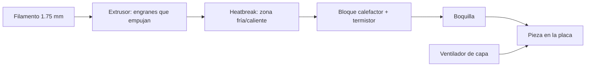

# Partes de una impresora FDM (CoreXY, extrusor, hotend y cama)

Parte de: [[36-Impresion-3D/01 Fundamentos/_Índice Fundamentos|Fundamentos]]

> [!info] Cómo avanzar
> `progreso`: **pendiente** → **viendo** (estudiando) → **visto** (contestaste la autoevaluación sin abrir las respuestas) → **dominado** (hiciste el laboratorio o lo aplicaste de verdad).

## Contenido

### Qué es
Una impresora FDM es, en esencia, una pistola de silicón muy precisa montada en un robot cartesiano. Conocer sus partes te ayuda a entender qué falla cuando algo sale mal y a leer la configuración del laminador. Las piezas clave son: el **sistema de movimiento** (en tu Centauri 2, CoreXY), el **extrusor**, el **hotend**, la **cama caliente** con su placa y los **ventiladores**.

### Cómo funciona

**Extrusor.** Un motor con engranes que muerde el filamento y lo empuja. Controla *cuánto* plástico sale. En un extrusor *direct drive* (como el de tu impresora) va montado en el cabezal, justo encima del hotend; el camino corto ayuda mucho con filamentos flexibles y con la retracción. La alternativa, *Bowden*, deja el motor en el marco y empuja por un tubo largo.

**Hotend.** Es lo que **funde**. Tiene:
- *Heatbreak*: un tubo delgado que separa la zona fría (arriba, enfriada por el ventilador del hotend) de la caliente. Si el calor sube, el filamento se ablanda antes de tiempo: *heat creep* y atascos.
- *Bloque calefactor* con resistencia y *termistor* (sensor de temperatura).
- *Boquilla*: define el diámetro de la línea. La de tu Centauri 2 llega a 350 °C; el perfil de OrcaSlicer la registra como de acero endurecido (Pendiente de confirmar en la ficha oficial), lo que aguanta mejor los filamentos abrasivos.

**CoreXY.** Dos motores fijos en el marco mueven el cabezal en X e Y con dos correas cruzadas; cuando ambos giran igual, el cabezal va en una diagonal, y combinándolos se logra cualquier dirección. La cama solo baja en Z conforme crecen las capas. Como la pieza no se sacude y el cabezal es ligero, se pueden usar aceleraciones altas (20,000 mm/s² en tu impresora). En una *bed slinger* (tipo Ender 3) la cama va y viene en Y, y eso limita la velocidad y sacude piezas altas.

**Cama caliente y placa.** La cama calienta para que la primera capa se mantenga pegada y para reducir la contracción de la base (*warping*). Encima va una **placa de acero flexible** magnética: la tuya es de doble cara (lo habitual es una cara lisa y otra de PEI texturizado; confirma las de la tuya en el manual: Pendiente de confirmar). Al terminar, la retiras y la doblas un poco: la pieza se suelta sola.

**Ventiladores.** El de **hotend** siempre enfría el heatbreak. El de **capa** (*part cooling*) sopla sobre el plástico recién depositado para que solidifique rápido; en impresoras abiertas como la tuya, además, el aire del cuarto también enfría la pieza. Si el ventilador de capa falla con PLA, los voladizos se caen, los puentes cuelgan y los detalles finos se ven derretidos; por eso tu equipo tiene detección de caída de ese ventilador.

**Electrónica y sensores.** Placa de control, pantalla, sensores de fin de filamento y de atasco, y el sensor que mide la cama para la nivelación automática.

### Ejemplo
Imprimes un gancho de PLA y la punta curva sale fea. Razonas por partes: el extrusor empujó bien (no hay huecos), el hotend fundió bien (las paredes se ven sanas), pero la punta está "chorreada": problema de enfriamiento. Revisas que el ventilador de capa gire y que en el perfil esté al 100 % tras las primeras capas.

### Cuándo importa cada parte
- Hilos, gotas y atascos → extrusor, hotend y temperatura.
- Ondulaciones y capas recorridas → movimiento (correas, aceleración).
- Piezas que se despegan → cama, placa y primera capa.
- Voladizos feos → ventilador de capa.

### Errores comunes
1. **Confundir extrusor con hotend.** Uno empuja, el otro funde: los síntomas y soluciones son distintos.
2. **Tocar la boquilla o el bloque "para ver si está caliente".** Llegan a cientos de grados; usa la lectura de la pantalla.
3. **Ignorar el ventilador del hotend.** Si se tapa de polvo provoca *heat creep* y atascos; revísalo en el [[Mantenimiento de la impresora 3D]].
4. **Doblar la placa en exceso** o rayarla con espátulas metálicas: pierde planitud y adherencia.

### Para profundizar
- [Centauri 2 — especificaciones oficiales](https://us.elegoo.com/products/centauri-2)
- [OrcaSlicer wiki: ajustes del extrusor](https://www.orcaslicer.com/wiki/printer_settings/extruder/printer_extruder_basic_information)
- Siguiente paso: [[Primera capa y calibración automática]]

## Autoevaluación

Contesta primero en voz alta o en papel; luego despliega la respuesta.

> [!question]- ¿Qué hace el extrusor y qué hace el hotend?
> El **extrusor** empuja el filamento con engranes (controla *cuánto* sale). El **hotend** lo funde: tiene bloque calefactor, termistor, *heatbreak* (zona que separa frío/caliente) y la boquilla. En un extrusor *direct drive* ambos van juntos en el cabezal, lo que ayuda con filamentos flexibles.

> [!question]- ¿Qué es CoreXY?
> Una cinemática en la que dos motores fijos mueven el cabezal en X e Y mediante dos correas cruzadas; la cama solo baja en Z. El cabezal es ligero y la pieza no se sacude, por eso permite velocidades y aceleraciones altas (a diferencia de una *bed slinger*, donde la cama va y viene en Y).

> [!question]- ¿Para qué sirve la cama caliente y la placa flexible?
> La cama caliente mantiene la primera capa adherida y reduce el *warping*. La placa de acero flexible (PEI u otra textura) se retira y se dobla ligeramente para soltar la pieza.

> [!question]- ¿Qué pasa si el ventilador de capa (part cooling) falla en PLA?
> Los voladizos y puentes se caen o se deforman, los detalles pequeños se ven derretidos y las puntas se redondean. Por eso la Centauri 2 tiene alerta de caída del ventilador de capa.

