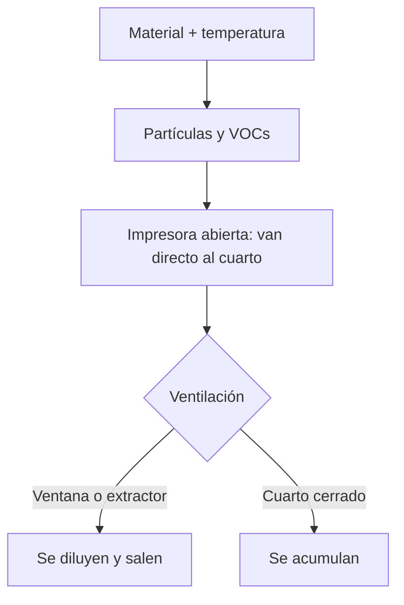

# Seguridad al imprimir (ventilación, emisiones y ubicación)

Parte de: [[36-Impresion-3D/01 Fundamentos/_Índice Fundamentos|Fundamentos]]

> [!info] Cómo avanzar
> `progreso`: **pendiente** → **viendo** (estudiando) → **visto** (contestaste la autoevaluación sin abrir las respuestas) → **dominado** (hiciste el laboratorio o lo aplicaste de verdad).

## Contenido

### Qué es
Imprimir en FDM implica plástico fundido a 190–300 °C, piezas calientes, electricidad funcionando durante horas y emisiones al aire. La seguridad consiste en **dónde** colocas la impresora, **cómo** ventilas y **cuánto** la supervisas. Con una impresora **abierta** como tu Centauri 2, todo lo que emite el plástico va directo al aire del cuarto: no hay gabinete ni filtro de por medio.

### Cómo funciona: qué se emite
Al calentar el filamento se liberan:
- **Partículas ultrafinas** (UFP), más pequeñas que las del polvo común, que pueden llegar profundo a los pulmones.
- **Compuestos orgánicos volátiles (VOCs)**; por ejemplo, el ABS emite estireno, responsable de su olor característico.

Los estudios de UL Chemical Insights encontraron que la cantidad depende del **material** (ABS, ASA y nylon emiten bastante más que PLA o PETG), de la **temperatura** (más caliente = más emisiones) y de la marca o aditivos. El **olor no es buen indicador**: algunas emisiones casi no huelen.

No es motivo de pánico con PLA y PETG en un cuarto ventilado, pero sí de tomarlo en serio con materiales de más emisiones.

### Ejemplo: dónde poner tu Centauri 2
- Un cuarto de trabajo o estudio **con ventana que se pueda abrir**, **no** la recámara donde duermes.
- Sobre una mesa **firme y estable** (una CoreXY a alta aceleración vibra) y nivelada.
- **Lejos de corrientes directas** (ventilador, aire acondicionado, ventana abierta que sople encima): enfrían la pieza de forma desigual. Ventila el cuarto, pero que el aire no le pegue de frente.
- Lejos de cortinas, papeles y solventes.
- Fuera del alcance de niños y mascotas: en una impresora abierta, la boquilla y la cama quedan al alcance de la mano.
- Conectada directo a un contacto en buen estado, no a una extensión barata sobrecargada.
- Un **detector de humo** en el cuarto es una inversión pequeña y sensata.

### Partes que queman
- **Boquilla y bloque calefactor**: hasta 350 °C en esta impresora.
- **Cama caliente**: la placa sigue caliente minutos después de terminar.
- Piezas recién impresas en PETG.

Espera a que enfríen antes de limpiar o retirar algo y usa pinzas metálicas para quitar restos de la boquilla, nunca los dedos.

### ¿Dejarla imprimiendo sola?
Al principio, **no**. Supervisa al menos la primera capa y tus primeras impresiones completas para conocer su comportamiento. Aunque tiene protecciones (sobretemperatura de cama, detección de atasco, fin de filamento, recuperación ante cortes), no la dejes sola mucho tiempo mientras no tengas experiencia, ni cuando no haya nadie en casa, y nunca con un material nuevo.

### Cuándo extremar precauciones
- **ABS, ASA, PC, nylon**: en una impresora abierta conviene **no** imprimirlos para empezar. Si lo haces, ventila hacia afuera y no permanezcas horas junto a la máquina. Ver [[Materiales que necesitan impresora cerrada (ABS, ASA, PC y nylon)]].
- **Lijado y pintura**: polvo y vapores; ver [[Lijado y relleno de piezas impresas]] y [[Primer, pintura y barniz para piezas impresas]].
- **Insertos con cautín**: humo de plástico fundido muy cerca de tu cara.

### Errores comunes
1. **Imprimir ABS en una recámara cerrada "porque huele poquito".** El olor engaña. Ventila hacia afuera, considera un gabinete con filtro/extracción, o quédate con PLA/PETG/TPU en tu impresora abierta.
2. **Ventilador apuntando a la impresora** para "ventilar": arruina la impresión con warping.
3. **Mesa coja o frágil**: las vibraciones arruinan la impresión y pueden tirar cosas.
4. **Retirar la pieza con la placa caliente** y quemarte.
5. **Dejarla al alcance de niños o mascotas** sin vigilancia.

### Para profundizar
- [UL Chemical Insights — estudios de emisiones de impresoras 3D (PDF)](https://chemicalinsights.org/wp-content/uploads/2022/03/3DPrint_EmissionStudies.pdf)
- [UL Chemical Insights — boletín técnico sobre impresoras 3D (PDF)](https://chemicalinsights.org/wp-content/uploads/2023/06/TB-540_3D-Printers_fin.pdf)
- [Centauri 2 Combo — página oficial (sensores y protecciones)](https://us.elegoo.com/products/centauri-2-combo)

## Autoevaluación

Contesta primero en voz alta o en papel; luego despliega la respuesta.

> [!question]- ¿Qué emite una impresora FDM al imprimir?
> Al fundir plástico se liberan **partículas ultrafinas** y **compuestos orgánicos volátiles (VOCs)**. La cantidad depende del material y la temperatura: PLA y PETG suelen emitir menos; ABS, ASA y nylon emiten bastante más. No es motivo de pánico, pero sí de ventilar.

> [!question]- ¿Dónde conviene colocar una impresora abierta como la Centauri 2?
> En un cuarto ventilado (ventana que se pueda abrir), **no** en la recámara donde duermes, sobre una superficie firme y estable, lejos de corrientes directas de aire (enfrían la pieza) y de cortinas o papeles, fuera del alcance de niños y mascotas.

> [!question]- ¿Es seguro dejarla imprimiendo sola?
> Al inicio **no**: supervisa al menos la primera capa y las primeras impresiones completas para conocer su comportamiento. Aun con protecciones (sensor de sobretemperatura de cama, detección de atascos), no la dejes sola mucho tiempo mientras no tengas experiencia, ni cuando no haya nadie en casa. Un detector de humo cerca es buena idea.

> [!question]- ¿Qué partes queman?
> La boquilla y el bloque calefactor (hasta 350 °C en esta impresora) y la cama caliente. Espera a que enfríen antes de limpiar o retirar piezas, y nunca toques la boquilla para quitar restos: usa pinzas de metal.

> [!question]- Error común: imprimir ABS en una recámara cerrada «porque huele poquito».
> El olor no es buen indicador. Con materiales de mayores emisiones, ventila hacia afuera o considera un gabinete con filtro/extracción; en una impresora abierta mejor quédate con PLA/PETG/TPU.

## Práctica

- [[Lab 1 - Primera impresión y revisión de calibración automática en Centauri 2]]

