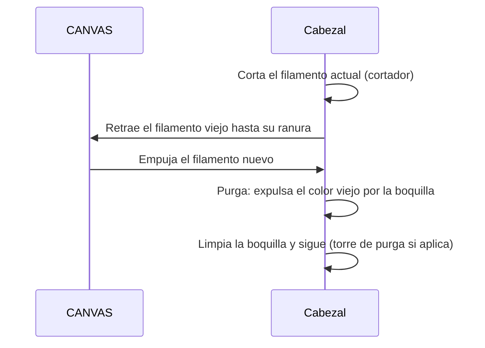

# Sistema multicolor CANVAS de Elegoo

Parte de: [[36-Impresion-3D/01 Fundamentos/_Índice Fundamentos|Fundamentos]]

> [!info] Cómo avanzar
> `progreso`: **pendiente** → **viendo** (estudiando) → **visto** (contestaste la autoevaluación sin abrir las respuestas) → **dominado** (hiciste el laboratorio o lo aplicaste de verdad).

## Contenido

### Qué es
**CANVAS** es el sistema multicolor de Elegoo que viene en tu Centauri 2 **Combo**. Tiene cuatro módulos de carrete y un *hub* de filamento que alimentan un solo cabezal. Durante la impresión, cambia de filamento automáticamente para que una pieza tenga hasta **4 colores** (o 4 materiales compatibles). No hay cuatro boquillas: hay una sola, y el CANVAS se encarga de cambiar lo que entra en ella.

### Cómo funciona
Cada cambio de color sigue una secuencia:

Además de cambiar colores, el CANVAS ofrece según Elegoo:
- **Lectura RFID** de carretes Elegoo: reconoce material y color y activa los ajustes recomendados.
- **Recarga automática**: si se acaba un carrete y hay otro idéntico cargado, continúa con ese.
- **Detección de enredos** del filamento.

### Por qué gasta más filamento y tiempo
En cada cambio hay que sacar todo el color anterior de la boquilla y estabilizar la presión antes de volver a la pieza. Ese plástico se tira (purga en la expulsión de la boquilla y, si la activas, en la **torre de purga**). Si un modelo tiene 4 colores mezclados en cada capa, cada capa necesita varios cambios, y cada uno cuesta gramos y decenas de segundos. Por eso el diseño importa tanto como la impresora: ver [[Impresión multicolor (pintar colores y torre de purga)]].

### Ejemplo
Imprimes un llavero con el logo de Xolotl en dos colores: base negra y letras blancas en relieve solo en las últimas capas. Cargas negro en la ranura 1 y blanco en la 2, asignas colores en ElegooSlicer y el laminador te muestra cuántos cambios habrá. Como el blanco solo aparece en las capas finales, hay pocos cambios y casi nada de purga. Si en cambio pintas el logo "a través" de toda la pieza, cada capa tendría cambios y la purga podría pesar más que el llavero.

### Cuándo usarlo y cuándo no
- **Sí**: piezas con colores por zonas o por altura, letreros, figuras con pocos colores, imprimir un solo color con recarga automática para trabajos largos.
- **Con cuidado**: muchos colores pequeños en muchas capas (mucho desperdicio).
- **No**: **TPU y flexibles**. Elegoo indica que el TPU se imprime sin pasar por el CANVAS: se instala el *Flexible Filament Adapter* y se desconecta el cable del CANVAS antes de imprimir. El filamento blando se dobla en los tubos largos y se atasca. Ver [[TPU (filamento flexible)]].
- **Carretes de cartón**: pueden soltar polvo y fibras en el sistema de alimentación; muchos usuarios los pasan a carrete de plástico o usan un anillo adaptador (recomendación oficial: Pendiente de confirmar).

### Errores comunes
1. **Mezclar materiales incompatibles** en la misma pieza (por ejemplo PLA y PETG en capas que deben unirse): no se pegan bien entre sí.
2. **No revisar la ranura asignada**: imprimes con el color correcto en el laminador pero ligado a otra ranura física.
3. **Ignorar el peso de la purga** en el costeo: ver [[Costeo de una impresión 3D]].
4. **Carrete trabado o mal enrollado**: provoca alertas de enredo y pausas; revisa que gire libre.
5. **Pasar TPU por el CANVAS** "para probar": puede atascarse dentro del sistema.

### Para profundizar
- [Centauri 2 Combo — página oficial (CANVAS y TPU)](https://us.elegoo.com/products/centauri-2-combo)
- [OrcaSlicer wiki: torre de purga](https://www.orcaslicer.com/wiki/printer_settings/multimaterial/printer_multimaterial_wipe_tower)
- Práctica: [[Lab 5 - Pieza en 4 colores con CANVAS minimizando purga]]

## Autoevaluación

Contesta primero en voz alta o en papel; luego despliega la respuesta.

> [!question]- ¿Qué hace el CANVAS?
> Alimenta hasta **4 filamentos** al cabezal y cambia entre ellos durante la impresión: corta el filamento, retrae el anterior, carga el nuevo y purga el color viejo. Además lee etiquetas **RFID** de carretes Elegoo, hace **recarga automática** si se acaba un carrete y hay otro idéntico, y detecta enredos.

> [!question]- ¿Por qué una pieza multicolor gasta más filamento y tiempo?
> Cada cambio requiere purgar el color anterior (en torre de purga, en relleno/objeto de sacrificio o en la expulsión de la boquilla) y tarda segundos o minutos. Muchas capas con muchos cambios = mucho desperdicio. Ver [[Impresión multicolor (pintar colores y torre de purga)]].

> [!question]- ¿Puedo pasar TPU por el CANVAS?
> No. Para TPU en la Combo, Elegoo indica instalar el adaptador de filamento flexible y desconectar el cable del CANVAS.

## Práctica

- [[Lab 5 - Pieza en 4 colores con CANVAS minimizando purga]]

