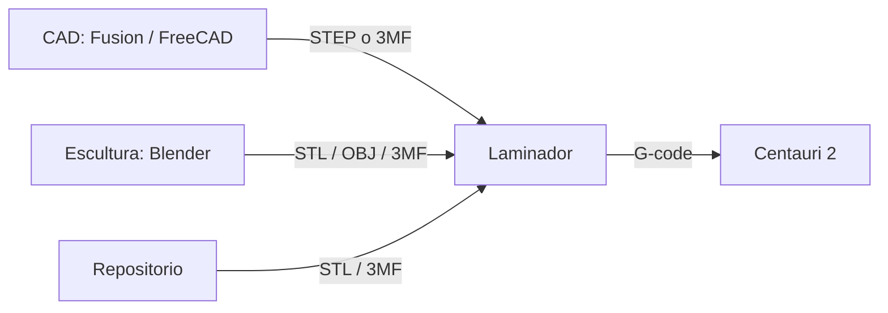

# Archivos para imprimir (STL, 3MF, OBJ y STEP)

Parte de: [[36-Impresion-3D/02 Laminador/_Índice Laminador|Laminador]]

> [!info] Cómo avanzar
> `progreso`: **pendiente** → **viendo** (estudiando) → **visto** (contestaste la autoevaluación sin abrir las respuestas) → **dominado** (hiciste el laboratorio o lo aplicaste de verdad).

## Contenido

### Qué es
Antes de laminar necesitas un archivo con la **geometría** de la pieza. Los formatos más comunes son **STL**, **3MF**, **OBJ** y **STEP**. Elegir bien el formato evita piezas diminutas, colores perdidos y curvas facetadas.

### Cómo funciona cada formato

| Formato | Qué guarda | Unidades | Color / varias piezas | Uso típico |
|---|---|---|---|---|
| **STL** | Solo malla de triángulos | **No** | No | El más compartido; universal |
| **3MF** | Malla + unidades + colores + varias partes + (opcional) placa y ajustes del laminador | Sí | Sí | Proyectos completos, multicolor |
| **OBJ** | Malla, puede llevar colores/texturas en archivo aparte | No fijas | Parcial | Modelos de escultura y escaneo |
| **STEP** | Geometría CAD exacta (superficies reales, no triángulos) | Sí | Partes | Piezas mecánicas desde Fusion, FreeCAD, Onshape |

**Malla vs. CAD.** STL, 3MF y OBJ describen la superficie con triángulos: una curva es en realidad muchos planos pequeños. Si el diseñador exportó con baja resolución, verás facetas. STEP guarda la curva matemática; al importarla, el laminador la convierte en malla con la resolución que él elija, por eso es ideal para piezas técnicas.

**3MF como "proyecto".** ElegooSlicer y OrcaSlicer guardan sus proyectos en 3MF: incluye la placa, la orientación, los colores pintados, modificadores y perfiles. Es lo mejor para trabajos multicolor con el CANVAS.

### Ejemplo
Descargas un STL de un soporte para tu DJI Osmo Pocket y al importarlo mide 2.5 mm en lugar de 25 mm. Como **STL no tiene unidades**, el laminador asume milímetros; el autor lo exportó en centímetros. Solución: escalar ×10 (cm → mm). Si hubiera sido en pulgadas, ×25.4. Algunos laminadores detectan piezas muy pequeñas y preguntan si quieres convertir unidades; acepta solo si la medida resultante tiene sentido (mide contra el objeto real con tu calibrador).

Otro caso: diseñas una tapa con una rosca en FreeCAD. Exportas **STEP** y el laminador la importa con curvas suaves; si exportas STL, revisa la tolerancia de exportación (desviación angular y lineal) para que la rosca no salga facetada.

### Cuándo usar cada uno
- **Compartir una pieza simple**: STL sigue siendo universal.
- **Multicolor, varias piezas o conservar ajustes**: 3MF.
- **Piezas mecánicas que vas a modificar**: STEP (o el archivo nativo del CAD).
- **Escultura con color**: OBJ o 3MF.

### Errores comunes
1. **Piezas diminutas o gigantes**: STL sin unidades; escala ×10 o ×25.4 según el origen.
2. **Mallas "no manifold" o con huecos**: el laminador puede repararlas, pero si salen capas faltantes, corrige en el programa de origen.
3. **Mandar un 3MF de otra marca tal cual**: trae el perfil de otra impresora; usa la geometría y lamina con tu perfil: ver [[Repositorios de modelos (Printables, MakerWorld y Thingiverse)]].
4. **Exportar STL con resolución baja**: curvas facetadas que no se arreglan en el laminador.

### Para profundizar
- [OrcaSlicer wiki: importar y exportar (incluye STEP)](https://www.orcaslicer.com/wiki/general_settings/import_export)
- [Especificación 3MF — 3MF Consortium](https://3mf.io/)
- Siguiente paso: [[Perfiles de filamento e impresora]]

## Autoevaluación

Contesta primero en voz alta o en papel; luego despliega la respuesta.

> [!question]- ¿Diferencia entre STL y 3MF?
> STL: solo la malla de triángulos, sin unidades ni colores. 3MF: malla con unidades, colores, varias piezas, y hasta la configuración del laminador y la placa. Para multicolor, 3MF es lo mejor.

> [!question]- ¿Qué es STEP y cuándo usarlo?
> Formato CAD con geometría exacta (superficies reales, no triángulos). Ideal para piezas mecánicas; el laminador lo convierte en malla al importarlo.

> [!question]- Un STL se importa diminuto (2.5 mm en vez de 25 mm). ¿Qué pasó?
> El STL no tiene unidades: se exportó en cm o pulgadas. Escala ×10 (cm→mm) o ×25.4 (in→mm).

## Práctica

- [[Lab 5 - Pieza en 4 colores con CANVAS minimizando purga]]

