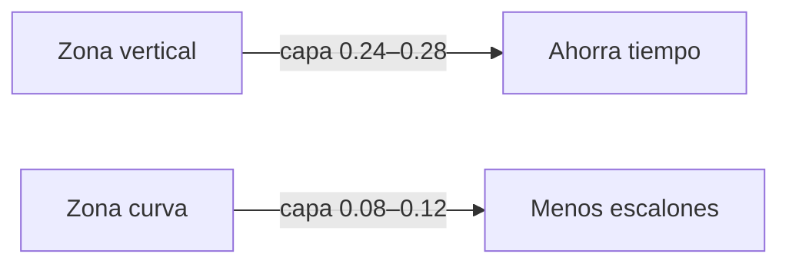

# Costura, ironing y altura de capa variable

Parte de: [[36-Impresion-3D/02 Laminador/_Índice Laminador|Laminador]]

> [!info] Cómo avanzar
> `progreso`: **pendiente** → **viendo** (estudiando) → **visto** (contestaste la autoevaluación sin abrir las respuestas) → **dominado** (hiciste el laboratorio o lo aplicaste de verdad).

## Contenido

### Qué es
Son tres ajustes de **acabado** que no cambian la resistencia, pero sí cómo se ve la pieza:
- **Costura** (*seam*): el punto donde empieza y termina cada perímetro en cada capa.
- **Ironing** (planchado): una pasada extra sobre las caras superiores para alisarlas.
- **Altura de capa variable**: capas finas donde hay curvas y gruesas donde no.

### Cómo funciona
**Costura.** Cada perímetro es un lazo cerrado: la boquilla empieza en un punto y vuelve a él. Ahí queda una pequeña marca (un granito o un hueco). Como pasa en todas las capas, se forma una línea vertical. Opciones típicas en ElegooSlicer/OrcaSlicer:

| Opción | Resultado |
|---|---|
| *Alineada* | Una línea limpia en un solo lugar |
| *Atrás* | Alineada en la parte trasera de la pieza |
| *Más cercana* | La pone en esquinas cercanas; rápida |
| *Aleatoria* | Granitos repartidos; no hay línea, pero toda la superficie se ve algo rugosa |
| *Pintada* | Tú la dibujas sobre el modelo con la herramienta de pintar costura |

En piezas con esquinas, una costura alineada en una esquina casi no se ve. En cilindros no hay dónde esconderla: píntala en la parte trasera. Opciones como *wipe* y *scarf seam* (costura en rampa) la suavizan.

**Ironing.** Tras imprimir la última capa superior, la boquilla vuelve a pasar muy cerca, con muy poco flujo (por ejemplo 10–15 %) y líneas muy juntas. Funde y aplana las crestas. Mejora letreros, tapas y placas planas; agrega tiempo y no sirve en superficies curvas.

**Altura de capa variable.** El laminador analiza la pendiente del modelo: donde la superficie es casi horizontal (cúpulas, cabezas), los escalones se notan mucho, así que pone capas finas (0.08–0.12 mm); donde es vertical, capas gruesas (0.24–0.28 mm). Hay un modo automático y un pincel para ajustar a mano.

### Ejemplo
Imprimes un letrero de escritorio "Itzamna" con texto en relieve:
- Costura: alineada atrás.
- Ironing: activado solo en la cara superior de la base, para que quede lisa.
- Si el texto es de otro color con el CANVAS, ten en cuenta que el ironing también tarda en esas capas.

Para una figura redonda de 10 cm, en lugar de imprimir todo a 0.12 mm usas altura variable: casi la misma calidad visual con bastante menos tiempo.

### Cuándo usarlo y cuándo no
- **Costura pintada**: piezas visibles desde un solo lado.
- **Costura aleatoria**: cilindros que se ven desde todos lados (acepta la textura).
- **Ironing**: superficies planas superiores grandes y visibles; no en figuras.
- **Altura variable**: figuras orgánicas; no hace falta en cajas rectas.

### Errores comunes
1. **Activar ironing en todo.** Duplica el tiempo de las caras superiores sin beneficio en curvas.
2. **Ironing con flujo mal calibrado.** Si hay sobreextrusión, el planchado arrastra material; calibra primero: [[Calibración de flujo y pressure advance]].
3. **Costura aleatoria en piezas funcionales que encajan.** Los granitos alteran la medida en todas partes.
4. **Altura variable en piezas que deben medir exacto en Z.** Revisa que las cotas importantes coincidan con capas.

### Para profundizar
- [OrcaSlicer wiki: costura](https://www.orcaslicer.com/wiki/print_settings/quality/quality_settings_seam)
- [OrcaSlicer wiki: ironing](https://www.orcaslicer.com/wiki/print_settings/quality/quality_settings_ironing)
- [OrcaSlicer wiki: altura de capa variable](https://www.orcaslicer.com/wiki/print_prepare/prepare_variable_layer_height)

## Autoevaluación

Contesta primero en voz alta o en papel; luego despliega la respuesta.

> [!question]- ¿Qué es la costura (seam)?
> El punto donde empieza y termina cada perímetro; deja una línea vertical de marcas. Puedes ponerla *alineada* en una esquina trasera, *aleatoria* (manchitas repartidas) o pintarla donde no se vea.

> [!question]- ¿Qué es el ironing?
> Una pasada extra de la boquilla caliente con muy poco flujo sobre las caras superiores para dejarlas lisas. Mejora placas o letreros planos, pero agrega tiempo.

> [!question]- ¿Para qué sirve la altura de capa variable?
> Usa capas finas en curvas y detalles y capas gruesas en zonas rectas, ahorrando tiempo con buena calidad visual (ideal para figuras redondeadas).

