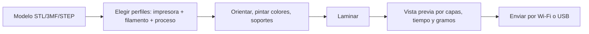

# ElegooSlicer y OrcaSlicer

Parte de: [[36-Impresion-3D/02 Laminador/_Índice Laminador|Laminador]]

> [!info] Cómo avanzar
> `progreso`: **pendiente** → **viendo** (estudiando) → **visto** (contestaste la autoevaluación sin abrir las respuestas) → **dominado** (hiciste el laboratorio o lo aplicaste de verdad).

## Contenido

### Qué es
Un **laminador** (*slicer*) es el programa que convierte un modelo 3D en instrucciones para la impresora. Rebana la pieza en capas, decide por dónde pasa la boquilla en cada una (paredes, relleno, soportes), a qué velocidad y temperatura, y genera un archivo de **G-code**. La impresora no entiende un STL: entiende G-code.

Para tu Centauri 2 Combo, Elegoo recomienda **ElegooSlicer**, su laminador oficial (gratuito y de código abierto). La alternativa más sólida es **OrcaSlicer**, también gratuito y abierto, que incluye perfiles de "Elegoo Centauri 2" para boquillas de 0.2, 0.4, 0.6 y 0.8 mm (verificado en su repositorio, 2026-11-10).

### Cómo funciona
Ambos programas son parientes: según su propio README, **ElegooSlicer está basado en OrcaSlicer**, que a su vez viene de Bambu Studio y este de PrusaSlicer. Por eso la interfaz, los menús de calibración y la mayoría de los ajustes son casi iguales.

El laminador combina tres perfiles: **impresora** (tamaño de cama, boquilla, límites de velocidad, G-code inicial), **filamento** (temperaturas, flujo, ventilador) y **proceso** (altura de capa, paredes, relleno, soportes). Ver [[Perfiles de filamento e impresora]].

| | ElegooSlicer | OrcaSlicer |
|---|---|---|
| Quién lo hace | Elegoo (oficial) | Comunidad (SoftFever y colaboradores) |
| Perfil Centauri 2 | Sí, de fábrica | Sí, incluido |
| Integración | App ELEGOO Matrix, modelos de Nexprint, materiales Elegoo con RFID | Muchas marcas de impresoras |
| Novedades | Puede ir detrás o adelante según la versión | Suele recibir funciones nuevas primero |
| Costo | Gratis | Gratis |

### Ejemplo
Instalas ElegooSlicer en tu PC (Windows, con la GTX 1660 Ti sobra para la vista previa), eliges "Elegoo Centauri 2 0.4 nozzle", filamento "Elegoo PLA" y proceso de 0.20 mm. Importas un soporte para tu DJI Mic Mini 2, lo laminas, revisas en la vista previa que la primera capa cubra bien y que no haya voladizos sin apoyo, y lo mandas por Wi-Fi. Si un día necesitas una función que solo está en OrcaSlicer, instalas también OrcaSlicer, eliges el mismo modelo de impresora y exportas tus perfiles de filamento calibrados.

### Cuándo usar cada uno
- **ElegooSlicer**: tu opción por defecto; la que Elegoo prueba con su firmware, CANVAS y RFID.
- **OrcaSlicer**: si quieres una función o calibración más reciente, o usas impresoras de varias marcas. Verifica que el envío por red funcione con tu firmware (Pendiente de confirmar para tu versión).
- Puedes tener ambos instalados; lo importante es que el perfil de impresora sea el correcto.

### Errores comunes
1. **Elegir el perfil de otra impresora.** "Centauri Carbon" (primera generación), "Centauri Carbon 2" (cerrada) y "Centauri 2" (abierta, la tuya) son modelos distintos; un perfil equivocado puede dar G-code inicial, límites o volumen que no corresponden, y en el peor caso movimientos fuera de lugar. Antes de laminar, lee el nombre exacto del perfil.
2. **Mezclar versiones viejas y nuevas.** Actualiza el laminador y el firmware cuando haya versión estable; perfiles viejos pueden no conocer funciones nuevas.
3. **Enviar sin vista previa.** La vista por capas detecta soportes faltantes, piezas flotando y tiempos absurdos.
4. **Bajar laminadores de sitios no oficiales.** Usa solo la página de Elegoo o el GitHub oficial.

### Para profundizar
- [ElegooSlicer — repositorio y descargas oficiales](https://github.com/ELEGOO-3D/ElegooSlicer/releases)
- [OrcaSlicer — repositorio oficial](https://github.com/OrcaSlicer/OrcaSlicer)
- [OrcaSlicer wiki](https://www.orcaslicer.com/wiki/)

## Autoevaluación

Contesta primero en voz alta o en papel; luego despliega la respuesta.

> [!question]- ¿Qué hace un laminador (slicer)?
> Convierte un modelo 3D (STL/3MF/STEP) en **G-code**: capas, trayectorias, temperaturas, velocidades, soportes y cambios de color. La impresora solo entiende el G-code.

> [!question]- ¿Cuál usar con la Centauri 2 Combo?
> **ElegooSlicer** es el laminador oficial: trae el perfil de la impresora y del CANVAS, y se conecta a ella por red. **OrcaSlicer** es gratuito y de código abierto (ElegooSlicer es un derivado suyo), con menús de calibración muy completos; que tenga perfil oficial para la Centauri 2 está (Pendiente de confirmar). Empieza con ElegooSlicer y usa Orca como referencia o para aprender.

> [!question]- ¿Qué pasa si laminas con el perfil de la Centauri Carbon 2 por error?
> Puede funcionar parcialmente, pero el G-code de inicio, los límites y los ajustes multicolor pueden no coincidir. Siempre selecciona exactamente *Centauri 2* (con CANVAS si usas multicolor).

## Práctica

- [[Lab 1 - Primera impresión y revisión de calibración automática en Centauri 2]]

