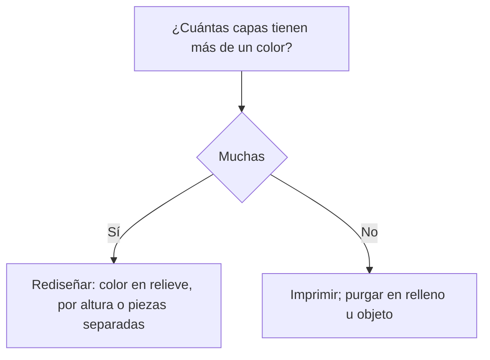

# Impresión multicolor (pintar colores y torre de purga)

Parte de: [[36-Impresion-3D/02 Laminador/_Índice Laminador|Laminador]]

> [!info] Cómo avanzar
> `progreso`: **pendiente** → **viendo** (estudiando) → **visto** (contestaste la autoevaluación sin abrir las respuestas) → **dominado** (hiciste el laboratorio o lo aplicaste de verdad).

## Contenido

### Qué es
La impresión multicolor con el CANVAS consiste en asignar a cada zona del modelo uno de los 4 filamentos cargados. El laminador planea los **cambios de filamento** y dónde se tira el plástico de la transición (**purga**). La clave para hacerlo bien es entender que **cada cambio cuesta filamento y tiempo**, así que el diseño y la orientación deciden si una pieza multicolor es eficiente o un desperdicio.

### Cómo funciona
**Asignar colores** en ElegooSlicer/OrcaSlicer:
1. **Por objeto o parte**: cada pieza de un 3MF o cada parte de un ensamble va a un filamento.
2. **Pintando caras**: la herramienta de pintar colorea zonas de la malla (pincel, relleno por área, por ángulo).
3. **Por altura**: un cambio de color en cierta capa (por ejemplo, la tapa de una caja en otro color).

Cada filamento del laminador se liga a una **ranura física** del CANVAS.

**Torre de purga** (*prime/wipe tower*): un pequeño bloque que se imprime junto a la pieza. Tras cada cambio, la boquilla imprime ahí un poco para terminar de limpiar el color viejo y estabilizar la presión antes de volver a la pieza. Evita manchas de color y huecos. Además hay purga por la boquilla al cargar el filamento nuevo. Se puede reducir con:
- **Purgar en el relleno** de la pieza (el color mezclado queda oculto adentro).
- **Purgar en un objeto de sacrificio** (otra pieza que no importa el color).
- **Ajustar volúmenes de purga**: de oscuro a claro se necesita más purga que de claro a oscuro.

### Ejemplo: cuánto cuestan los cambios
```text
120 cambios × 0.25 g = 30 g de filamento desperdiciado
120 cambios × 40 s   = 4,800 s = 80 min extra
```
Rediseñas para que el color solo esté en las **últimas 10 capas**, con 2 cambios por capa:
```text
10 capas × 2 cambios = 20 cambios
20 × 0.25 g = 5 g de purga
```
Pasas de 30 g a 5 g y de 80 min a unos 13 min de cambios. Mismo aspecto desde arriba.



### Cuándo usarlo y cuándo no
- **Muy eficiente**: logos y textos en relieve en las capas superiores o inferiores, cambios por altura, piezas separadas de un color cada una en la misma placa.
- **Caro**: colores pequeños repartidos en muchas capas (ojos de una figura de pie, franjas verticales).
- **Truco**: imprime varias piezas iguales a la vez; comparten los mismos cambios y la purga por pieza baja.
- Cuenta siempre la purga en el [[Costeo de una impresión 3D]].

### Errores comunes
1. **Logo pequeño de 4 colores atravesando 200 capas.** Cientos de cambios; diseña para que cada color ocupe un rango corto de capas.
2. **Quitar la torre para ahorrar** sin purgar en otro lado: aparecen manchas y huecos.
3. **Ranuras mal ligadas**: el color del laminador no coincide con el carrete físico.
4. **Mezclar materiales que no se pegan** (PLA y PETG en la misma capa estructural).
5. **No mirar el resumen**: el laminador muestra gramos por filamento y de purga; léelo antes de imprimir.

### Para profundizar
- [OrcaSlicer wiki: pintar colores](https://www.orcaslicer.com/wiki/print_prepare/prepare_color_painting)
- [OrcaSlicer wiki: torre de purga](https://www.orcaslicer.com/wiki/printer_settings/multimaterial/printer_multimaterial_wipe_tower)
- Antes de esto: [[Sistema multicolor CANVAS de Elegoo]]. Práctica: [[Lab 5 - Pieza en 4 colores con CANVAS minimizando purga]]

## Ejercicios

Resuélvelos en papel o en la herramienta; la solución está plegada.

> [!question]- Una pieza tiene 120 cambios de color y cada uno purga 0.25 g en torre + boquilla. ¿Cuánto filamento se desperdicia?
> 120 × 0.25 = **30 g** de purga (además de lo que pesa la pieza).

> [!question]- Si cada cambio tarda 40 s, ¿cuánto tiempo agregan 120 cambios?
> 120 × 40 = 4,800 s = **80 min**.

> [!question]- Rediseñas para que el color solo esté en las últimas 10 capas, con 2 cambios por capa. ¿Cuántos cambios quedan y cuánto purgas (0.25 g)?
> 10 × 2 = 20 cambios → 20 × 0.25 = **5 g** (de 30 g a 5 g).

## Autoevaluación

Contesta primero en voz alta o en papel; luego despliega la respuesta.

> [!question]- ¿Cómo se asignan colores en el laminador?
> Con la herramienta de **pintar** caras del modelo, asignando objetos/partes distintas a cada filamento, o por altura (cambio de color en cierta capa). Cada color se liga a una ranura del CANVAS.

> [!question]- ¿Para qué es la torre de purga?
> Para limpiar el color anterior y estabilizar la presión antes de seguir con la pieza; evita mezclas de color y huecos. Gasta filamento en cada cambio.

> [!question]- ¿Cómo reducir el desperdicio de purga?
> 1) Usa menos cambios por capa (colores por altura donde se pueda); 2) ordena de claro a oscuro y ajusta volúmenes de purga (oscuro→claro necesita más); 3) *purgar en relleno* o en un objeto de sacrificio; 4) imprime varias piezas a la vez para que compartan cambios.

> [!question]- Error común: logo pequeño de 4 colores en 200 capas distintas.
> Si los colores aparecen en muchas capas, hay cientos de cambios. Diseña de modo que cada color ocupe un rango de capas (por ejemplo, logo en relieve solo en las últimas capas).

## Práctica

- [[Lab 5 - Pieza en 4 colores con CANVAS minimizando purga]]

