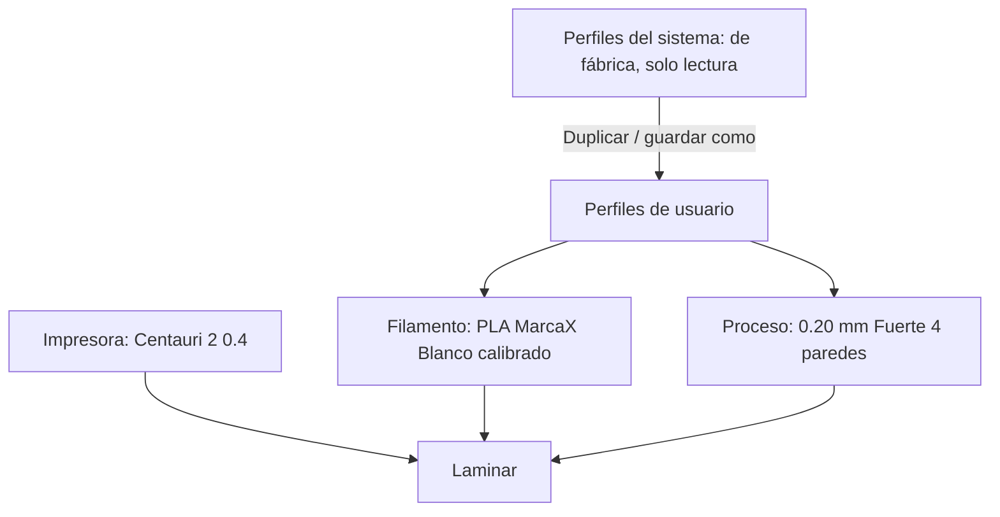

# Perfiles de filamento e impresora

Parte de: [[36-Impresion-3D/02 Laminador/_Índice Laminador|Laminador]]

> [!info] Cómo avanzar
> `progreso`: **pendiente** → **viendo** (estudiando) → **visto** (contestaste la autoevaluación sin abrir las respuestas) → **dominado** (hiciste el laboratorio o lo aplicaste de verdad).

## Contenido

### Qué es
Un **perfil** es un conjunto guardado de ajustes del laminador. Hay tres tipos que se combinan en cada impresión:
- **Impresora**: tamaño de cama (256 × 256 × 256 mm), diámetro de boquilla, límites de velocidad y aceleración, G-code de inicio y fin.
- **Filamento**: temperaturas de boquilla y cama, flujo (*flow ratio*), *pressure advance*, ventilador, flujo volumétrico máximo, retracción específica, temperatura de ablandamiento.
- **Proceso** (o "calidad"): altura de capa, paredes, relleno, soportes, velocidades por tipo de línea.

Separarlos permite combinar: el mismo proceso de 0.2 mm con distintos filamentos, o el mismo PLA calibrado en distintas calidades.

### Cómo funciona

Los perfiles del sistema (por ejemplo "Elegoo PLA @EC2" en OrcaSlicer) vienen con el laminador y se actualizan con él. Cuando cambias un valor, el laminador lo marca como modificado; al guardar, te pide un nombre nuevo y crea un **perfil de usuario** que hereda del original. Así tus cambios sobreviven a las actualizaciones.

Con filamentos Elegoo con RFID, el CANVAS identifica el material y la impresora aplica los ajustes recomendados; aun así, tus calibraciones finas viven en el perfil de usuario.

### Ejemplo
Compras un PLA de otra marca, color blanco. Proceso:
1. Duplicas "Generic PLA" (o el de Elegoo) y lo nombras `PLA MarcaX - Blanco`.
2. Pones la temperatura que recomienda la ficha del fabricante del filamento como punto de partida.
3. Haces la [[Torre de temperatura]] y guardas la mejor temperatura en tu perfil.
4. Haces la [[Calibración de flujo y pressure advance]] y guardas flow ratio y PA.
5. Si la marca indica un flujo máximo, lo pones en "velocidad volumétrica máxima".

La próxima vez que uses ese carrete eliges tu perfil y listo. Si compras el mismo PLA en negro, conviene recalibrar al menos el flujo: los pigmentos cambian el comportamiento.

### Cuándo crear un perfil propio
- Siempre que calibres algo para un filamento concreto.
- Cuando cambies de boquilla (0.4 → 0.6 mm): usa el perfil de impresora de ese diámetro.
- Para procesos que repites: "Funcional 4 paredes", "Figura 0.12", "Prototipo 0.28".

Exporta tus perfiles de vez en cuando (Archivo → Exportar → paquete de perfiles) y guárdalos fuera de la PC, por ejemplo junto a tus notas o en tu respaldo.

### Errores comunes
1. **Editar y sobrescribir el perfil del sistema.** Al actualizar el laminador puedes perder o confundir cambios. Siempre **duplica** y edita tu copia.
2. **Un solo perfil "PLA" para todas las marcas.** Cada marca y color se comporta distinto; anota en el nombre marca y color.
3. **Perfil de impresora equivocado** (otra boquilla u otro modelo de Centauri): todos los cálculos quedan mal.
4. **No anotar qué cambiaste.** Usa el campo de notas del perfil o una tabla en Obsidian con fecha, valor y resultado.

### Para profundizar
- [OrcaSlicer wiki: perfiles de usuario](https://www.orcaslicer.com/wiki/user_profiles/user_profiles)
- [OrcaSlicer wiki: guía de calibración (orden recomendado)](https://www.orcaslicer.com/wiki/guides/calibration_guide.html)
- [ElegooSlicer — descargas oficiales](https://github.com/ELEGOO-3D/ElegooSlicer/releases)

## Autoevaluación

Contesta primero en voz alta o en papel; luego despliega la respuesta.

> [!question]- ¿Qué guarda un perfil de filamento?
> Temperaturas de boquilla y cama, flujo (*flow ratio*), pressure advance, ventilador, flujo volumétrico máximo y retracción específica del material.

> [!question]- ¿Por qué crear tu propio perfil tras calibrar?
> Cada marca/color se comporta distinto. Duplica el perfil genérico, ponle nombre (`PLA Marca X - Blanco`) y guarda ahí tu temperatura y flujo calibrados.

> [!question]- Error común: editar el perfil del sistema directamente.
> Al actualizar el laminador se puede perder o confundir. Siempre **duplica** y edita tu copia.

## Práctica

- [[Lab 2 - Torre de temperatura de PLA]]
- [[Lab 3 - Prueba de flujo y pressure advance]]

