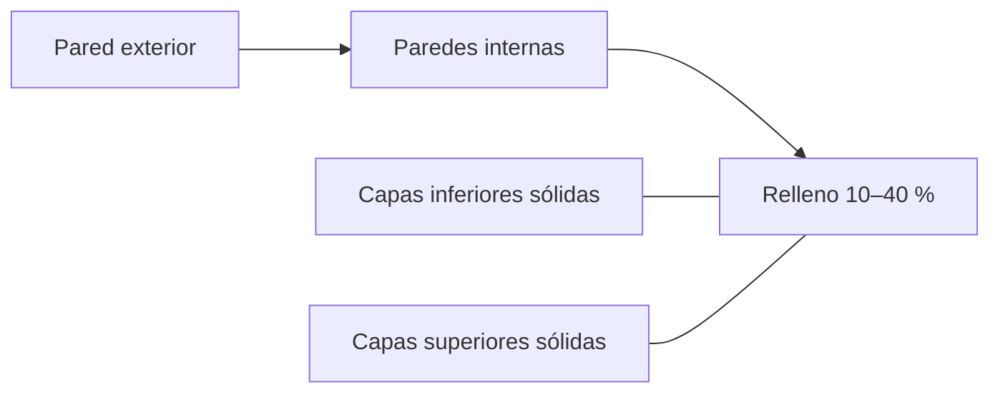

# Perímetros y relleno

Parte de: [[36-Impresion-3D/02 Laminador/_Índice Laminador|Laminador]]

> [!info] Cómo avanzar
> `progreso`: **pendiente** → **viendo** (estudiando) → **visto** (contestaste la autoevaluación sin abrir las respuestas) → **dominado** (hiciste el laboratorio o lo aplicaste de verdad).

## Contenido

### Qué es
Una pieza FDM no es sólida por dentro. Tiene:
- **Perímetros** (paredes): las líneas del contorno de cada capa. La exterior define la apariencia.
- **Capas sólidas superiores e inferiores**: capas 100 % llenas que cierran la pieza arriba y abajo.
- **Relleno** (*infill*): una estructura interna con cierto porcentaje y patrón.

Ajustar estas tres cosas es la forma principal de equilibrar **resistencia, peso, tiempo y filamento**.

### Cómo funciona

La mayoría de las cargas (flexión, torsión, tornillos) se concentran en la superficie de la pieza, igual que en un tubo: un tubo resiste casi como una barra maciza con mucho menos material. Por eso **más paredes** suelen aportar más resistencia que más relleno. Pasar de 2 a 4 paredes fortalece más que pasar de 15 % a 40 % de relleno, y gasta menos.

**Patrones de relleno** (nombres de ElegooSlicer/OrcaSlicer):

| Patrón | Para qué |
|---|---|
| *Grid*, *Rectilinear* | Rápidos, decorativos |
| *Lightning* | Solo sostiene los techos; mínimo material, figuras |
| *Gyroid* | Resistencia en todas direcciones, buen aspecto, bueno para TPU |
| *Cubic*, *Adaptive cubic* | Funcionales, reparten carga en 3D |
| *Honeycomb* | Rígido pero lento |

**Capas superiores/inferiores.** Si son pocas, el techo se hunde entre las líneas del relleno (*pillowing*). Con capa de 0.2 mm, 4–5 capas superiores y 3–4 inferiores suelen bastar; muchos laminadores también permiten fijar un espesor mínimo en mm.

### Ejemplo
Diseñas un soporte de pared para tu dron DJI Mini 4K que llevará tornillos.
- Figura decorativa de escritorio: 2 paredes, 10–15 % *lightning* o *grid*.
- El soporte de pared: **4 paredes**, 25–35 % *gyroid* o *cubic*, 5 capas superiores. Alrededor de los agujeros de tornillo, las paredes extra dan "carne" para que no se rompa.
- Si vas a usar insertos térmicos, al menos 3 paredes alrededor del agujero: ver [[Insertos térmicos, tornillería y pegado]].

### Cuándo usar qué
- **Visual y ligera**: pocas paredes, relleno bajo.
- **Funcional**: más paredes primero, luego sube relleno.
- **Flexible (TPU)**: el relleno define qué tan blanda queda; menos relleno = más suave.
- **Orientación**: la pieza es más débil entre capas; orienta para que la carga no "despegue" capas (ver [[Soportes (normales, árbol e interfaces)]]).

### Errores comunes
1. **100 % de relleno "para que sea indestructible".** Gasta mucho filamento y tiempo, acumula calor y puede deformarse; casi siempre es mejor 4–6 paredes y 30–40 %.
2. **Relleno 5 % con 2 capas superiores.** El techo queda con huecos.
3. **Olvidar la orientación.** Una pieza perfecta en relleno puede romperse por la línea de capa si la orientaste mal.
4. **Patrón lento sin razón.** *Honeycomb* tarda mucho; *gyroid* o *cubic* dan resultados similares más rápido.

### Para profundizar
- [OrcaSlicer wiki: paredes y superficies](https://www.orcaslicer.com/wiki/print_settings/quality/quality_settings_wall_and_surfaces)
- [OrcaSlicer wiki: generador de paredes](https://www.orcaslicer.com/wiki/print_settings/quality/quality_settings_wall_generator)
- [OrcaSlicer wiki (índice de ajustes de resistencia y patrones)](https://www.orcaslicer.com/wiki/)

## Autoevaluación

Contesta primero en voz alta o en papel; luego despliega la respuesta.

> [!question]- ¿Qué aporta más resistencia: más perímetros o más relleno?
> Normalmente **más perímetros** (paredes). Pasar de 2 a 4 paredes fortalece más que pasar de 15 % a 40 % de relleno, y gasta menos.

> [!question]- ¿Qué patrón de relleno usarías para una figura decorativa y cuál para una pieza funcional?
> Decorativa: relleno bajo (10–15 %), patrón rápido como *grid* o *lightning* (solo sostiene techos). Funcional: 25–40 % con *gyroid* o *cubic*, que reparten carga en varias direcciones.

> [!question]- ¿Qué son las capas sólidas superiores/inferiores?
> Capas 100 % llenas que cierran la pieza. Si son pocas, la superficie superior queda con huecos (*pillowing*); 4–5 capas superiores con 0.2 mm suelen bastar.

> [!question]- Error común: 100 % de relleno «para que sea indestructible».
> Gasta mucho filamento y tiempo, y puede deformarse por calor acumulado. Casi siempre es mejor 4–6 paredes y 30–40 % de relleno.

## Práctica

- [[Lab 8 - Inserto térmico con cautín]]

