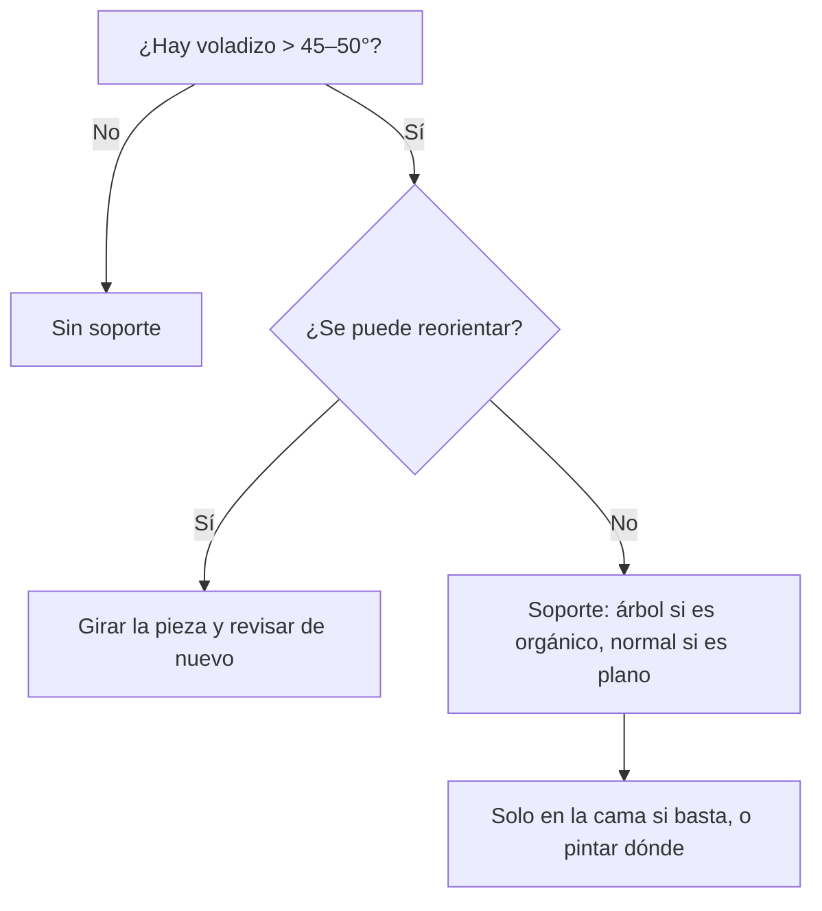

# Soportes (normales, árbol e interfaces)

Parte de: [[36-Impresion-3D/02 Laminador/_Índice Laminador|Laminador]]

> [!info] Cómo avanzar
> `progreso`: **pendiente** → **viendo** (estudiando) → **visto** (contestaste la autoevaluación sin abrir las respuestas) → **dominado** (hiciste el laboratorio o lo aplicaste de verdad).

## Contenido

### Qué es
Los **soportes** son estructuras temporales que el laminador agrega debajo de las partes de la pieza que "empiezan en el aire". FDM no puede depositar plástico sobre la nada: cada capa necesita algo debajo. Los soportes se quitan al final; el truco es usar los menos posibles y que se quiten fácil sin arruinar la superficie.

### Cómo funciona
**Voladizos.** Cada capa puede sobresalir un poco de la anterior. Hasta unos **45–50° respecto a la vertical**, la línea se apoya en parte en la de abajo y se imprime bien (con buen ventilador). Más allá, cuelga y se cae. Los **puentes** (tramos horizontales entre dos apoyos) sí se imprimen sin soporte si son cortos, porque el plástico se tiende como un hilo y el ventilador lo endurece.

**Tipos de soporte:**

| Tipo | Cómo es | Mejor para |
|---|---|---|
| **Normal** (*grid*, *snug*) | Columnas o bloques rectos bajo toda la zona | Superficies planas grandes, piezas mecánicas |
| **Árbol** (*tree*) | Tronco con ramas que tocan solo donde hace falta | Figuras y formas orgánicas; gasta menos y se quita mejor |

**Interfaz y distancia Z.**
- La **interfaz** son capas densas en la parte superior del soporte, en contacto con la pieza: dan una base lisa para la cara de abajo.
- La **distancia Z superior** es el hueco entre la interfaz y la pieza (≈0.2 mm con capa de 0.2 en PLA). Muy chica: el soporte se fusiona y no sale. Muy grande: la cara inferior queda colgada y fea.
- Distancia XY: separación lateral entre soporte y pieza.

### Ejemplo
Un soporte en "L" para la DJI Osmo Pocket: si lo imprimes de pie, el brazo horizontal necesita un bloque de soporte enorme. Si lo **acuestas** sobre la cara plana más grande, no necesita ninguno y además es más fuerte (las capas siguen la dirección del esfuerzo). Para una figura con brazos extendidos, usas **árbol**, "solo desde la cama" para que las ramas no se apoyen sobre la figura, y pintas bloqueadores donde no quieres marcas.

### Cuándo usarlo y cuándo no
- Primero **orienta** la pieza; la herramienta de orientación automática ayuda.
- Usa **pintar soportes** para ponerlos solo donde hacen falta y **bloqueadores** donde no.
- Para la cara de abajo muy lisa, más capas de interfaz; para quitar rápido, menos.
- Si una pieza necesita muchos soportes, considera **partirla** y pegarla: ver [[Insertos térmicos, tornillería y pegado]].

### Errores comunes
1. **Activar soportes "en todas partes" sin reorientar.** Gastas material y tiempo, y dejas marcas por todos lados.
2. **Distancia Z en 0** para que "salga lisa": el soporte se suelda a la pieza.
3. **Soportes sobre la propia pieza** en figuras: dejan cicatrices en zonas visibles; usa "solo desde la cama" cuando se pueda.
4. **Soportes de árbol altos y delgados** sin brim: se caen a media impresión y provocan fallas.
5. **Quitar soportes en caliente**: ver [[Quitar soportes y limpiar piezas]].

### Para profundizar
- [OrcaSlicer wiki: pintar soportes](https://www.orcaslicer.com/wiki/print_prepare/prepare_support_painting)
- [OrcaSlicer wiki: voladizos](https://www.orcaslicer.com/wiki/print_settings/quality/quality_settings_overhangs)
- [OrcaSlicer wiki: puentes](https://www.orcaslicer.com/wiki/print_settings/quality/quality_settings_bridging)

## Autoevaluación

Contesta primero en voz alta o en papel; luego despliega la respuesta.

> [!question]- ¿Cuándo necesita soporte una pieza?
> Cuando tiene voladizos de más de ~45–50° respecto a la vertical o zonas que empiezan en el aire. Los puentes cortos entre dos apoyos suelen imprimirse sin soporte.

> [!question]- ¿Soporte normal o de árbol (tree)?
> **Árbol**: ramas que tocan solo donde hace falta; ideal para figuras y formas orgánicas, gasta menos y se quita fácil. **Normal**: bloques rectos bajo superficies planas grandes; más estable para piezas mecánicas.

> [!question]- ¿Qué es la interfaz de soporte y la distancia Z?
> La interfaz son capas densas en contacto con la pieza para que la cara de abajo quede lisa. La distancia Z (≈0.2 mm en PLA) es el hueco entre soporte y pieza: muy chica = no se despega; muy grande = cara inferior fea.

> [!question]- Error común: activar soportes «en todas partes» sin reorientar.
> Antes de poner soportes, prueba **girar la pieza** para que su cara plana más grande quede sobre la cama. Muchas piezas no necesitan soporte si se orientan bien.

## Práctica

- [[Lab 7 - Posprocesado soportes, lijado, primer y pintura]]

