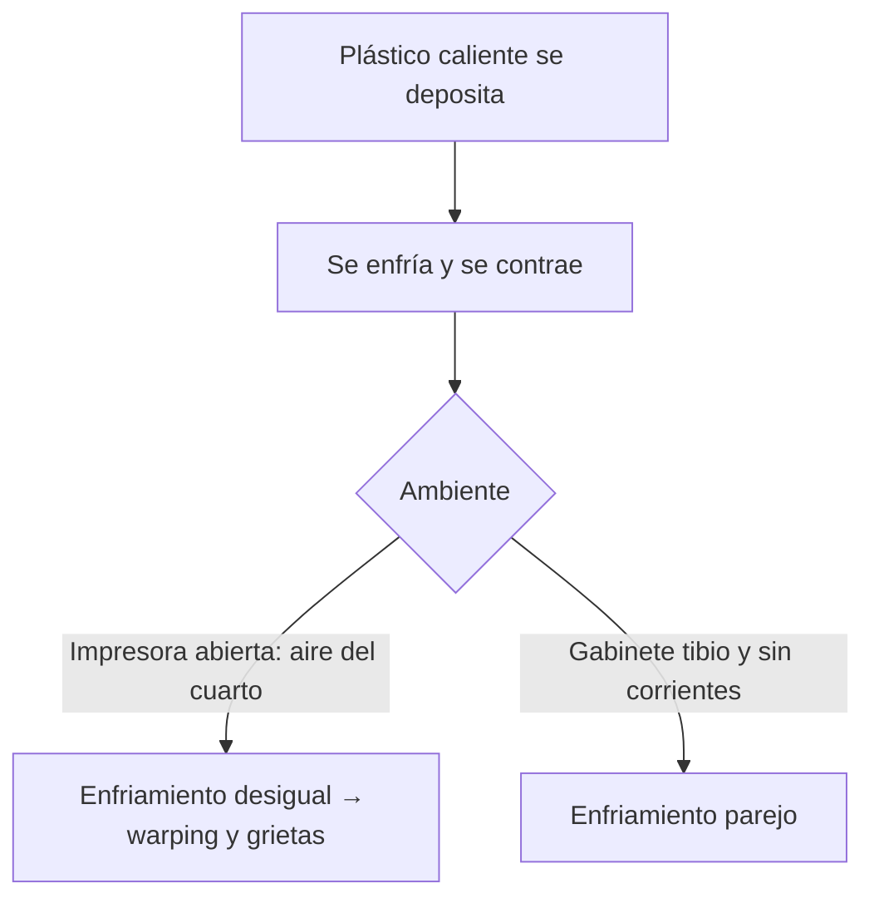

# Materiales que necesitan impresora cerrada (ABS, ASA, PC y nylon)

Parte de: [[36-Impresion-3D/03 Materiales/_Índice Materiales|Materiales]]

> [!info] Cómo avanzar
> `progreso`: **pendiente** → **viendo** (estudiando) → **visto** (contestaste la autoevaluación sin abrir las respuestas) → **dominado** (hiciste el laboratorio o lo aplicaste de verdad).

## Contenido

### Qué es
Son **materiales de ingeniería** que se contraen mucho al enfriarse o necesitan temperaturas altas, y por eso dan buenos resultados sobre todo en impresoras **cerradas** (con gabinete):
- **ABS**: tenaz, resiste ≈90–100 °C, se pule con acetona. Emite estireno (olor típico).
- **ASA**: como el ABS pero **resistente a UV**: el material para exterior al sol.
- **PC** (policarbonato): muy resistente al impacto y al calor; temperaturas muy altas y contracción fuerte.
- **Nylon (PA)**: tenaz y resistente al desgaste; absorbe humedad en horas. Las versiones con fibra de carbono son abrasivas (necesitan boquilla endurecida).

Tu Centauri 2 es **abierta**: puede alcanzar las temperaturas de boquilla (hasta 350 °C), pero no tiene el ambiente que estos materiales necesitan.

### Cómo funciona

La contracción del ABS/ASA es mucho mayor que la del PLA. Sin gabinete, el aire del cuarto enfría la pieza de forma desigual: las esquinas se levantan (**warping**) y las capas se separan (**delaminación**), sobre todo en piezas grandes. Además emiten más VOCs y partículas que PLA/PETG, y en una impresora abierta todo eso va directo al cuarto.

- **PC**: temperaturas muy altas y contracción fuerte; sin cámara caliente es muy difícil.
- **Nylon**: hay que secarlo y mantenerlo seco durante la impresión; también se deforma.

**Rangos generales** (consulta la ficha del fabricante del filamento):

| Material | Boquilla | Cama | Ventilador |
|---|---|---|---|
| ABS | 240–270 °C | 90–110 °C | 0–20 % |
| ASA | 240–270 °C | 90–110 °C | 0–30 % |
| PC | 260–300 °C | 100–110 °C | 0–20 % |
| Nylon | 250–290 °C | 70–100 °C | Bajo |

La temperatura máxima de cama de la Centauri 2 es 110 °C según reseñas (Pendiente de confirmar): justo en el límite de lo que piden ABS, ASA y PC.

### ¿Está prohibido imprimirlos en la Centauri 2?
No, pero **no es recomendable para empezar**. Si lo intentas:
- Piezas **pequeñas**, brim ancho (5–8 mm), cara texturizada de la placa, ventilador apagado o mínimo.
- Sin corrientes de aire; una caja o gabinete improvisado **no inflamable**, separado de la electrónica y que no tape los ventiladores (revisa el manual antes de encerrar la impresora).
- **Ventilación hacia afuera**; nunca en una recámara.

### Ejemplo: pieza para exterior al sol
Necesitas un soporte para montar una cámara en el balcón:
1. **Prueba primero PETG**: aguanta más calor y humedad que el PLA y se imprime bien en tu impresora abierta. Ver [[PETG]].
2. Si el PETG se deforma o se degrada con el sol después de un tiempo, entonces sí necesitas **ASA**: considera un gabinete o pedir la pieza a un servicio con impresora cerrada.
3. Si decides probar ASA en casa: pieza pequeña, brim, ventilador mínimo, cuarto ventilado y filamento seco (≈60–80 °C según fabricante).

### Cuándo usarlos y cuándo no
- **ASA**: exteriores al sol intenso, piezas de coche… idealmente en impresora cerrada.
- **ABS**: piezas tenaces y resistentes al calor en interior.
- **PC / nylon / con fibra**: cuando tengas gabinete o experiencia; piezas pequeñas.
- **No**: si PLA o PETG resuelven el problema, que en tu impresora es la mayoría de las veces.

### Errores comunes
1. **Imprimir ABS grande en un cuarto con corrientes**: warping y grietas casi seguros.
2. **Ventilador alto** como en PLA: capas débiles.
3. **Nylon sin secar**: burbujas y piezas frágiles.
4. **Gabinete improvisado inflamable** (cartón) o que tapa la electrónica.
5. **No ventilar**: con una impresora abierta, las emisiones van directo a tu cuarto. Ver [[Seguridad al imprimir (ventilación, emisiones y ubicación)]].

### Para profundizar
- [Centauri 2 Combo — página oficial](https://us.elegoo.com/products/centauri-2-combo)
- [UL Chemical Insights — estudios de emisiones (PDF)](https://chemicalinsights.org/wp-content/uploads/2022/03/3DPrint_EmissionStudies.pdf)
- Relacionado: [[Warping (esquinas levantadas) en FDM]] y [[Secado y almacenamiento de filamento]]

## Autoevaluación

Contesta primero en voz alta o en papel; luego despliega la respuesta.

> [!question]- ¿Por qué ABS y ASA dan problemas en una impresora abierta como la Centauri 2?
> Se encogen mucho al enfriar. Sin gabinete, el aire del cuarto enfría la pieza de forma desigual → **warping** (esquinas levantadas) y **grietas entre capas** (*delaminación*), sobre todo en piezas grandes. Además emiten más VOCs y partículas que PLA/PETG (el estireno del ABS da el olor característico).

> [!question]- ¿Y policarbonato (PC) y nylon?
> **PC**: temperaturas muy altas y contracción fuerte; sin cámara caliente es muy difícil. **Nylon**: absorbe humedad en horas (hay que secarlo y mantenerlo seco al imprimir) y también se deforma. Los nylon con fibra de carbono son abrasivos (necesitan boquilla endurecida).

> [!question]- ¿Entonces está prohibido imprimirlos en la Centauri 2?
> No está prohibido y la boquilla llega a 350 °C, pero **no es recomendable para empezar**. Si lo intentas: piezas pequeñas, brim ancho, ventilador apagado, sin corrientes de aire, una caja o gabinete improvisado *no inflamable* y separado de la electrónica, y **ventilación hacia afuera**; nunca en una recámara. Si necesitas resistencia al sol/calor, prueba primero PETG.

> [!question]- Necesitas una pieza para exterior al sol. ¿Qué pruebas primero en tu impresora?
> PETG (aguanta más calor y humedad que PLA). Si de verdad necesitas ASA, considera un gabinete o pedirla a un servicio con impresora cerrada.

