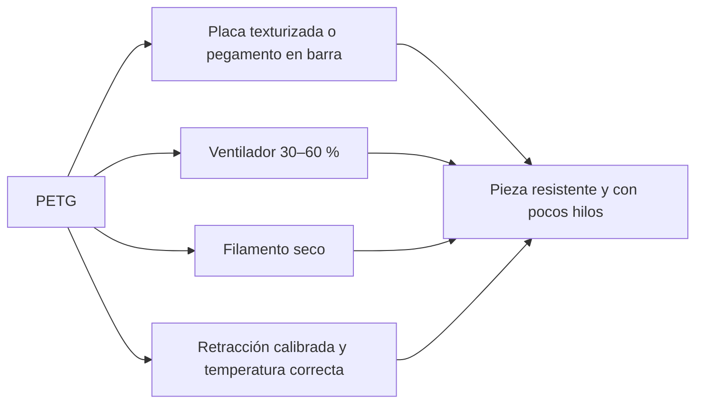

# PETG

Parte de: [[36-Impresion-3D/03 Materiales/_Índice Materiales|Materiales]]

> [!info] Cómo avanzar
> `progreso`: **pendiente** → **viendo** (estudiando) → **visto** (contestaste la autoevaluación sin abrir las respuestas) → **dominado** (hiciste el laboratorio o lo aplicaste de verdad).

## Contenido

### Qué es
El **PETG** es un poliéster (pariente del PET de las botellas, con glicol añadido para que no se cristalice). Es el segundo material más usado en FDM: un poco más difícil que el PLA, pero más **resistente al calor, a la humedad, a químicos y a impactos**. Es la opción natural cuando el PLA no alcanza.

### Cómo funciona
**Temperaturas orientativas** (consulta la ficha del fabricante del filamento): boquilla ≈230–260 °C, cama ≈70–85 °C. Aguanta temperaturas de uso de ≈70–80 °C antes de ablandarse, frente a 55–60 °C del PLA.

**Comportamiento al imprimir:**
- **Más pegajoso** fundido: tiende a dejar hilos (*stringing*) y a acumular "mocos" en la boquilla.
- **Se pega muchísimo** al PEI liso: puede arrancar pedazos de la superficie.
- Quiere **menos ventilador** que el PLA (≈30–60 %): con mucho aire, las capas se unen mal.
- Es **higroscópico**: absorbe humedad más rápido que el PLA, y húmedo hace más hilos y burbujas.
- Contrae poco: se imprime bien en impresoras abiertas como la tuya; en piezas grandes evita corrientes de aire.

### Ejemplo
Necesitas un soporte para montar la DJI Osmo Pocket en el tablero del coche. En PLA se deformaría con el sol. Lo haces en PETG:
1. Seca el carrete si estuvo abierto semanas (≈60–65 °C, 4–6 h, o lo que indique el fabricante).
2. Usa la cara de **PEI texturizado** de tu placa.
3. Perfil de PETG del laminador (o el de Elegoo con RFID), 4 paredes, 30 % *gyroid*.
4. Haz una [[Torre de temperatura]] la primera vez con esa marca.
5. Si aparecen hilos, revisa humedad y temperatura antes de subir la retracción: ver [[Stringing (hilos) en FDM]].

### Cuándo usarlo y cuándo no
- **Sí**: piezas funcionales, ganchos, soportes, macetas, piezas para exterior a la sombra o al sol moderado, contenedores, piezas que se flexionan un poco.
- **Mejor otro**: detalle fino y superficie muy limpia (PLA), sol intenso y calor sostenido (ASA), flexibilidad real (TPU).
- **Uso alimentario**: aunque el PET se usa en botellas, una pieza impresa tiene ranuras donde crecen bacterias y el filamento puede tener aditivos; no lo asumas seguro sin certificación del fabricante.

### Errores comunes
1. **PETG sobre PEI liso limpio y caliente.** Se suelda a la placa. Usa la texturizada o pegamento en barra como separador.
2. **Ventilador al 100 % como en PLA.** Capas débiles que se separan con la mano.
3. **Primera capa demasiado aplastada.** El PETG no tolera estar tan pegado a la boquilla como el PLA: se arrastra y hace grumos. Deja que el Z offset automático trabaje y ajusta fino si hace falta.
4. **Ignorar la humedad.** Es la causa principal de hilos en PETG.
5. **Quitar soportes en caliente.** La pieza se dobla: espera a que enfríe.

### Para profundizar
- [OrcaSlicer wiki: calibración de retracción](https://www.orcaslicer.com/wiki/calibration/retraction_calib)
- [OrcaSlicer wiki: calibración de temperatura](https://www.orcaslicer.com/wiki/calibration/temp_calib)
- Relacionado: [[Adherencia a la cama (brim, raft y superficies)]] y [[Secado y almacenamiento de filamento]]

## Autoevaluación

Contesta primero en voz alta o en papel; luego despliega la respuesta.

> [!question]- ¿Cuándo usar PETG en vez de PLA?
> Para piezas que deben aguantar más temperatura (≈70–80 °C), humedad, exterior o impactos: soportes, ganchos, macetas.

> [!question]- ¿Temperaturas típicas?
> Boquilla ≈230–250 °C y cama ≈70–85 °C (revisa el rango del fabricante del filamento).

> [!question]- ¿Qué problema es típico del PETG?
> *Stringing* (hilos) y que se pegue demasiado a PEI liso. Usa poco ventilador, retracción calibrada, filamento seco y placa texturizada.

## Práctica

- [[Lab 6 - Secado de filamento casero vs secador]]

