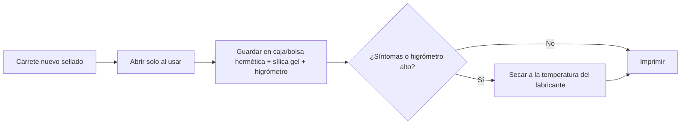

# Secado y almacenamiento de filamento

Parte de: [[36-Impresion-3D/03 Materiales/_Índice Materiales|Materiales]]

> [!info] Cómo avanzar
> `progreso`: **pendiente** → **viendo** (estudiando) → **visto** (contestaste la autoevaluación sin abrir las respuestas) → **dominado** (hiciste el laboratorio o lo aplicaste de verdad).

## Contenido

### Qué es
Muchos filamentos son **higroscópicos**: absorben humedad del aire. El agua dentro del filamento hierve al pasar por la boquilla caliente y arruina la impresión. **Almacenar** bien evita que se humedezca; **secar** quita la humedad que ya absorbió.

### Cómo funciona
**Síntomas de filamento húmedo:**
- Chasquidos o pequeños "pops" al extruir.
- Burbujas y superficie áspera.
- Muchos **hilos** aunque la retracción esté bien.
- Piezas frágiles, capas que se separan.
- En PLA viejo, filamento que se rompe solo en el carrete.

**Sensibilidad por material** (de más a menos): nylon y TPU → PETG y PC → ABS/ASA → PLA. En lugares húmedos (costas, temporada de lluvias) el problema llega antes.

**Almacenamiento sin secador:**
- Bolsas con cierre hermético o cajas de plástico con tapa y empaque.
- **Sílica gel**, idealmente con indicador de color (cambia cuando se satura; se regenera calentándola según su instrucción).
- Un **higrómetro** barato dentro de la caja: apunta a humedad relativa baja (por ejemplo, menos de ~20–30 % para materiales sensibles; mientras más baja, mejor).
- Saca solo el carrete que vas a usar. Los que quedan en el CANVAS días sin usar también toman humedad del cuarto.

**Temperaturas orientativas de secado** (siempre revisa lo que indica el fabricante del filamento):

| Material | Temperatura | Tiempo típico |
|---|---|---|
| PLA | 45–55 °C | 4–8 h |
| PETG | 60–65 °C | 4–8 h |
| TPU | 50–60 °C | 4–8 h |
| ABS / ASA | 60–80 °C | 4–8 h |
| Nylon / PC | 70–80 °C o más | 8–12 h |

El límite del PLA es importante: se ablanda alrededor de 55–60 °C, así que pasarse puede deformar el filamento o el carrete.

### Ejemplo
Abriste un PETG hace un mes y ahora salen hilos por todos lados. Lo secas a 65 °C durante 6 h en un [[Secador de filamento]], lo guardas después en caja con sílica gel y repites la impresión: los hilos casi desaparecen. Anotas en tu perfil "secar antes de usar".

### ¿Horno de cocina?
**Riesgoso.** Muchos hornos no son precisos a 45–65 °C (su mínimo suele ser más alto o oscila mucho), pueden pasarse y deformar el filamento y el carrete de plástico (sobre todo PLA). Además, un horno donde se cocina no es lugar para plásticos. Si lo intentas, usa termómetro independiente, nunca lo dejes sin vigilancia y no uses el horno para PLA. Un secador es más seguro y repetible.

### Cuándo secar
- TPU y nylon: **siempre** antes de imprimir.
- PETG: si estuvo abierto días o semanas.
- PLA: cuando hay síntomas o vives en clima húmedo.

### Errores comunes
1. **Calibrar con filamento húmedo.** Elegirás mal temperatura y retracción.
2. **Secar PLA a 70 °C.** Se deforma el carrete y el filamento se pega.
3. **Sílica gel saturada.** Sin indicador no sabes si ya no sirve.
4. **Secar y dejar el carrete al aire otra semana.** Vuelve a humedecerse.

### Para profundizar
- Laboratorio: [[Lab 6 - Secado de filamento casero vs secador]]
- Relacionado: [[Stringing (hilos) en FDM]] y [[Secador de filamento]]
- [OrcaSlicer wiki: centro de solución de problemas](https://www.orcaslicer.com/wiki/general_settings/troubleshoot_center)

## Autoevaluación

Contesta primero en voz alta o en papel; luego despliega la respuesta.

> [!question]- ¿Por qué se humedece el filamento?
> Muchos plásticos son **higroscópicos**: absorben humedad del aire. Al imprimir, el agua hierve en la boquilla: chasquidos, burbujas, hilos, superficies ásperas y piezas frágiles. TPU, nylon y PETG son muy sensibles; PLA, menos.

> [!question]- ¿Cómo guardarlo sin comprar secador?
> En bolsas herméticas o cajas con tapa y empaque, con **sílica gel** (ideal con indicador de color) y, si puedes, un higrómetro barato adentro. Saca solo el carrete que vas a usar.

> [!question]- ¿Se puede secar en el horno de la cocina?
> Riesgoso: muchos hornos no son precisos a 45–65 °C y se pasan, deformando el filamento y el carrete (sobre todo PLA, que se ablanda ~55–60 °C). Si lo intentas, usa termómetro de horno y nunca sin vigilancia. Un secador de filamento es más seguro y repetible.

> [!question]- Temperaturas orientativas de secado
> PLA ≈45–55 °C, PETG ≈60–65 °C, TPU ≈50–60 °C, 4–8 h. Revisa siempre lo que indica el fabricante del filamento.

## Práctica

- [[Lab 6 - Secado de filamento casero vs secador]]

