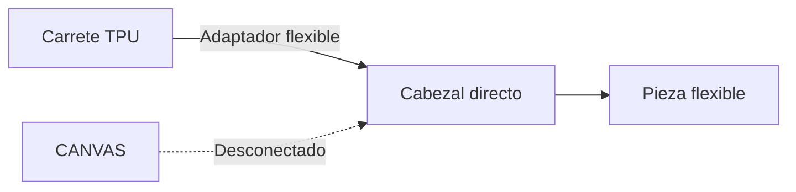

# TPU (filamento flexible)

Parte de: [[36-Impresion-3D/03 Materiales/_Índice Materiales|Materiales]]

> [!info] Cómo avanzar
> `progreso`: **pendiente** → **viendo** (estudiando) → **visto** (contestaste la autoevaluación sin abrir las respuestas) → **dominado** (hiciste el laboratorio o lo aplicaste de verdad).

## Contenido

### Qué es
El **TPU** (poliuretano termoplástico) es un filamento **elástico**: las piezas se doblan, se estiran y regresan a su forma. Su dureza se mide en escala Shore; el más común para FDM es **95A** (flexible pero firme, como una funda de teléfono). Hay versiones más blandas (85A, 90A) que son más difíciles de imprimir.

Usos típicos: fundas para el iPhone 15 Pro, pies antiderrapantes, protectores para el DJI Mini 4K, juntas, correas, llantas para modelos, amortiguadores.

### Cómo funciona
El problema del TPU es que es **blando**: si lo empujas rápido, en lugar de avanzar se comprime y se dobla, como empujar un fideo cocido. Por eso:
- Se imprime **lento**: flujo volumétrico bajo, por ejemplo 3–5 mm³/s como punto de partida (el fabricante puede indicar otro).
- Se beneficia de un **extrusor directo** con camino corto y guiado, como el de tu impresora.
- Usa **retracción mínima o nula**: retraer y empujar un material elástico causa atascos.
- **Ventilador** bajo a medio.
- **Temperaturas orientativas**: boquilla ≈210–240 °C, cama ≈30–60 °C (consulta la ficha del fabricante del filamento).
- Es **muy higroscópico**: húmedo hace burbujas, hilos y superficies ásperas. Sécalo antes.

**En tu Centauri 2 Combo.** Elegoo indica que el TPU está soportado de forma nativa, pero **no** pasa por el CANVAS: se instala el **Flexible Filament Adapter** y se **desconecta el cable del CANVAS** antes de imprimir; el filamento entra directo al cabezal. Según Elegoo, el modelo y la guía del adaptador vienen en la USB incluida; sigue ese procedimiento exacto.

### Ejemplo
Una funda para tu DJI Mic Mini 2:
1. Seca el TPU (≈50–60 °C, 4–8 h o lo que indique el fabricante).
2. Desconecta el CANVAS y monta el adaptador según la guía.
3. En el laminador elige el perfil de TPU 95A para Centauri 2 (ElegooSlicer y OrcaSlicer traen uno de Elegoo como base).
4. 2–3 paredes; relleno *gyroid* 15–20 % (menos relleno = más blanda).
5. Imprime y vigila la primera capa; el TPU pega fuerte a PEI, usa la cara texturizada o pegamento en barra como separador si la ficha lo recomienda.

### Cuándo usarlo y cuándo no
- **Sí**: piezas que deben amortiguar, sujetar con fricción, doblarse o proteger.
- **No**: piezas rígidas, multicolor con el CANVAS, piezas con muchos viajes y retracciones (hilos).

### Errores comunes
1. **Imprimir TPU rápido "como PLA".** El filamento se dobla en el extrusor y se atasca. Baja velocidad y flujo; parte del perfil de TPU del laminador.
2. **Pasar TPU por el CANVAS.** No está soportado; se atora en el sistema.
3. **Retracción de PLA.** Provoca atascos; usa la mínima del perfil.
4. **Filamento húmedo.** Burbujas y superficie fea; sécalo siempre.
5. **Olvidar reconectar el CANVAS** y quitar el adaptador cuando vuelvas a PLA multicolor (sigue el manual).

### Para profundizar
- [Centauri 2 Combo — página oficial (nota sobre TPU)](https://us.elegoo.com/products/centauri-2-combo)
- [Centauri 2 — página oficial](https://us.elegoo.com/products/centauri-2)
- [OrcaSlicer wiki: calibración de velocidad volumétrica máxima](https://www.orcaslicer.com/wiki/calibration/volumetric_speed_calib)

## Autoevaluación

Contesta primero en voz alta o en papel; luego despliega la respuesta.

> [!question]- ¿Qué es el TPU y para qué sirve?
> Elastómero flexible (dureza típica 95A): fundas de teléfono, pies antiderrapantes, juntas, llantas para modelos.

> [!question]- ¿Cómo se imprime TPU en la Centauri 2 Combo?
> Elegoo indica que la Centauri 2 soporta TPU de forma nativa, pero en la Combo se instala el **Flexible Filament Adapter** (modelo y guía en la USB incluida) y se **desconecta el cable del CANVAS**: el TPU **no** pasa por el CANVAS.

> [!question]- ¿Qué ajustes cambian respecto a PLA?
> Velocidad baja (flujo volumétrico bajo, p. ej. 3–5 mm³/s como punto de partida), retracción mínima o nula, ventilador medio, filamento muy seco (es higroscópico).

> [!question]- Error común: imprimir TPU rápido «como PLA».
> El filamento blando se dobla en el extrusor y se atasca. Baja velocidad y flujo; si el laminador tiene perfil de TPU, úsalo de base.

