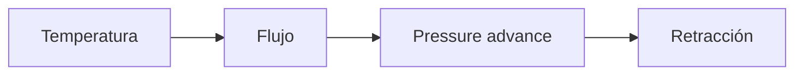

# Calibración de flujo y pressure advance

Parte de: [[36-Impresion-3D/04 Calibración y calidad/_Índice Calibración y calidad|Calibración y calidad]]

> [!info] Cómo avanzar
> `progreso`: **pendiente** → **viendo** (estudiando) → **visto** (contestaste la autoevaluación sin abrir las respuestas) → **dominado** (hiciste el laboratorio o lo aplicaste de verdad).

## Contenido

### Qué es
Dos calibraciones por filamento que afinan **cuánto** plástico sale y **cuándo**:
- **Flujo** (*flow ratio*): un multiplicador de la cantidad que extruye el laminador. 1.0 = lo calculado; 0.95 = 5 % menos.
- **Pressure advance** (PA): compensa el retraso de presión dentro de la boquilla al acelerar y frenar.

### Cómo funciona
**Flujo.** Cada filamento varía un poco en diámetro y en cómo se comprime. Si el flujo es bajo, quedan huecos entre líneas y paredes débiles; si es alto, las caras superiores se ven sobrecargadas, las esquinas abultadas y las medidas crecen.

**Pressure advance.** El plástico fundido se comporta como un resorte: cuando el cabezal acelera, la presión tarda en subir y la línea sale flaca; cuando frena, sigue saliendo plástico y se forma un bulto. PA empuja un poco **antes** de acelerar y alivia **antes** de frenar. Sin él: esquinas abultadas, inicios de línea flacos, costuras feas.

**E-steps vs. flujo.** Los *e-steps* (pasos del motor del extrusor por mm) son de la **máquina** y normalmente vienen bien de fábrica; en esta impresora con firmware propio, editarlos está (Pendiente de confirmar). Lo que tú calibras por **material** es el flujo en el laminador. Aun así conviene entender el cálculo:

```text
Marcas 120 mm, pides extruir 100 mm, quedan 23 mm de la marca a la entrada:
extruido real = 120 − 23 = 97 mm
e-steps nuevos = e-steps actuales × pedido / real = 400 × 100 / 97 ≈ 412.4
```

**Flujo con una pared.** Imprimes un cubo de una sola pared (ancho 0.42 mm, flujo 0.98) y mides 0.46 mm:
```text
flujo nuevo = flujo actual × ancho esperado / ancho medido = 0.98 × 0.42 / 0.46 ≈ 0.895
```
Mide con calibrador en varios puntos, lejos de la costura.

**Herramientas del laminador** (menú **Calibración** en ElegooSlicer y OrcaSlicer):
- **Flow ratio**. El método recomendado actual de OrcaSlicer es *YOLO*: un solo juego de bloques con modificadores aditivos (por ejemplo −0.05 a +0.05) y la fórmula `flujo anterior ± modificador`. El método clásico de **2 pasadas** usa modificadores en porcentaje y la fórmula `flujo anterior × (100 + modificador) / 100`. Ejemplo del método clásico: el mejor bloque es el **−5** sobre 0.98 → `0.98 × 95 / 100 = 0.931`. Elige el bloque con la cara superior más lisa y sin huecos.
- **Pressure advance**: torre, patrón o líneas. En una torre de PA de 0 a 0.1 con incremento de 0.002 por mm de altura:
```text
PA = inicio + incremento × altura = 0 + 0.002 × 18 mm = 0.036
```



### Ejemplo
Con tu PLA nuevo ya calibrado en temperatura: corres **Flow ratio → YOLO**, eliges el bloque +0.01 sobre 0.98 → guardas 0.99. Luego **Pressure advance → torre**, ves las esquinas más limpias a cierta altura, calculas el valor y lo guardas en el perfil del filamento. Si el CANVAS tiene cuatro filamentos distintos, cada uno lleva su propio perfil.

### Cuándo hacerlo
- Con cada filamento nuevo, después de la [[Torre de temperatura]].
- Si cambias de boquilla.
- Si aparecen síntomas de [[Subextrusión y sobreextrusión en FDM]].
- Si la impresora hace calibración automática de flujo o PA, revisa si tu ajuste manual se suma o se reemplaza (Pendiente de confirmar en el manual).

### Errores comunes
1. **Calibrar flujo antes de temperatura.** Cada uno afecta al otro; sigue el orden.
2. **Mezclar fórmulas.** YOLO suma; el método clásico multiplica por porcentaje.
3. **Medir sobre la costura.** Da un ancho mayor del real.
4. **Usar el flujo para "arreglar" tolerancias.** Para eso está la compensación XY: ver [[Prueba de tolerancias]].
5. **Olvidar guardar el perfil.**

### Para profundizar
- [OrcaSlicer wiki: calibración de flujo](https://www.orcaslicer.com/wiki/calibration/flow_ratio_calib)
- [OrcaSlicer wiki: calibración de pressure advance](https://www.orcaslicer.com/wiki/calibration/pressure_advance_calib)
- [OrcaSlicer wiki: guía de calibración](https://www.orcaslicer.com/wiki/guides/calibration_guide.html)

## Ejercicios

Resuélvelos en papel o en la herramienta; la solución está plegada.

> [!question]- Mides cuánto filamento entra: marcas 120 mm, pides extruir 100 mm y quedan 23 mm de la marca a la entrada. E-steps actuales: 400. ¿Nuevos e-steps?
> Extruyó 120 − 23 = 97 mm. Nuevo = 400 × 100 / 97 ≈ **412.4 pasos/mm**. (Ejercicio conceptual: comprueba si tu firmware permite cambiarlo; si no, corrige con el flujo.)

> [!question]- Imprimes un cubo de una sola pared con ancho de línea 0.42 mm y flujo 0.98; mides 0.46 mm. ¿Nuevo flujo?
> Nuevo = 0.98 × 0.42 / 0.46 ≈ **0.895**. (Requiere calibrador; mide en varias caras y promedia.)

> [!question]- En la prueba de flujo de Orca (paso 1) el mejor bloque es el «−5» sobre un flujo base de 0.98. ¿Nuevo flujo?
> En Orca el modificador es porcentual: 0.98 × (100 − 5)/100 = **0.931**. Revisa la fórmula exacta que muestre tu versión del laminador.

> [!question]- En la torre de pressure advance de 0 a 0.1 con incremento 0.002 por mm de altura, las mejores esquinas están a 18 mm. ¿Valor de PA?
> 0 + 18 × 0.002 = **0.036**.

## Autoevaluación

Contesta primero en voz alta o en papel; luego despliega la respuesta.

> [!question]- ¿Qué es el flujo (flow ratio)?
> Un multiplicador de cuánto plástico extruye el laminador. Si es bajo, hay huecos; si es alto, las caras superiores se ven sobrecargadas y las medidas crecen.

> [!question]- ¿Qué es pressure advance?
> Compensa el retraso de presión dentro de la boquilla: empuja un poco antes de acelerar y alivia antes de frenar. Sin él, las esquinas salen abultadas y los inicios de línea flacos.

> [!question]- ¿E-steps o flujo?
> Los *e-steps* (pasos del motor del extrusor por mm) son de la máquina y normalmente vienen bien de fábrica; en esta impresora con firmware propio, editarlos está (Pendiente de confirmar). Lo que tú calibras por material es el **flow ratio** en el laminador.

> [!question]- ¿Con qué herramientas se hace en OrcaSlicer/ElegooSlicer?
> Menú **Calibración**: *Flow rate* (bloques con distinto flujo; eliges el más liso), *Pressure advance* (torre, líneas o patrón; eliges el valor con esquinas más limpias). Se repite por cada filamento distinto.

## Práctica

- [[Lab 3 - Prueba de flujo y pressure advance]]

