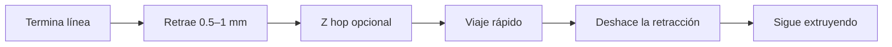

# Calibración de retracción

Parte de: [[36-Impresion-3D/04 Calibración y calidad/_Índice Calibración y calidad|Calibración y calidad]]

> [!info] Cómo avanzar
> `progreso`: **pendiente** → **viendo** (estudiando) → **visto** (contestaste la autoevaluación sin abrir las respuestas) → **dominado** (hiciste el laboratorio o lo aplicaste de verdad).

## Contenido

### Qué es
La **retracción** es jalar el filamento un poco hacia atrás justo antes de que la boquilla viaje sin extruir (de una isla de la pieza a otra). Al bajar la presión dentro de la boquilla, deja de gotear y no se forman **hilos** durante el viaje. Al llegar, el filamento se vuelve a empujar y sigue la impresión.

### Cómo funciona
Se configura sobre todo con dos valores:
- **Longitud**: cuántos mm se retrae. En extrusor directo, como el de tu Centauri 2, suele ser poca (≈0.5–1 mm). En Bowden se necesitan varios mm.
- **Velocidad**: qué tan rápido se retrae (por ejemplo 30–40 mm/s).

Ajustes relacionados en ElegooSlicer/OrcaSlicer:
- **Z hop**: levanta la boquilla al viajar para no rozar la pieza.
- **Wipe**: la boquilla "limpia" sobre la pieza al terminar una línea.
- **Retracción mínima de viaje**: no retrae en viajes muy cortos.
- **Combing / evitar cruzar paredes**: viaja por dentro de la pieza para que los hilos queden ocultos.

**¿Más retracción siempre es mejor?** No. Demasiada longitud puede:
- Dejar **huecos** al reanudar (el plástico tarda en volver a llenar la boquilla).
- Provocar **atascos**: el filamento blando sube hasta la zona fría del *heatbreak*, se enfría ahí y forma un tapón.
- Moler el filamento con los engranes si retraes muchas veces en el mismo punto.

**La calibración.** El menú **Calibración → Retracción** genera una torre en la que la longitud de retracción aumenta con la altura (por ejemplo de 0 a 2 mm). Buscas la altura más baja en la que ya casi no hay hilos y calculas el valor; el laminador te indica el incremento por mm.

### Ejemplo
Tu PETG deja hilos entre dos columnas. Antes de tocar la retracción, confirmas lo básico: filamento seco y temperatura de la torre. Luego corres la torre de retracción de 0 a 2 mm con pasos de 0.1 mm por cada mm de altura; los hilos desaparecen a los 8 mm de altura → 0.8 mm de retracción. Lo guardas en el perfil del filamento (no en el de la impresora), porque PETG y PLA quieren valores distintos.

### Cuándo calibrarla
- Después de temperatura, flujo y pressure advance (estos últimos también reducen goteo).
- Con materiales que dejan hilos: PETG, TPU (aunque en TPU se usa muy poca), Silk.
- Si cambias de boquilla o de hotend.

### Hilos con la retracción ya calibrada
Las causas más comunes son otras:
1. **Temperatura demasiado alta** → baja 5 °C o repite la [[Torre de temperatura]].
2. **Filamento húmedo** → [[Secado y almacenamiento de filamento]].
3. Viajes largos sobre huecos → activa evitar cruzar paredes, reorienta o agrupa piezas.

### Errores comunes
1. **Subir la retracción a 5 mm** en extrusor directo "porque así decía un video de Bowden": atascos.
2. **Calibrar con filamento húmedo**: ningún valor funciona.
3. **Ponerla en el perfil de impresora** para todos los materiales: cada filamento necesita la suya.
4. **Retracción alta en TPU**: el material elástico se comprime y se atora.

### Para profundizar
- [OrcaSlicer wiki: calibración de retracción](https://www.orcaslicer.com/wiki/calibration/retraction_calib)
- [OrcaSlicer wiki: ajustes de retracción del extrusor](https://www.orcaslicer.com/wiki/printer_settings/extruder/printer_extruder_retraction)
- Relacionado: [[Stringing (hilos) en FDM]]

## Autoevaluación

Contesta primero en voz alta o en papel; luego despliega la respuesta.

> [!question]- ¿Qué es la retracción?
> Jalar un poco el filamento hacia atrás antes de un movimiento sin extruir, para que no gotee y deje hilos.

> [!question]- ¿Más retracción siempre es mejor?
> No. Demasiada puede crear huecos al reanudar o atascos (el plástico blando sube al *heatbreak*). En extrusor directo suele ser poca (≈0.5–1 mm).

> [!question]- Hay hilos aunque la retracción esté calibrada, ¿qué más revisas?
> Temperatura muy alta y filamento húmedo, que son las causas más comunes.

