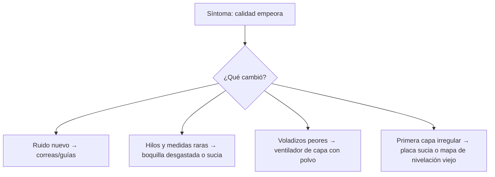

# Mantenimiento de la impresora 3D

Parte de: [[36-Impresion-3D/04 Calibración y calidad/_Índice Calibración y calidad|Calibración y calidad]]

> [!info] Cómo avanzar
> `progreso`: **pendiente** → **viendo** (estudiando) → **visto** (contestaste la autoevaluación sin abrir las respuestas) → **dominado** (hiciste el laboratorio o lo aplicaste de verdad).

## Contenido

### Qué es
El **mantenimiento** son las revisiones y limpiezas periódicas que mantienen la impresora precisa y confiable. Una CoreXY rápida como la Centauri 2 mueve el cabezal a gran aceleración durante cientos de horas: el polvo, los restos de plástico y el desgaste se acumulan. Unos minutos de mantenimiento evitan fallas a mitad de una impresión de 10 horas.

### Cómo funciona: rutina sugerida
La frecuencia exacta y los procedimientos están en el manual de Elegoo; esta es una guía general para organizarte.

| Frecuencia | Tarea |
|---|---|
| Cada impresión | Revisar que la placa esté limpia; quitar restos de purga y de la boquilla |
| Cada semana o ~50 h | Lavar la placa con agua y jabón; limpiar el limpiador de silicona de la boquilla y la zona de purga; quitar restos de purga y filamento alrededor de la impresora |
| Cada mes o ~200 h | Revisar tensión de correas (sonido y holgura), limpiar polvo de guías y ventiladores (hotend y capa), revisar el cortador de filamento y los tubos del CANVAS |
| Según el fabricante | Lubricar guías con el producto indicado (Pendiente de confirmar en el manual) |
| Cuando salga versión estable | Actualizar firmware y laminador |

**Boquilla.** Según el perfil de OrcaSlicer la tuya es de acero endurecido (Pendiente de confirmar en la ficha), que resiste mucho mejor que el latón los filamentos abrasivos (fibra de carbono, glow, madera). Aun así se desgasta o se tapa. Cámbiala cuando:
- La calidad empeora sin otra causa (más hilos, medidas que crecen, líneas irregulares).
- Hay un atasco que no se quita con el procedimiento normal.
Hazlo siguiendo el procedimiento del manual (temperatura indicada, herramienta correcta). La Centauri 2 tiene una cubierta magnética en el cabezal pensada para cambiar la boquilla rápido; hazlo con la boquilla fría o según el procedimiento del manual.

**Firmware.** Las actualizaciones corrigen errores y a veces mejoran calibraciones. Lee las notas de versión, no actualices a mitad de un proyecto importante y no apagues durante la actualización.

### Ejemplo
Llevas un mes imprimiendo PETG y notas un zumbido nuevo y ondulaciones en las paredes. Revisas: el ventilador de capa tiene pelusa, una correa suena distinta a la otra al pulsarla. Limpias con brocha suave y aire, ajustas la tensión según el procedimiento del manual y la siguiente impresión sale bien. Anotas la fecha en una nota de bitácora en Obsidian.

### Cuándo hacer mantenimiento extra
- Tras imprimir mucho material abrasivo o con partículas.
- Después de un atasco o de un "espagueti" (pieza despegada que enreda el cabezal).
- Si moviste la impresora de lugar.

### Errores comunes
1. **Lubricar guías con aceite de cocina o WD-40.** El aceite de cocina se pone rancio y pegajoso; el WD-40 es más limpiador que lubricante. Usa solo el producto que indique Elegoo y en poca cantidad: el exceso atrae polvo.
2. **Limpiar la boquilla caliente con los dedos o un trapo.** Usa pinzas metálicas o cepillo de latón con cuidado.
3. **Apretar correas "lo más posible".** Demasiada tensión desgasta rodamientos y motores.
4. **Ignorar el ventilador del hotend.** Con polvo enfría peor el heatbreak y aparecen atascos.
5. **Desarmar sin apagar y desconectar.**

### Para profundizar
- [Centauri 2 — página oficial (cambio rápido de boquilla, limpiador)](https://us.elegoo.com/products/centauri-2)
- [Centauri 2 Combo — página oficial](https://us.elegoo.com/products/centauri-2-combo)
- Relacionado: [[Atascos de boquilla en FDM]] y [[Desplazamiento de capas en FDM]]

## Autoevaluación

Contesta primero en voz alta o en papel; luego despliega la respuesta.

> [!question]- ¿Qué mantenimiento básico necesita?
> Limpiar la placa, limpiar restos del cabezal y del limpiador de boquilla, revisar tensión de correas, quitar polvo de guías y ventiladores, y actualizar firmware cuando sea estable.

> [!question]- ¿Cada cuándo cambias la boquilla?
> Cuando haya desgaste (hilos y medidas que empeoran) o atasco que no se quite. La Centauri 2 tiene cubierta magnética para cambiarla rápido; hazlo con la boquilla fría o según el procedimiento del manual.

> [!question]- Error común: lubricar guías con aceite de cocina o WD-40 sin revisar.
> Usa solo el lubricante que indique el fabricante (Pendiente de confirmar) y poco; el exceso atrae polvo.

