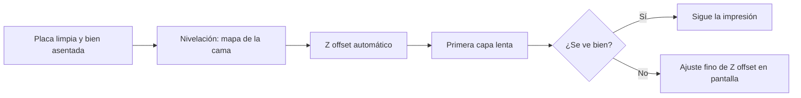

# Primera capa y calibración automática

Parte de: [[36-Impresion-3D/04 Calibración y calidad/_Índice Calibración y calidad|Calibración y calidad]]

> [!info] Cómo avanzar
> `progreso`: **pendiente** → **viendo** (estudiando) → **visto** (contestaste la autoevaluación sin abrir las respuestas) → **dominado** (hiciste el laboratorio o lo aplicaste de verdad).

## Contenido

### Qué es
La **primera capa** es la base de toda la impresión: si no pega bien o queda mal aplastada, todo lo demás falla. Para lograrla, la boquilla debe estar a la **altura correcta** sobre la cama en todos los puntos. Tu Centauri 2 lo hace sola con **nivelación automática** y **Z offset automático**.

### Cómo funciona
**Qué calibra sola la Centauri 2** (según Elegoo):
- **Nivelación automática de 4 puntos** o **nivelación parcial**: mide solo la zona donde va la pieza para ahorrar tiempo.
- **Z offset automático**: mide la distancia real entre la boquilla y la cama, que es lo que más afecta la primera capa.
- Autoprueba de ventiladores y revisión de sensores al iniciar.
- Otras calibraciones automáticas (flujo, resonancias / input shaping): (Pendiente de confirmar en el manual y la pantalla).

La nivelación no hace que la cama quede perfectamente plana: crea un **mapa** de alturas y el firmware sube o baja Z mientras imprime para seguir la forma real de la cama.

**Cómo se ve una primera capa correcta:**
- Líneas **ligeramente aplastadas** que se tocan entre sí, sin huecos.
- Superficie uniforme y mate (o brillante en la cara lisa) sin crestas.
- Esquinas pegadas.

| Síntoma | Causa | Qué hacer |
|---|---|---|
| Líneas redondas separadas, se despegan | Boquilla muy **alta** | Bajar Z offset fino (valores pequeños, p. ej. 0.01–0.02 mm) |
| Crestas, superficie rugosa, zonas transparentes o raspadas | Boquilla muy **baja** | Subir Z offset fino |
| Falla solo en una zona | Grasa, basura bajo la placa o mapa viejo | Limpiar, revisar asiento, renivelar |

### Ejemplo
Tu primera impresión en la Centauri 2: lavas la placa con agua y jabón, la colocas por la cara lisa tomándola de los bordes, revisas que no haya restos de plástico debajo, eliges un cuadro de prueba de primera capa en el laminador y activas la nivelación antes de imprimir. Observas de cerca: las líneas se ven unidas y planas. Si en la esquina trasera izquierda se ven separadas, limpias esa zona, reasientas la placa y repites; si persiste, ajustas el Z offset fino desde la pantalla durante la primera capa.

### Cuándo renivelar
- Después de mover la impresora o cambiar la placa.
- Si cambias de boquilla.
- Si una zona empieza a fallar.
- La nivelación parcial antes de cada impresión es lo más cómodo; no cuesta casi tiempo.

### Errores comunes
1. **Tocar la placa con los dedos tras lavarla.** La grasa hace que la pieza se despegue justo ahí. Tómala de los bordes.
2. **Restos de plástico debajo de la placa magnética.** La levantan en un punto; el mapa no lo compensa bien.
3. **Corregir con temperatura o pegamento** lo que es un problema de altura.
4. **Ajustes grandes de Z offset.** Cambios de 0.1 mm son enormes; ve de 0.01 en 0.01.
5. **No mirar la primera capa.** Es el momento de mayor riesgo: quédate a verla.

### Para profundizar
- [Centauri 2 — especificaciones (nivelación y Z offset)](https://us.elegoo.com/products/centauri-2)
- [OrcaSlicer wiki: guía de calibración](https://www.orcaslicer.com/wiki/guides/calibration_guide.html)
- Laboratorio: [[Lab 1 - Primera impresión y revisión de calibración automática en Centauri 2]]

## Autoevaluación

Contesta primero en voz alta o en papel; luego despliega la respuesta.

> [!question]- ¿Qué calibra sola la Centauri 2?
> Según Elegoo: nivelación automática (4 puntos o solo del área de impresión) y **Z offset automático** (altura de la boquilla respecto a la cama). Qué otras calibraciones automáticas hace (flujo, resonancias) está (Pendiente de confirmar); revisa la pantalla y el manual.

> [!question]- ¿Cómo se ve una primera capa correcta?
> Líneas ligeramente aplastadas que se tocan entre sí sin huecos, superficie uniforme y sin crestas. Si ves líneas redondas separadas: boquilla muy alta. Si ves crestas o raspones transparentes: muy baja.

> [!question]- La primera capa falla solo en una esquina, ¿qué revisas?
> Limpieza de la placa en esa zona, que la placa esté bien asentada (sin basura debajo) y repetir la nivelación. Si persiste, ajuste fino del Z offset desde la pantalla durante la primera capa.

> [!question]- Error común: tocar la placa con los dedos tras lavarla.
> Deja grasa y la pieza se despega justo ahí. Tómala de los bordes.

## Práctica

- [[Lab 1 - Primera impresión y revisión de calibración automática en Centauri 2]]

