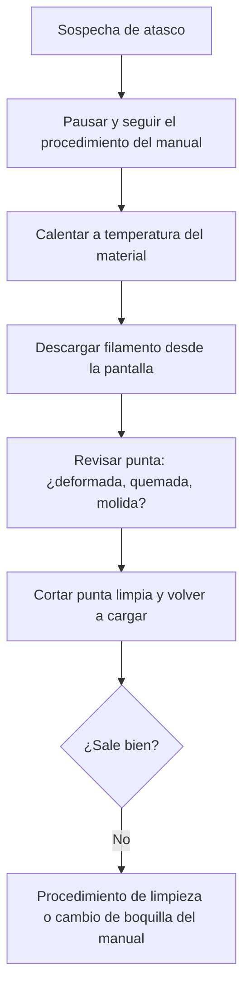

# Atascos de boquilla en FDM

Parte de: [[Problemas comunes de impresión FDM]]

> [!info] Cómo avanzar
> `progreso`: **pendiente** → **viendo** (estudiando) → **visto** (contestaste la autoevaluación sin abrir las respuestas) → **dominado** (hiciste el laboratorio o lo aplicaste de verdad).

## Contenido

### Qué es
Un **atasco** (*clog*) es cuando el plástico ya no puede salir (o sale muy poco) por la boquilla. Puede ser total (no sale nada) o parcial (sale delgado e irregular). Es una de las fallas más molestas porque arruina la impresión y, si no se atiende bien, puede dañar piezas del hotend.

### Cómo funciona
**Cómo se nota:**
- Deja de salir plástico o sale muy delgado.
- El extrusor hace **clics** o salta (los engranes no pueden empujar).
- Filamento "mordido" o molido en el extrusor.
- Tu Centauri 2 tiene **detección de atasco** y puede pausar y avisar.

**Causas comunes:**

| Causa | Por qué |
|---|---|
| Temperatura demasiado baja | El plástico no funde lo suficiente para la velocidad |
| *Heat creep* | El calor sube por el *heatbreak*; el filamento se ablanda arriba y se atora. Ventilador del hotend sucio, cuarto muy caliente, retracciones muy largas |
| Partículas | Filamentos con madera, glitter, glow o fibra en boquillas finas (0.2 mm) |
| Retracción excesiva | Jala plástico blando a la zona fría |
| Polvo y suciedad | El filamento arrastra polvo; carretes de cartón sueltan fibras |
| Material equivocado | Restos de un material de alta temperatura que no funden a la temperatura del siguiente |

### Primer paso seguro
Sigue el procedimiento del manual de Elegoo: **calentar**, **descargar** el filamento desde la pantalla (la impresora tiene descarga automática) y revisar la punta. Muchas veces basta cortar la punta dañada y cargar de nuevo. Si no, el manual indica cómo limpiar o cambiar la boquilla. **No** metas agujas u objetos metálicos con la boquilla caliente sin guantes y protección, y no desarmes el hotend caliente si el manual no lo indica.

### Ejemplo
Imprimiendo PLA en verano en un cuarto caluroso, a las 3 horas el extrusor empieza a hacer clics y la impresora avisa de atasco. Descargas el filamento: la punta tiene un "bulbo" ensanchado, síntoma típico de *heat creep*. Cortas, limpias el polvo del ventilador del hotend, recargas, ventilas el cuarto y relanzas la impresión. No vuelve a pasar.

### Cuándo prevenir
- Con filamentos abrasivos o con partículas: boquilla 0.4 mm o mayor.
- Con PLA en cuartos muy calurosos: ventila y revisa el ventilador del hotend.
- Al cambiar de un material de alta temperatura a uno de baja: purga bien a la temperatura alta primero.
- Mantén limpio el ventilador del hotend: [[Mantenimiento de la impresora 3D]].

### Errores comunes
1. **Forzar el filamento a mano** con la boquilla fría.
2. **Subir la temperatura al máximo** para "derretir" el atasco: puede carbonizar el plástico y empeorarlo.
3. **Ignorar los clics** del extrusor y dejar seguir la impresión.
4. **Boquilla de 0.2 mm con glitter o madera.**
5. **Retracción de Bowden en extrusor directo.**

### Para profundizar
- [Centauri 2 Combo — página oficial (sensores)](https://us.elegoo.com/products/centauri-2-combo)
- [OrcaSlicer wiki: ajustes de retracción](https://www.orcaslicer.com/wiki/printer_settings/extruder/printer_extruder_retraction)
- Relacionado: [[Filamentos especiales (seda, mate, madera y brillo)]] y [[Calibración de retracción]]

## Autoevaluación

Contesta primero en voz alta o en papel; luego despliega la respuesta.

> [!question]- ¿Cómo se nota un atasco?
> Deja de salir plástico, el extrusor hace clics o salta. La Centauri 2 tiene **detección de atasco**.

> [!question]- ¿Causas comunes?
> Temperatura demasiado baja, *heat creep* (calor que sube por el heatbreak), filamento con partículas en boquilla fina, retracción excesiva o polvo en el filamento.

> [!question]- Primer paso seguro ante un atasco
> Sigue el procedimiento del manual: calentar, descargar el filamento y revisar. No metas objetos metálicos con la boquilla caliente sin guantes y protección.

