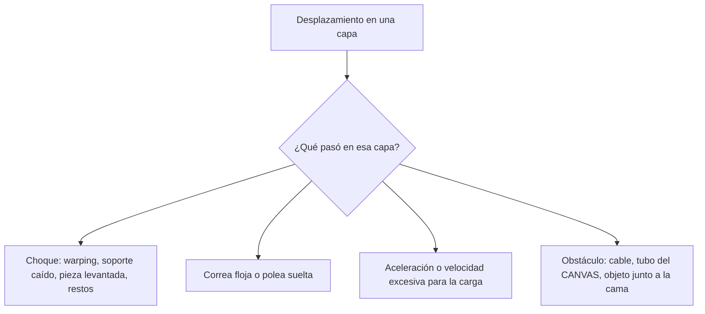

# Desplazamiento de capas en FDM

Parte de: [[Problemas comunes de impresión FDM]]

> [!info] Cómo avanzar
> `progreso`: **pendiente** → **viendo** (estudiando) → **visto** (contestaste la autoevaluación sin abrir las respuestas) → **dominado** (hiciste el laboratorio o lo aplicaste de verdad).

## Contenido

### Qué es
El **desplazamiento de capas** (*layer shift*) es cuando, a cierta altura, toda la pieza **"se recorre"** de golpe en X o en Y: las capas de arriba quedan desfasadas respecto a las de abajo, como un pastel mal apilado. A diferencia de otras fallas, no es gradual: ocurre en una capa concreta.

### Cómo funciona
La impresora no sabe dónde está el cabezal; **cuenta pasos** de los motores. Si el cabezal no llega a donde el firmware cree (porque chocó, la correa patinó o el motor no tuvo fuerza), todas las capas siguientes se imprimen corridas por esa diferencia.

**Causas típicas:**
1. **Choque del cabezal** con algo: una esquina con warping, un soporte que se cayó, un "moco" de PETG acumulado, la pieza que se despegó un poco.
2. **Correas flojas** o una polea con el tornillo prisionero suelto.
3. **Aceleraciones excesivas** configuradas por encima de los límites del perfil de impresora.
4. **Obstáculos** en el recorrido: objetos junto a la impresora, tubos mal pasados.
5. Motores sobrecalentados (raro en equipos actuales).

### Qué revisas primero
1. **Esa capa en la vista previa y en un timelapse** si lo grabaste: ¿había warping, un soporte caído o un objeto alto?
2. **Tensión de correas**: comparando el sonido y la holgura de ambas.
3. Que nada estorbe el movimiento del cabezal.
4. Si cambiaste aceleraciones en el perfil, vuelve a las de fábrica.

### Ejemplo
Una figura de PLA sale desplazada 3 mm en Y a 4 cm de altura. Revisas el timelapse que grabaste con el iPhone: justo antes, una rama de soporte de árbol se dobló y el cabezal la golpeó. Solución: soporte de árbol con más diámetro de rama o brim en la base del soporte, y reorientar la figura para necesitar menos soporte. En otro caso, sin choque visible, encuentras que una correa suena mucho más grave que la otra: la tensas según el procedimiento del manual y el problema desaparece.

### Cómo prevenirlo
Revisa la vista previa antes de imprimir: soportes muy altos y delgados, piezas pequeñas sueltas y zonas donde la boquilla pasa muy cerca de superficies ya impresas son candidatos a choque. Mantén el área de impresión libre de objetos, revisa que los tubos del CANVAS no rocen el cabezal y no cambies los límites de aceleración del perfil de impresora sin una razón concreta.

### Cuándo esperarlo
- Piezas con warping no resuelto.
- Soportes altos y delgados.
- Después de mover o transportar la impresora.
- Si alguien tocó la máquina o la mesa durante la impresión.

### Errores comunes
1. **Bajar todas las velocidades** sin buscar el choque: la causa sigue ahí.
2. **Tensar correas "a tope"**: desgasta rodamientos; sigue el manual.
3. **Ignorar el warping**: es la causa invisible más frecuente de choques. Ver [[Warping (esquinas levantadas) en FDM]].
4. **No usar z hop** en piezas con superficies superiores irregulares: la boquilla puede rozar.

### Para profundizar
- [OrcaSlicer wiki: z hop](https://www.orcaslicer.com/wiki/printer_settings/extruder/printer_extruder_z_hop)
- [OrcaSlicer wiki: centro de solución de problemas](https://www.orcaslicer.com/wiki/general_settings/troubleshoot_center)
- Relacionado: [[Mantenimiento de la impresora 3D]] y [[Soportes (normales, árbol e interfaces)]]

## Autoevaluación

Contesta primero en voz alta o en papel; luego despliega la respuesta.

> [!question]- ¿Qué es?
> La pieza «se recorre» de golpe en X o Y a cierta altura.

> [!question]- ¿Causas típicas?
> El cabezal choca con una pieza levantada o con restos, correas flojas o aceleraciones excesivas.

> [!question]- ¿Qué revisas primero?
> Si había warping o un soporte caído en esa capa, y la tensión de las correas.

