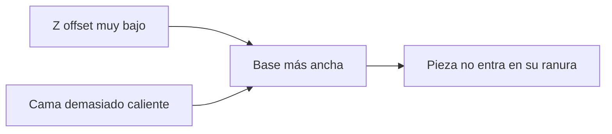

# Pata de elefante en FDM

Parte de: [[Problemas comunes de impresión FDM]]

> [!info] Cómo avanzar
> `progreso`: **pendiente** → **viendo** (estudiando) → **visto** (contestaste la autoevaluación sin abrir las respuestas) → **dominado** (hiciste el laboratorio o lo aplicaste de verdad).

## Contenido

### Qué es
La **pata de elefante** (*elephant's foot*) es cuando las primeras capas de la pieza salen **más anchas** que el resto: la base se ve "aplastada" y sobresale hacia afuera, como el pie de un elefante. Es pequeña (décimas de milímetro), pero importa mucho en piezas que encajan.

### Cómo funciona
Dos efectos se combinan:
1. **Primera capa aplastada**: para que pegue bien, la primera capa se imprime muy cerca de la cama. Si está **demasiado** cerca, el plástico no tiene a dónde ir y se extiende hacia los lados.
2. **Cama caliente**: las primeras capas quedan cerca de la cama a 60 °C (PLA) o más, se mantienen blandas, y el peso de las capas de arriba las "aplasta" un poco más.

**Soluciones**, en orden:
1. **Ajuste fino del Z offset**: sube 0.01–0.02 mm si la primera capa se ve demasiado aplastada (crestas, zonas transparentes). Ver [[Primera capa y calibración automática]].
2. **Bajar un poco la cama**, dentro del rango de la ficha del fabricante del filamento (por ejemplo, de 65 a 55–60 °C en PLA).
3. **Compensación de pata de elefante** del laminador: reduce el ancho de las primeras capas una cantidad que tú defines (por ejemplo 0.1–0.2 mm).
4. **Chaflán en el diseño**: un chaflán pequeño (0.4–0.6 mm a 45°) en el borde inferior esconde el efecto y es la solución favorita en CAD.

### Por qué importa en piezas que encajan
Imagina una tapa que entra en una ranura con 0.2 mm de holgura por lado. Si la base sale 0.25 mm más ancha por lado, ya no entra, aunque el resto de la pieza mida perfecto. También engaña al medir: si mides en la base con el calibrador, crees que toda la pieza está grande y corriges mal el flujo.

### Ejemplo
Imprimes la pieza de la [[Prueba de tolerancias]] y el perno no entra solo en los primeros milímetros. Con el calibrador mides: base 7.9 mm, a media altura 7.6 mm (lo diseñado). Diagnóstico: pata de elefante. Activas la compensación del laminador en 0.15 mm, agregas un chaflán de 0.5 mm en el diseño y vuelves a imprimir: entra completo.

### Cuándo preocuparse
- Piezas que encajan, ensambles, cajas con tapa, piezas que se apoyan en una superficie plana junto a otra.
- En figuras decorativas casi no importa.

### Errores comunes
1. **Bajar el flujo de toda la pieza** para corregir la base: arruina el resto.
2. **Medir en la base** y sacar conclusiones de toda la pieza.
3. **Compensación excesiva**: la base queda más chica y con huecos en la primera capa.
4. **Cama al máximo** "para que pegue más": más pata de elefante sin mejorar la adherencia.

### Para profundizar
- [OrcaSlicer wiki: ajustes de precisión (compensación de pata de elefante)](https://www.orcaslicer.com/wiki/print_settings/quality/quality_settings_precision)
- Relacionado: [[Calibrador digital (vernier)]] y [[Prueba de tolerancias]]
- Laboratorio: [[Lab 4 - Prueba de tolerancias con pieza que encaja]]

## Autoevaluación

Contesta primero en voz alta o en papel; luego despliega la respuesta.

> [!question]- ¿Qué es?
> Las primeras capas se ensanchan hacia fuera (base «aplastada»).

> [!question]- ¿Causas y solución?
> Boquilla muy cerca en la primera capa o cama demasiado caliente. Ajusta Z offset fino, baja un poco la cama o usa la compensación de *pata de elefante* del laminador.

> [!question]- ¿Por qué importa en piezas que encajan?
> La base queda más ancha y no entra en su ranura aunque el resto mida bien.

## Práctica

- [[Lab 4 - Prueba de tolerancias con pieza que encaja]]

