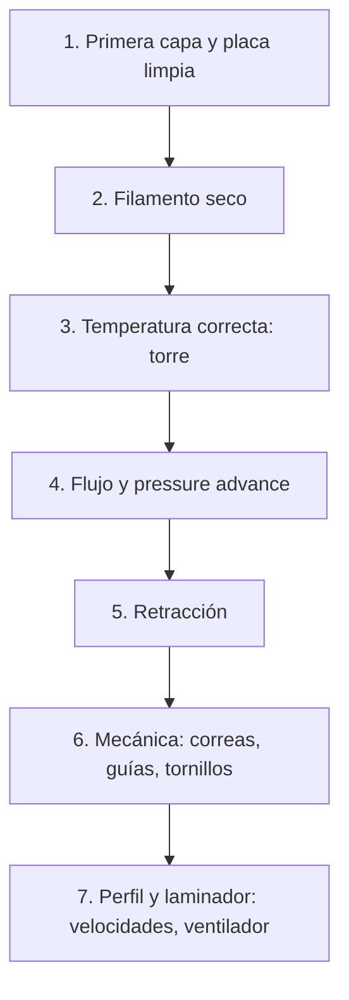

# Problemas comunes de impresión FDM

Parte de: [[36-Impresion-3D/04 Calibración y calidad/_Índice Calibración y calidad|Calibración y calidad]]

> [!info] Cómo avanzar
> `progreso`: **pendiente** → **viendo** (estudiando) → **visto** (contestaste la autoevaluación sin abrir las respuestas) → **dominado** (hiciste el laboratorio o lo aplicaste de verdad).

## Contenido

### Qué es
Esta nota es el **mapa** para diagnosticar fallas de impresión FDM. Cada problema típico tiene su propia nota con causas y soluciones; aquí aprendes a reconocerlos y, sobre todo, el **orden** en que conviene revisar, porque muchas fallas tienen causas compartidas (humedad, temperatura, primera capa).

### Cómo funciona: los problemas típicos

| Problema | Cómo se ve | Nota |
|---|---|---|
| Warping | Esquinas que se levantan de la cama | [[Warping (esquinas levantadas) en FDM]] |
| Stringing | Hilos tipo telaraña entre partes | [[Stringing (hilos) en FDM]] |
| Sub / sobreextrusión | Huecos y paredes débiles / crestas y medidas grandes | [[Subextrusión y sobreextrusión en FDM]] |
| Pata de elefante | Base ensanchada | [[Pata de elefante en FDM]] |
| Desplazamiento de capas | La pieza "se recorre" en X o Y | [[Desplazamiento de capas en FDM]] |
| Atascos | Deja de salir plástico, clics del extrusor | [[Atascos de boquilla en FDM]] |

**Orden de diagnóstico recomendado.** Va de lo más común y barato a lo menos común:


1. **Primera capa**: la mitad de las fallas empiezan ahí. Ver [[Primera capa y calibración automática]].
2. **Humedad**: imita casi todos los problemas (hilos, burbujas, subextrusión, capas débiles).
3. **Temperatura**: con una [[Torre de temperatura]].
4. **Flujo y PA**: [[Calibración de flujo y pressure advance]].
5. **Retracción**: [[Calibración de retracción]].
6. **Mecánica**: [[Mantenimiento de la impresora 3D]].

La razón del orden: cada paso depende de los anteriores. Calibrar retracción con filamento húmedo o temperatura equivocada da un valor que no sirve.

### Ejemplo: método de una variable
Una pieza de PETG sale con hilos y capas débiles. En vez de cambiar cinco cosas:
1. Revisas la primera capa: bien.
2. Secas el filamento 6 h → reimprimes: los hilos bajan mucho, las capas siguen débiles.
3. Revisas el ventilador: el perfil lo tenía al 100 % → lo bajas a 40 % → capas fuertes.

Documentas cada prueba con una foto desde el iPhone (misma luz, mismo ángulo) y una línea en tu bitácora: fecha, cambio, resultado. Un timelapse grabado con tu iPhone o la Osmo Pocket (o la cámara accesorio de la impresora, si la tienes: Pendiente de confirmar) ayuda a ver **en qué momento** empezó la falla (por ejemplo, la capa donde se despegó una esquina).

### Cuándo usar este mapa
- Cuando una impresión falla y no sabes por dónde empezar.
- Cuando un filamento nuevo se comporta raro.
- Cuando la calidad empeora poco a poco (piensa en desgaste y mantenimiento).

Herramientas que ayudan: la vista previa por capas del laminador (muchas fallas se ven antes de imprimir), los mensajes de los sensores de la impresora y el centro de solución de problemas de OrcaSlicer.

### Errores comunes
1. **Cambiar 5 ajustes a la vez.** No sabrás cuál lo arregló (o lo empeoró) y no podrás repetirlo.
2. **Saltarse lo básico** y buscar soluciones exóticas en foros.
3. **No guardar evidencias**: sin fotos y notas, repites las mismas pruebas.
4. **Imprimir la pieza completa para probar**: usa piezas pequeñas de prueba que tarden minutos.
5. **Culpar a la impresora** cuando el problema es el filamento húmedo o el perfil equivocado.

### Para profundizar
- [OrcaSlicer wiki: centro de solución de problemas](https://www.orcaslicer.com/wiki/general_settings/troubleshoot_center)
- [OrcaSlicer wiki: guía de calibración](https://www.orcaslicer.com/wiki/guides/calibration_guide.html)
- [Centauri 2 Combo — página oficial (sensores)](https://us.elegoo.com/products/centauri-2-combo)

## Subtemas

- [[Warping (esquinas levantadas) en FDM]]
- [[Stringing (hilos) en FDM]]
- [[Subextrusión y sobreextrusión en FDM]]
- [[Pata de elefante en FDM]]
- [[Desplazamiento de capas en FDM]]
- [[Atascos de boquilla en FDM]]

## Autoevaluación

Contesta primero en voz alta o en papel; luego despliega la respuesta.

> [!question]- ¿Cuál es el orden de diagnóstico recomendado?
> 1) Primera capa y limpieza de placa; 2) filamento seco; 3) temperatura correcta (torre); 4) flujo y pressure advance; 5) retracción; 6) mecánica (correas, tornillos). Cambia **una sola cosa** a la vez.

> [!question]- ¿Qué problemas típicos hay?
> Warping, stringing, sub/sobreextrusión, pata de elefante, desplazamiento de capas y atascos. Cada uno tiene su nota de subtema.

> [!question]- Error común: cambiar 5 ajustes a la vez.
> No sabrás cuál arregló (o empeoró) el problema. Documenta cada prueba con fotos desde el iPhone.

## Progreso de los subtemas

```base
filters:
  and:
    - file.inFolder("36-Impresion-3D/04 Calibración y calidad/Problemas comunes de impresión FDM")
    - file.name != "Problemas comunes de impresión FDM"
views:
  - type: table
    name: Progreso
    order:
      - file.name
      - progreso
      - nivel
```
