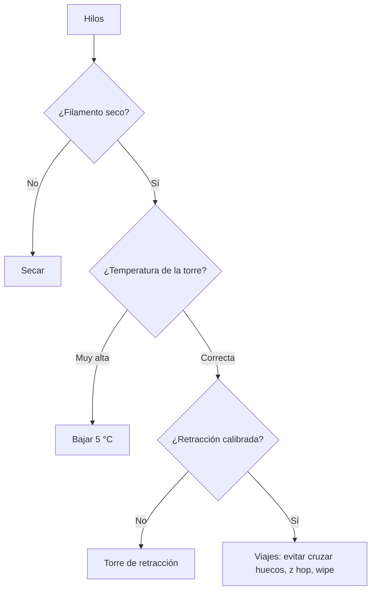

# Stringing (hilos) en FDM

Parte de: [[Problemas comunes de impresión FDM]]

> [!info] Cómo avanzar
> `progreso`: **pendiente** → **viendo** (estudiando) → **visto** (contestaste la autoevaluación sin abrir las respuestas) → **dominado** (hiciste el laboratorio o lo aplicaste de verdad).

## Contenido

### Qué es
El **stringing** son hilos finos de plástico, como telaraña, que quedan entre partes separadas de la pieza (por ejemplo, entre dos columnas o entre los dedos de una figura). Aparecen porque la boquilla **gotea** mientras viaja de un punto a otro sin extruir.

### Cómo funciona
Cuando la boquilla termina una línea y viaja, queda plástico fundido con presión dentro. Si ese plástico es muy fluido o tiene vapor de agua empujándolo, sale durante el viaje y se estira como hilo.

**Causas principales:**
1. **Filamento húmedo**: el agua hierve y empuja plástico fuera de la boquilla. Es la causa más común en PETG y TPU.
2. **Temperatura alta**: el plástico queda demasiado fluido.
3. **Retracción insuficiente** o mal calibrada.
4. **Viajes largos sobre huecos**: más tiempo para gotear.
5. Material naturalmente "hilachento": PETG y PLA Silk lo son más que PLA normal.

**Si ya calibraste la retracción y sigue:** lo más probable es **humedad**, sobre todo en PETG y TPU. Seca el filamento antes de seguir moviendo valores. Después revisa la temperatura con una torre.

### Ejemplo
Imprimes una torre de prueba con dos columnas en PETG y salen muchos hilos.
1. El carrete llevaba tres semanas abierto → lo secas a 60–65 °C unas 6 h (según la ficha del fabricante). Los hilos bajan a la mitad.
2. La ficha dice 230–250 °C y estabas en 250 → bajas a 240. Casi desaparecen.
3. Activas "evitar cruzar paredes" para que los viajes vayan por dentro.
Quedan hilos muy finos que se quitan con una pasada rápida de pistola de calor o encendedor **a distancia y con cuidado** (o con cúter), sin derretir la pieza.

### Ajustes del laminador que ayudan
Además de la retracción, ElegooSlicer y OrcaSlicer tienen opciones que reducen hilos sin tocar la temperatura:
- **Evitar cruzar paredes**: el viaje va por dentro de la pieza; si gotea, el hilo queda oculto en el relleno.
- **Wipe** (limpiar al retraer): la boquilla se mueve un poco sobre la línea recién hecha mientras retrae, dejando ahí la gota.
- **Z hop**: levanta la boquilla en los viajes; ayuda a no rozar, aunque en algunos materiales puede *aumentar* los hilos finos. Pruébalo con y sin.
- **Velocidad de viaje alta**: menos tiempo en el aire, menos tiempo para gotear.
- **Pressure advance calibrado**: reduce la presión residual al final de cada línea.
- **Orden de impresión**: varias piezas pequeñas impresas "una por una" en vez de "todas por capa" reducen viajes entre ellas, si la altura lo permite.

### Cuándo preocuparse
- En piezas visuales, siempre.
- En funcionales, solo si afectan medidas o encajes.
- Si aparece de repente en un filamento que antes iba bien: casi seguro es humedad.

### Errores comunes
1. **Subir la retracción cada vez más**: provoca atascos y huecos; el problema era otro.
2. **Calibrar con filamento húmedo**: ningún valor funciona y eliges mal.
3. **Ignorar la temperatura**: PLA Silk y PETG muy calientes siempre hacen hilos.
4. **Cambiar varias cosas a la vez**: no sabrás qué funcionó. Sigue el orden de [[Problemas comunes de impresión FDM]].

### Para profundizar
- [OrcaSlicer wiki: calibración de retracción](https://www.orcaslicer.com/wiki/calibration/retraction_calib)
- [OrcaSlicer wiki: calibración de temperatura](https://www.orcaslicer.com/wiki/calibration/temp_calib)
- Relacionado: [[Secado y almacenamiento de filamento]], [[Calibración de retracción]] y [[Torre de temperatura]]

## Autoevaluación

Contesta primero en voz alta o en papel; luego despliega la respuesta.

> [!question]- ¿Qué es?
> Hilos finos tipo telaraña entre partes separadas de la pieza.

> [!question]- ¿Causas principales?
> Temperatura alta, filamento húmedo, retracción insuficiente y desplazamientos largos sobre huecos.

> [!question]- Ya calibraste retracción y sigue. ¿Qué es lo más probable?
> Humedad (sobre todo en PETG y TPU). Seca el filamento.

## Práctica

- [[Lab 2 - Torre de temperatura de PLA]]
- [[Lab 6 - Secado de filamento casero vs secador]]

