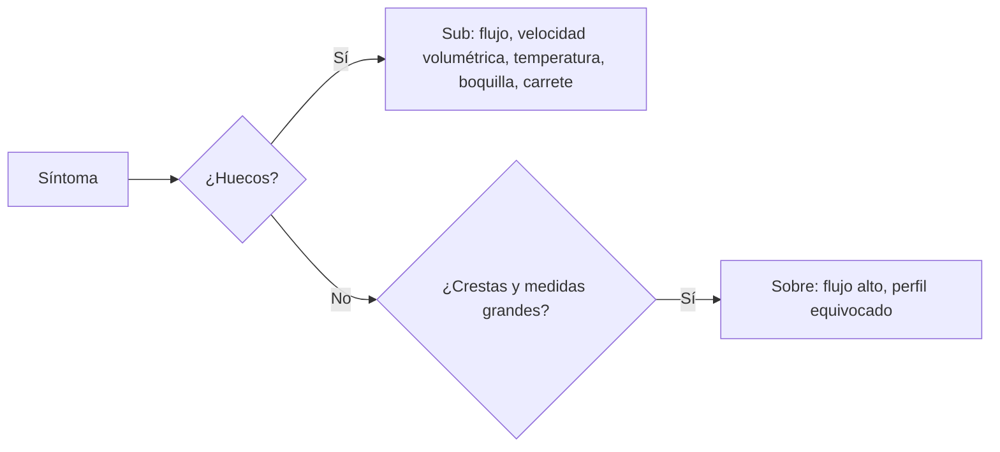

# Subextrusión y sobreextrusión en FDM

Parte de: [[Problemas comunes de impresión FDM]]

> [!info] Cómo avanzar
> `progreso`: **pendiente** → **viendo** (estudiando) → **visto** (contestaste la autoevaluación sin abrir las respuestas) → **dominado** (hiciste el laboratorio o lo aplicaste de verdad).

## Contenido

### Qué es
- **Subextrusión**: sale **menos** plástico del que el laminador calculó.
- **Sobreextrusión**: sale **más**.

Ambas dañan la pieza: la primera la debilita y deja huecos; la segunda arruina el acabado y las medidas.

### Cómo funciona
**Cómo se ve la subextrusión:**
- Huecos entre líneas en caras superiores e inferiores.
- Paredes delgadas que se ven a contraluz.
- Capas que se separan fácil.
- Líneas que se interrumpen o salen "rayadas".

**Causas de subextrusión:**
1. **Flujo** (*flow ratio*) bajo en el perfil.
2. **Velocidad mayor** a la que el hotend puede fundir: superar la velocidad volumétrica máxima del filamento (por ejemplo, pedir 25 mm³/s a un PLA que funde bien solo 15).
3. **Temperatura baja** para la velocidad usada.
4. **Boquilla parcialmente tapada** (ver [[Atascos de boquilla en FDM]]).
5. **Carrete que se traba**, filamento enredado o con diámetro irregular; en el CANVAS, un tubo con fricción.
6. Filamento húmedo.

**Cómo se ve la sobreextrusión:**
- Caras superiores con **crestas** o con material acumulado.
- **Medidas más grandes** de lo diseñado; agujeros pequeños.
- Esquinas abultadas, superficie "gorda".
- La boquilla arrastra material en la cara superior.

**Causas de sobreextrusión:** flujo alto, perfil de otro filamento u otra boquilla (por ejemplo, perfil de 0.6 con boquilla de 0.4), ancho de línea mal configurado.

### Ejemplo
Subes la velocidad de relleno para terminar más rápido y el relleno sale con huecos, pero las paredes exteriores (más lentas) están bien. El patrón dice **límite de fusión**, no flujo: la velocidad volumétrica superó lo que el filamento puede fundir. Haces la calibración de **velocidad volumétrica máxima** del laminador y pones ese límite en el perfil; el laminador bajará la velocidad sola donde haga falta. En cambio, si toda la pieza (incluidas las paredes lentas) tiene huecos, revisas el flujo con la [[Calibración de flujo y pressure advance]].

Para la sobreextrusión, una tapa de caja que no entra y una cara superior con crestas: calibras el flujo, bajas el valor y la medida vuelve a lo esperado.

### Cuándo revisar
- Después de cambiar de filamento o de boquilla.
- Al subir velocidades.
- Si las medidas no cuadran en la [[Prueba de tolerancias]].

### Errores comunes
1. **Subir el flujo para tapar huecos causados por velocidad**: arregla el relleno y arruina las paredes.
2. **Bajar el flujo para que entre una pieza**: mejor usa la compensación XY tras calibrar.
3. **Perfil de boquilla equivocado**: revisa que el perfil de impresora diga la boquilla que tienes.
4. **Ignorar el carrete**: un carrete trabado causa subextrusión intermitente difícil de diagnosticar.

### Para profundizar
- [OrcaSlicer wiki: calibración de flujo](https://www.orcaslicer.com/wiki/calibration/flow_ratio_calib)
- [OrcaSlicer wiki: calibración de velocidad volumétrica máxima](https://www.orcaslicer.com/wiki/calibration/volumetric_speed_calib)
- Laboratorio: [[Lab 3 - Prueba de flujo y pressure advance]]

## Autoevaluación

Contesta primero en voz alta o en papel; luego despliega la respuesta.

> [!question]- ¿Cómo se ve la subextrusión?
> Huecos entre líneas, paredes delgadas que se ven a contraluz, caras superiores incompletas.

> [!question]- ¿Causas de la subextrusión?
> Flujo bajo, velocidad mayor a la que el hotend puede fundir, temperatura baja, boquilla parcialmente tapada o carrete que se traba.

> [!question]- ¿Y la sobreextrusión?
> Caras superiores con crestas, medidas más grandes, esquinas abultadas. Baja el flujo tras calibrarlo.

## Práctica

- [[Lab 3 - Prueba de flujo y pressure advance]]

