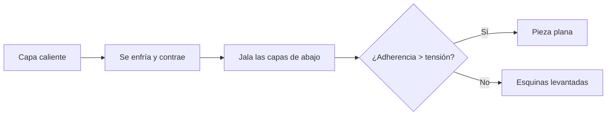

# Warping (esquinas levantadas) en FDM

Parte de: [[Problemas comunes de impresión FDM]]

> [!info] Cómo avanzar
> `progreso`: **pendiente** → **viendo** (estudiando) → **visto** (contestaste la autoevaluación sin abrir las respuestas) → **dominado** (hiciste el laboratorio o lo aplicaste de verdad).

## Contenido

### Qué es
El **warping** es cuando las esquinas o bordes de la pieza se **levantan de la cama** durante la impresión. La base deja de ser plana, la pieza queda torcida y, en casos graves, se despega por completo y el cabezal la arrastra.

### Cómo funciona
Todo plástico se **contrae** al enfriarse. Cada capa nueva se deposita caliente sobre la anterior ya fría; al contraerse, jala hacia el centro. Si la adherencia a la cama es menor que esa fuerza, las esquinas (donde se concentra la tensión) se levantan.

Factores que aumentan la tensión:
- **Material**: el ABS y el ASA se contraen mucho más que el PLA; el PC y el nylon también. El PETG está en medio.
- **Enfriamiento desigual**: corrientes de aire, ventilador alto, cuarto frío.
- **Geometría**: piezas grandes, planas y con esquinas agudas.

Factores que aumentan la adherencia:
- Placa **limpia** (sin grasa).
- **Temperatura de cama** correcta (consulta la ficha del fabricante del filamento).
- Superficie adecuada: texturizada para PETG/ABS/ASA.
- **Brim** o *brim ears*.
- Primera capa bien aplastada.

**Por qué ABS lo sufre más que PLA.** Su contracción es mucho mayor y necesita un ambiente caliente y estable para enfriarse parejo. En una impresora abierta el aire del cuarto lo enfría de forma desigual. Tu Centauri 2 es abierta, así que con ABS y ASA el warping es el problema principal; por eso en tu impresora conviene PLA y PETG, o un gabinete si de verdad necesitas esos materiales.

### Ejemplo
Imprimes una caja de 20 × 15 cm en PETG cerca de una ventana y las cuatro esquinas se levantan 1–2 mm a partir de la capa 20. Correcciones, en orden:
1. Lavas la placa y usas la cara texturizada.
2. Subes la cama al valor alto de la ficha del fabricante.
3. Agregas brim de 8 mm.
4. Bajas el ventilador de capa en las primeras capas y alejas la impresora de la corriente de aire.
5. Si sigue, redondeas las esquinas en el diseño (un radio de unos milímetros reduce mucho la tensión).

### Cuándo esperarlo
- Piezas grandes y planas, sobre todo en ABS, ASA, PC y nylon.
- PLA en cuartos muy fríos o con corrientes directas.
- Cualquier material con placa sucia.

### Errores comunes
1. **Impresora junto a una ventana, ventilador o aire acondicionado**: en una impresora abierta, la corriente fría causa warping y grietas.
2. **Ventilador alto en las primeras capas**: enfría la base demasiado rápido.
3. **Subir la cama sin límite** con PLA: no ayuda y provoca [[Pata de elefante en FDM]].
4. **Usar raft** por reflejo: con buena placa y brim rara vez hace falta.
5. **Ignorar la geometría**: esquinas a 90° en piezas grandes son el peor caso.

### Para profundizar
- [OrcaSlicer wiki: pintar brim ears](https://www.orcaslicer.com/wiki/print_prepare/prepare_brim_ears_painting)
- Relacionado: [[Adherencia a la cama (brim, raft y superficies)]] y [[Materiales que necesitan impresora cerrada (ABS, ASA, PC y nylon)]]
- [Centauri 2 — página oficial](https://us.elegoo.com/products/centauri-2)

## Autoevaluación

Contesta primero en voz alta o en papel; luego despliega la respuesta.

> [!question]- ¿Qué es el warping?
> Las esquinas se levantan de la cama porque el plástico se contrae al enfriarse y jala la base.

> [!question]- ¿Cómo se corrige?
> Placa limpia, temperatura de cama correcta, brim, menos ventilador en primeras capas, evitar corrientes de aire y materiales de alta contracción en impresora abierta.

> [!question]- ¿Por qué ABS lo sufre mucho más que PLA?
> Su contracción es mucho mayor y necesita ambiente caliente; sin gabinete se enfría desigual.

