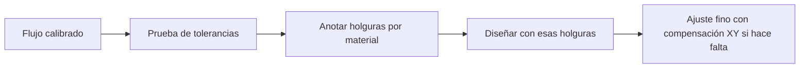

# Prueba de tolerancias

Parte de: [[36-Impresion-3D/04 Calibración y calidad/_Índice Calibración y calidad|Calibración y calidad]]

> [!info] Cómo avanzar
> `progreso`: **pendiente** → **viendo** (estudiando) → **visto** (contestaste la autoevaluación sin abrir las respuestas) → **dominado** (hiciste el laboratorio o lo aplicaste de verdad).

## Contenido

### Qué es
La **tolerancia** u **holgura** es el espacio que dejas en el diseño entre dos piezas que deben encajar: un perno en un agujero, una tapa en una caja, una bisagra. Las impresoras FDM no imprimen exactamente la medida del modelo: los contornos exteriores salen un poco más grandes y los agujeros un poco más chicos. La **prueba de tolerancias** te dice cuánta holgura necesita **tu** impresora con **tu** filamento.

### Cómo funciona
**Por qué cambian las medidas.** La línea de plástico se aplasta y se ensancha; en curvas pequeñas (agujeros) el material se acumula hacia dentro; la costura y la pata de elefante agregan bultos. Resultado: un agujero de 10 mm sale, por ejemplo, de 9.8 mm, y un perno de 10 mm de 10.1 mm.

**Holgura por lado.** Se expresa por lado (radial). Un perno en un agujero tiene holgura a ambos lados:
```text
diámetro del perno = diámetro del agujero − 2 × holgura por lado
agujero 8.0 mm, holgura 0.2 mm → perno 8.0 − 2 × 0.2 = 7.6 mm

tapa que entra en una caja de 50.0 mm interior, holgura 0.15 mm por lado:
medida exterior de la tapa = 50.0 − 2 × 0.15 = 49.7 mm
```

**Puntos de partida** en FDM (por lado; confírmalos con tu prueba):

| Ajuste | Holgura por lado |
|---|---|
| A presión (no se suelta) | ≈0.1 mm |
| Deslizante (entra con la mano) | ≈0.2 mm |
| Giratorio libre | ≈0.3 mm o más |

**La prueba.** Imprimes una pieza con varios pernos y agujeros con holguras crecientes (por ejemplo 0.1, 0.15, 0.2, 0.25 mm). OrcaSlicer incluye una prueba de tolerancias en el menú **Calibración**; también hay modelos de prueba en repositorios. Interpretas así: si los de 0.1 y 0.15 no giran, el de 0.2 gira con esfuerzo y el de 0.25 gira libre, anotas en tu bitácora: **"ajuste justo/deslizante: 0.2 mm; giratorio libre: 0.25 mm"** para ese filamento y perfil.

**Compensaciones del laminador:**
- **Compensación XY de contornos** y **de agujeros**: agranda o achica en el laminador sin cambiar el diseño.
- **Compensación de pata de elefante**: reduce el ancho de las primeras capas.

Úsalas **después** de calibrar el flujo, no para ocultar un flujo mal ajustado.



### Ejemplo
Diseñas una caja para tu DJI Mic Mini 2 con tapa deslizante. Tu prueba en PLA dio 0.2 mm para deslizante: si el canal interior mide 30.0 mm, la tapa mide 29.6 mm. Imprimes y entra con un empujón suave. En PETG la misma prueba podría dar otro número; repítela.

### Cuándo hacerla
- Antes de diseñar piezas que encajen.
- Con cada material distinto y si cambias boquilla o perfil de calidad.
- Para insertos térmicos, usa la medida del fabricante del inserto, no esta tabla.

### Errores comunes
1. **Confundir holgura por lado con holgura total.** Restar 0.2 al diámetro en vez de 0.4 deja el perno apretado.
2. **Medir sobre la costura o la base.** Ver [[Pata de elefante en FDM]].
3. **Imprimir el perno acostado** cuando la pieza real va de pie: la orientación cambia la medida.
4. **Arreglar todo con compensación XY** sin calibrar flujo.

### Para profundizar
- [OrcaSlicer wiki: calibración de tolerancias](https://www.orcaslicer.com/wiki/calibration/tolerance_calib)
- [OrcaSlicer wiki: ajustes de precisión (compensaciones XY)](https://www.orcaslicer.com/wiki/print_settings/quality/quality_settings_precision)
- Laboratorio: [[Lab 4 - Prueba de tolerancias con pieza que encaja]]

## Ejercicios

Resuélvelos en papel o en la herramienta; la solución está plegada.

> [!question]- Agujero de 8.0 mm en el diseño; quieres un perno deslizante con 0.2 mm por lado. ¿Diámetro del perno?
> 8.0 − 2 × 0.2 = **7.6 mm**.

> [!question]- Diseñas una tapa que entra en una caja de 50.0 mm interior con holgura 0.15 mm por lado. ¿Medida exterior de la tapa?
> 50.0 − 2 × 0.15 = **49.7 mm**.

> [!question]- En la prueba, los pernos de 0.1 y 0.15 mm no giran, el de 0.2 gira con esfuerzo y el de 0.25 gira libre. ¿Qué anotas?
> Para PLA en tu impresora: ajuste justo/deslizante ≈0.2 mm, giro libre ≈0.25 mm por lado. Anótalo en el perfil del filamento o en tu nota de diseño.

## Autoevaluación

Contesta primero en voz alta o en papel; luego despliega la respuesta.

> [!question]- ¿Qué es la tolerancia u holgura en impresión 3D?
> El espacio que dejas entre dos piezas que deben encajar. Las impresoras FDM agregan algo de material en contornos, así que un agujero de 10 mm sale un poco más chico y un perno de 10 mm algo más grande.

> [!question]- ¿Qué holgura usar para que algo deslice y para que quede a presión?
> Depende de tu impresora y material; como punto de partida en FDM: ≈0.1 mm por lado para ajuste a presión, ≈0.2 mm por lado para ajuste deslizante y ≈0.3 mm o más para piezas que giran libres. Confírmalo con una prueba de tolerancias.

> [!question]- ¿Qué compensaciones tiene el laminador?
> Compensación XY de agujeros/contornos y de *pata de elefante*. Úsalas después de calibrar flujo, no para ocultar un flujo mal ajustado.

## Práctica

- [[Lab 4 - Prueba de tolerancias con pieza que encaja]]
- [[Lab 8 - Inserto térmico con cautín]]

