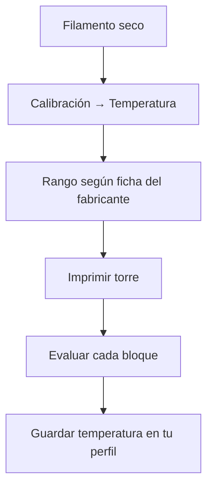

# Torre de temperatura

Parte de: [[36-Impresion-3D/04 Calibración y calidad/_Índice Calibración y calidad|Calibración y calidad]]

> [!info] Cómo avanzar
> `progreso`: **pendiente** → **viendo** (estudiando) → **visto** (contestaste la autoevaluación sin abrir las respuestas) → **dominado** (hiciste el laboratorio o lo aplicaste de verdad).

## Contenido

### Qué es
Una **torre de temperatura** es una pieza de prueba formada por bloques apilados; el laminador imprime cada bloque a una temperatura de boquilla distinta. Al terminar, comparas los bloques y eliges la temperatura que da mejor resultado para **ese filamento concreto** (marca, color y lote). Es la primera calibración que haces con un filamento nuevo.

### Cómo funciona
La temperatura correcta es un equilibrio:
- **Muy alta**: más hilos, superficie brillante o "derretida", voladizos caídos, puentes colgados.
- **Muy baja**: mala unión entre capas (la torre se rompe fácil con la mano), superficie opaca y rugosa, posible subextrusión.

**Cuántos bloques.** De 230 a 190 °C en pasos de 5 °C:
```text
(230 − 190) / 5 + 1 = 9 bloques: 230, 225, 220, 215, 210, 205, 200, 195, 190
```
**Dónde empieza cada bloque.** Con base de 1 mm y bloques de 10 mm, empezando en 230 °C abajo y bajando:
```text
altura de inicio = base + (posición − 1) × 10 mm
205 °C es el 6.º bloque → 1 + 5 × 10 = 51 mm
```
Esto sirve para revisar en la vista previa del laminador que el cambio de temperatura ocurre a la altura correcta. En ElegooSlicer y OrcaSlicer la torre se genera desde el menú **Calibración → Temperatura**: eliges el rango y el programa arma la pieza y los cambios de temperatura por ti.



**Qué buscar en cada bloque:**
1. Pocos **hilos** entre las columnas.
2. **Voladizos** y **puentes** limpios.
3. Superficie uniforme y texto legible.
4. **Unión entre capas**: intenta partir la torre con las manos al final; donde se rompe fácil, esa temperatura es demasiado baja para piezas fuertes.

### Ejemplo
Compras un PLA de una marca nueva cuya ficha dice 190–230 °C. Lo secas si llevaba tiempo abierto, haces la torre 230 → 190 y observas: 230–220 tienen hilos y voladizos caídos; 195–190 se parten fácil; 210 y 205 se ven limpios y aguantan. Eliges **210 °C** (un poco más caliente da margen de resistencia) y lo guardas en tu perfil `PLA MarcaX - Blanco`. Después sigue la [[Calibración de flujo y pressure advance]].

### Cuándo hacerla
- Con cada **marca nueva** o tipo distinto (PLA, PLA+, Silk, PETG…).
- Si un mismo filamento cambia de color: los pigmentos pueden mover la temperatura óptima.
- Cuando cambias de boquilla o de velocidad de forma importante (a más velocidad, suele hacer falta más temperatura).
- Rango: el que indique la ficha del fabricante del filamento.

### Errores comunes
1. **Hacer la torre con filamento húmedo.** La humedad provoca hilos en todas las temperaturas y te hace elegir mal. Seca primero si sospechas.
2. **Rango fuera de la ficha.** Muy caliente puede degradar el material; muy frío, atascar.
3. **Fijarte solo en la apariencia.** La resistencia entre capas importa en piezas funcionales.
4. **No guardar el resultado.** Si no lo anotas en el perfil, la próxima vez empiezas de cero.
5. **Usar la torre de PLA para PETG.** Cada material necesita su rango.

### Para profundizar
- [OrcaSlicer wiki: calibración de temperatura](https://www.orcaslicer.com/wiki/calibration/temp_calib)
- [OrcaSlicer wiki: guía de calibración](https://www.orcaslicer.com/wiki/guides/calibration_guide.html)
- Laboratorio: [[Lab 2 - Torre de temperatura de PLA]]

## Ejercicios

Resuélvelos en papel o en la herramienta; la solución está plegada.

> [!question]- Torre de 230 a 190 °C en pasos de 5 °C. ¿Cuántos bloques tiene?
> (230 − 190)/5 + 1 = **9 bloques**.

> [!question]- Cada bloque mide 10 mm y la base 1 mm. ¿A qué altura empieza el bloque de 205 °C (desde 230 bajando)?
> 205 es el 6.º bloque (230, 225, 220, 215, 210, 205) → empieza a 1 + 5 × 10 = **51 mm**.

## Autoevaluación

Contesta primero en voz alta o en papel; luego despliega la respuesta.

> [!question]- ¿Qué es una torre de temperatura?
> Una pieza con bloques impresos cada uno a distinta temperatura (p. ej. 230 → 190 °C en pasos de 5 °C) para elegir la mejor para un filamento concreto.

> [!question]- ¿Qué buscas en cada bloque?
> Pocos hilos, buenos voladizos y puentes, superficie limpia y buena unión entre capas (intenta romperla: la temperatura demasiado baja se parte fácil entre capas).

> [!question]- Error común: hacer la torre con filamento húmedo.
> La humedad provoca hilos en todas las temperaturas y te hará elegir mal. Seca primero si sospechas.

## Práctica

- [[Lab 2 - Torre de temperatura de PLA]]

