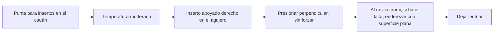

# Insertos térmicos, tornillería y pegado

Parte de: [[36-Impresion-3D/05 Posprocesado/_Índice Posprocesado|Posprocesado]]

> [!info] Cómo avanzar
> `progreso`: **pendiente** → **viendo** (estudiando) → **visto** (contestaste la autoevaluación sin abrir las respuestas) → **dominado** (hiciste el laboratorio o lo aplicaste de verdad).

## Contenido

### Qué es
Tres formas de **unir** o **fijar** piezas impresas:
- **Insertos térmicos**: roscas de latón que se calientan con un cautín y se hunden en un agujero de la pieza; el plástico se funde alrededor y queda una **rosca metálica** durable (por ejemplo M3).
- **Tornillería directa**: tornillos autorroscantes o tuercas encapsuladas en la pieza.
- **Pegado**: cianoacrilato o epóxico para piezas que se imprimieron separadas.

### Cómo funciona
**Por qué insertos.** Una rosca impresa en plástico se desgasta al atornillar varias veces. El inserto tiene moleteado exterior que se ancla en el plástico fundido y aguanta muchas vueltas y más torque.

**Diseño del agujero.**
- Usa el **diámetro y la profundidad que recomiende el fabricante del inserto**: el agujero es ligeramente **menor** que el diámetro exterior del inserto, para que el plástico fundido lo abrace.
- Deja **al menos 2–3 perímetros** alrededor del agujero para que haya material.
- Profundidad un poco mayor que el largo del inserto, para que el plástico desplazado tenga a dónde ir.
- Si la tolerancia de tu impresora hace agujeros más chicos, compénsalo (ver [[Prueba de tolerancias]]).

**Colocación con cautín:**

La temperatura del cautín depende del material y del inserto; para PLA, una temperatura moderada basta (empieza cerca de la temperatura de impresión del filamento y ajusta; consulta la recomendación del fabricante del inserto). Demasiado caliente derrite de más y el inserto se hunde chueco.

**Pegado:**

| Pegamento | Para qué |
|---|---|
| Cianoacrilato (tipo kola loka) | Uniones pequeñas en PLA; rápido. Con activador, aún más |
| Epóxico de 2 componentes | Uniones que reciben carga, rellena huecos; mejor opción para PETG |
| Diseño con pines o colas de milano | Alinea las piezas antes de pegar |

El PETG pega peor: lija las superficies y usa epóxico.

### Ejemplo
Una caja para un proyecto con tapa atornillada: diseñas 4 torres con agujero según la ficha de insertos M3, 3 paredes y 30 % de relleno alrededor. Imprimes en PLA, colocas los insertos con cautín y punta para insertos, presionando derecho. La tapa se atornilla y desatornilla muchas veces sin desgaste.

### Cuándo usar cada uno
- **Insertos**: tornillos que se quitan y ponen seguido, cargas medias.
- **Tuerca encapsulada** (hexágono impreso para una tuerca): cuando no tienes cautín.
- **Autorroscante directo**: pocas vueltas, piezas que casi no se abren.
- **Pegado**: piezas más grandes que la cama (256 mm) o divididas para evitar soportes.

### Errores comunes
1. **Empujar el inserto torcido o a demasiada temperatura**: queda chueco y el tornillo no entra derecho. Calienta solo lo necesario y presiona perpendicular.
2. **Agujero sin perímetros suficientes**: se raja la pieza.
3. **Cianoacrilato en PETG con carga**: se despega.
4. **Tocar el inserto recién puesto**: está muy caliente.
5. **Humo del plástico en la cara**: ventila y no te acerques de más.

### Para profundizar
- Laboratorio: [[Lab 8 - Inserto térmico con cautín]]
- Relacionado: [[Perímetros y relleno]] y [[Herramientas básicas para impresión 3D]]
- [OrcaSlicer wiki: herramienta de corte (dividir piezas para pegar)](https://www.orcaslicer.com/wiki/print_prepare/prepare_cutting_tool)

## Autoevaluación

Contesta primero en voz alta o en papel; luego despliega la respuesta.

> [!question]- ¿Qué es un inserto térmico?
> Una rosca de latón que se calienta con un cautín y se hunde en un agujero de la pieza; el plástico se funde alrededor y queda una rosca metálica durable (p. ej. M3).

> [!question]- ¿Cómo se diseña el agujero?
> Con el diámetro y profundidad que recomiende el fabricante del inserto (ligeramente menor al diámetro exterior del inserto) y al menos 2–3 perímetros alrededor para que tenga material.

> [!question]- ¿Qué pegamento usar?
> Cianoacrilato (kola loka) para PLA en uniones pequeñas; epóxico de dos componentes para uniones que reciben carga. PETG pega peor; lija y usa epóxico.

> [!question]- Error común: empujar el inserto torcido o a demasiada temperatura.
> Queda chueco y el tornillo no entra derecho. Calienta solo lo necesario (para PLA, temperatura moderada en el cautín) y presiona perpendicular, sin forzar.

## Práctica

- [[Lab 8 - Inserto térmico con cautín]]

