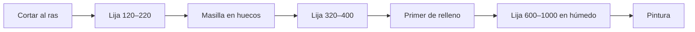

# Lijado y relleno de piezas impresas

Parte de: [[36-Impresion-3D/05 Posprocesado/_Índice Posprocesado|Posprocesado]]

> [!info] Cómo avanzar
> `progreso`: **pendiente** → **viendo** (estudiando) → **visto** (contestaste la autoevaluación sin abrir las respuestas) → **dominado** (hiciste el laboratorio o lo aplicaste de verdad).

## Contenido

### Qué es
**Lijar** es desgastar la superficie para eliminar las líneas de capa, marcas de soporte y la costura. **Rellenar** es tapar huecos y líneas con masilla o *primer* de relleno. Juntos convierten una pieza con aspecto de "impresa en 3D" en algo liso, listo para pintar.

### Cómo funciona
**Secuencia de lijas** (número de grano: más alto = más fino):

| Grano | Para qué |
|---|---|
| 120–220 | Quitar líneas de capa, marcas de soporte y costura; dar forma |
| 320–400 | Borrar las rayas de la lija anterior |
| 600–1000 | Superficie lisa, antes de pintar o para dejar mate |
| 1500–2000+ | Solo si buscas brillo o acabado de espejo con pulido |

Nunca saltes demasiados números: cada grano debe borrar las rayas del anterior.

**Lijado en húmedo.** El PLA se ablanda alrededor de 55–60 °C; la fricción de la lija lo calienta, se embarra y tapa la lija. Con **agua** (lija de agua, la gris o negra) la superficie se mantiene fría y el polvo se queda en la pasta en lugar de flotar en el aire. Para los granos gruesos puedes ir en seco con poca presión; del 400 en adelante, en húmedo.

**Relleno de huecos y líneas:**
- **Masilla** para modelismo o automotriz: para huecos y uniones. Se aplica, se deja secar y se lija.
- **Primer de relleno** (*filler primer*) en aerosol: capas que rellenan las líneas de capa; lija entre capas. Además revela imperfecciones.
- Para PLA, algunos usan una mezcla espesa de masilla y solvente o resinas de dos componentes; sigue siempre la ficha del producto.

### Ejemplo
Un casco de personaje en PLA (para uso personal) impreso a 0.16 mm. Lijas con 220 hasta que desaparecen las líneas más marcadas, rellenas con masilla una grieta en la unión de dos piezas, lijas con 400, aplicas dos capas de primer de relleno con secado entre capas, lijas con 600 en húmedo y repites primer en las zonas que aún muestran líneas. Al final, 1000 en húmedo y pasas a pintura.

**Truco:** imprime con capa más fina o con [[Costura, ironing y altura de capa variable|altura variable]] en zonas curvas: menos que lijar después.

### Cuándo lijar y cuándo no
- **Sí**: piezas que vas a pintar, piezas de exhibición, zonas de contacto de soportes.
- **No tanto**: piezas funcionales (lijar quita material y cambia medidas) o PLA mate que ya esconde las capas.
- PETG y TPU se lijan peor: el PETG "se peluchea"; el TPU casi no se lija.

### Seguridad al lijar
- **Cubrebocas tipo N95** (o mejor) al lijar en seco, y lugar ventilado: el polvo de plástico es fino.
- Lentes si usas herramienta rotativa (tipo Dremel) a baja velocidad: a alta velocidad el PLA se derrite.
- Limpia el polvo con trapo húmedo, no soplando.

### Errores comunes
1. **Lijar en seco con mucha presión**: el PLA se funde y se embarra.
2. **Saltar de 120 a 1000**: las rayas gruesas no desaparecen.
3. **Rotativa a alta velocidad**: derrite la superficie.
4. **Lijar piezas que deben encajar** sin medir después.

### Para profundizar
- Laboratorio: [[Lab 7 - Posprocesado soportes, lijado, primer y pintura]]
- Siguiente paso: [[Primer, pintura y barniz para piezas impresas]]
- [UL Chemical Insights — estudios de emisiones y partículas (PDF)](https://chemicalinsights.org/wp-content/uploads/2022/03/3DPrint_EmissionStudies.pdf)

## Autoevaluación

Contesta primero en voz alta o en papel; luego despliega la respuesta.

> [!question]- ¿Qué secuencia de lijas usar?
> Empieza con 120–220 para quitar líneas de capa, sigue con 400 y termina con 800–1000 (en húmedo para menos polvo y menos calor).

> [!question]- ¿Por qué lijar en húmedo el PLA?
> La fricción calienta el PLA, que se ablanda y se embarra. El agua lo enfría y retiene el polvo.

> [!question]- ¿Con qué se rellenan huecos y líneas?
> Masilla para modelismo o automotriz, o *primer de relleno* (filler primer) en capas, lijando entre capas.

> [!question]- Seguridad al lijar
> Usa cubrebocas tipo N95 al lijar en seco y hazlo ventilado.

## Práctica

- [[Lab 7 - Posprocesado: soportes, lijado, primer y pintura]]

