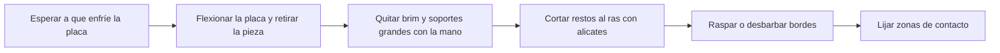

# Quitar soportes y limpiar piezas

Parte de: [[36-Impresion-3D/05 Posprocesado/_Índice Posprocesado|Posprocesado]]

> [!info] Cómo avanzar
> `progreso`: **pendiente** → **viendo** (estudiando) → **visto** (contestaste la autoevaluación sin abrir las respuestas) → **dominado** (hiciste el laboratorio o lo aplicaste de verdad).

## Contenido

### Qué es
El **posprocesado** empieza al retirar la pieza de la placa: quitar soportes, brim y restos, y dejar limpias las zonas de contacto. Hacerlo bien evita romper la pieza, cortarte y tener que lijar de más después.

### Cómo funciona
**Secuencia recomendada:**

1. **Espera a que enfríe.** La placa flexible de tu Centauri 2 suelta la pieza sola al doblarla un poco cuando está fría. PETG y piezas grandes se sueltan mejor frías.
2. **Soportes de árbol**: casi siempre salen con la mano o con pinzas, girando suavemente la rama desde la base.
3. **Soportes normales**: separa primero los bloques grandes; luego los restos de la interfaz.
4. **Corte al ras**: con **alicates de corte al ras** (*flush cutters*) eliminas restos sin dejar picos.
5. **Desbarbado**: una herramienta de desbarbar (*deburring tool*) con cuchilla giratoria limpia bordes de agujeros y aristas; una espátula fina o cúter, con mucho cuidado, quita restos planos.
6. **Lijado**: en zonas donde estuvo el soporte, de grano grueso a fino (ver [[Lijado y relleno de piezas impresas]]).

**Herramientas útiles:** alicates de corte al ras, pinzas de punta, espátula, herramienta de desbarbar, cúter con hoja nueva, guantes anticorte si haces mucho.

### Ejemplo
Una figura de PLA impresa con soportes de árbol: esperas 10 minutos, flexionas la placa y la figura se suelta. Giras las ramas una por una desde la base y salen limpias gracias a la distancia Z correcta. Bajo el brazo queda una marca: la cortas al ras, la desbarbas y la lijas con 220 y luego 400. Si vas a pintar, el primer de relleno ocultará el resto (ver [[Primer, pintura y barniz para piezas impresas]]).

### Cuándo cuesta más
- Distancia Z muy pequeña: el soporte se fusionó. Corrige el perfil para la próxima: [[Soportes (normales, árbol e interfaces)]].
- PETG: se pega más a sí mismo; los soportes cuestan más. Usa más distancia Z y, en zonas críticas, interfaz de otro material compatible si tu perfil lo permite.
- Soportes dentro de agujeros pequeños: mejor reorientar o diseñar sin necesitarlos.

### Seguridad
- Corta **siempre en dirección contraria a tu mano** y a tu cuerpo.
- Usa lentes de seguridad: los restos de PLA cortados salen disparados.
- No uses la espátula metálica sobre la placa en caliente ni hacia tu mano.

### Errores comunes
1. **Quitar soportes de PETG con la pieza todavía caliente.** La pieza se dobla o deforma: espera a que enfríe por completo.
2. **Arrancar soportes torciendo la pieza**: rompe partes delgadas (dedos, antenas). Sujeta cerca del punto de contacto.
3. **Cúter hacia la mano.** Es la lesión más común en este hobby.
4. **Usar pinzas de corte normales** en vez de al ras: dejan un pico que hay que lijar.
5. **Lijar antes de cortar al ras**: más trabajo y calor en la pieza.

### Para profundizar
- [OrcaSlicer wiki: pintar soportes](https://www.orcaslicer.com/wiki/print_prepare/prepare_support_painting)
- Laboratorio: [[Lab 7 - Posprocesado soportes, lijado, primer y pintura]]
- Herramientas: [[Herramientas básicas para impresión 3D]]

## Autoevaluación

Contesta primero en voz alta o en papel; luego despliega la respuesta.

> [!question]- ¿Con qué se quitan los soportes?
> Con alicates de corte al ras, pinzas y espátula o cúter con cuidado (cortando siempre **lejos** de tu mano). Los soportes de árbol suelen salir con la mano.

> [!question]- ¿Cómo dejar limpia la zona donde estaba el soporte?
> Corta al ras, luego lija de grano grueso a fino o raspa con *deburring tool*.

> [!question]- Error común: quitar soportes de PETG con la pieza todavía caliente.
> Se dobla la pieza. Espera a que enfríe por completo.

## Práctica

- [[Lab 7 - Posprocesado soportes, lijado, primer y pintura]]

