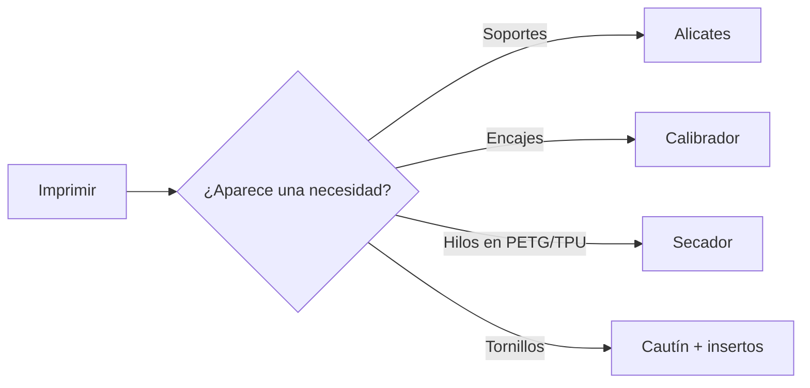

# Herramientas básicas para impresión 3D

Parte de: [[36-Impresion-3D/06 Herramientas y compras/_Índice Herramientas y compras|Herramientas y compras]]

> [!info] Cómo avanzar
> `progreso`: **pendiente** → **viendo** (estudiando) → **visto** (contestaste la autoevaluación sin abrir las respuestas) → **dominado** (hiciste el laboratorio o lo aplicaste de verdad).

## Contenido

### Qué es
Más allá de la impresora y el filamento, unas pocas herramientas hacen la diferencia entre pelear con cada pieza y disfrutar el proceso. La clave es **comprar por necesidad real**, en orden de prioridad, y no un kit enorme el primer día.

### Cómo funciona: prioridad de compra
La lista va de lo que usarás desde la primera semana a lo que necesitarás cuando avances:

| Prioridad | Herramienta | Para qué | Cuándo la necesitas |
|---|---|---|---|
| 1 | **Espátula** fina de plástico o metal | Soltar piezas difíciles, quitar restos | Primera semana |
| 2 | **Alicates de corte al ras** | Soportes, brim, cortar puntas de filamento | Primera pieza con soportes |
| 3 | **Lijas de agua** 120 a 1000 | Acabado, quitar marcas | Primeras piezas visibles |
| 4 | **Calibrador digital** | Medir piezas, tolerancias, flujo | Primeras piezas que encajan; ver [[Calibrador digital (vernier)]] |
| 5 | **Secador de filamento** | PETG, TPU, nylon y clima húmedo | Cuando uses esos materiales; ver [[Secador de filamento]] |
| 6 | **Cautín** con punta para insertos | Insertos térmicos | Piezas atornilladas |
| 7 | **Insertos térmicos** M3/M4 | Roscas metálicas | Con el cautín |
| 8 | **Primer** en aerosol | Pintar | Proyectos de pintura |

**También útiles y baratos:** sílica gel y bolsas o cajas herméticas, higrómetro, pinzas de punta, alcohol isopropílico, jabón para trastes (limpiar la placa), guantes, cubrebocas N95, lentes de seguridad, herramienta de desbarbar, cúter con hojas de repuesto, cinta métrica, organizador para tornillería.

### Qué trae la impresora y qué no
El contenido exacto de la caja de tu Centauri 2 Combo está (Pendiente de confirmar): revisa el inventario del manual al desempacar **antes** de comprar duplicados. Es común que las impresoras incluyan alguna herramienta básica (llaves, a veces espátula o pinzas) y repuestos pequeños, pero varía por modelo. La página oficial menciona que en la caja va el ensamble del portacarretes y una USB con archivos (por ejemplo, el adaptador de filamento flexible). Lo que **no** suele venir: lijas, calibrador, secador, cautín, primer.

### Ejemplo
Tu primer mes:
- Semana 1: imprimes PLA de prueba. Usas la espátula y descubres que te faltan **alicates al ras** para los soportes.
- Semana 2: diseñas una caja con tapa para la DJI Mic Mini 2 y necesitas medir: compras **calibrador**.
- Semana 4: empiezas con PETG y ves hilos; antes de comprar secador, pruebas caja hermética con sílica gel (ver [[Lab 6 - Secado de filamento casero vs secador]]).

Así compras solo lo que usas y entiendes por qué lo usas.

### Cuándo invertir más
- **Calibrador**: uno decente dura años; vale más que uno muy barato con lecturas erráticas.
- **Cautín**: uno con temperatura regulable sirve para insertos y electrónica.
- **Secador**: si vives en clima húmedo o usas mucho PETG/TPU.
- Prefiere herramientas que sirven para varios hobbies (lijas, cautín, calibrador te servirán también con tu equipo de foto y dron).

### Errores comunes
1. **Comprar un kit gigante el primer día.** La mitad no se usa y el resto es de baja calidad. Imprime primero y compra conforme aparezca la necesidad.
2. **Espátula metálica afilada sobre la placa**: raya el PEI. Usa la de plástico o la flexión de la placa.
3. **Pinzas normales en vez de corte al ras**: dejan picos.
4. **Olvidar la protección**: lentes y cubrebocas cuestan poco.
5. **No revisar la caja de la impresora** y comprar lo que ya tenías.

### Para profundizar
- [Centauri 2 Combo — página oficial](https://us.elegoo.com/products/centauri-2-combo)
- Relacionado: [[Quitar soportes y limpiar piezas]] e [[Insertos térmicos, tornillería y pegado]]
- Laboratorio: [[Lab 1 - Primera impresión y revisión de calibración automática en Centauri 2]]

## Autoevaluación

Contesta primero en voz alta o en papel; luego despliega la respuesta.

> [!question]- ¿Qué comprar primero (por prioridad)?
> 1. **Espátula** de plástico/metal fino para piezas difíciles.
> 2. **Alicates de corte al ras** (para soportes y puntas de filamento).
> 3. **Lijas** de agua 120 a 1000.
> 4. **Calibrador digital** (medir piezas y tolerancias).
> 5. **Secador de filamento** (sobre todo si usarás PETG/TPU).
> 6. **Cautín** con punta para insertos.
> 7. **Insertos térmicos** M3/M4.
> 8. **Primer** en aerosol para pintar.
>
> También útiles: sílica gel y bolsas herméticas, pinzas, alcohol isopropílico, guantes y cubrebocas.

> [!question]- ¿Qué trae la impresora y qué no?
> Lo que incluye exactamente en la caja está (Pendiente de confirmar); revisa el inventario del manual al desempacar antes de comprar duplicados.

> [!question]- Error común: comprar un kit gigante de herramientas el primer día.
> Imprime primero y compra conforme aparezca la necesidad real (soportes → alicates; piezas que encajan → calibrador).

## Práctica

- [[Lab 1 - Primera impresión y revisión de calibración automática en Centauri 2]]

