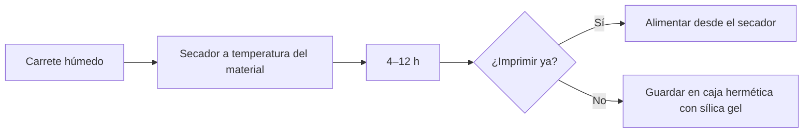

# Secador de filamento

Parte de: [[36-Impresion-3D/06 Herramientas y compras/_Índice Herramientas y compras|Herramientas y compras]]

> [!info] Cómo avanzar
> `progreso`: **pendiente** → **viendo** (estudiando) → **visto** (contestaste la autoevaluación sin abrir las respuestas) → **dominado** (hiciste el laboratorio o lo aplicaste de verdad).

## Contenido

### Qué es
Un **secador de filamento** es una caja con calefacción y control de temperatura (y a veces ventilador y sensor de humedad) donde pones uno o varios carretes durante horas para sacarles la humedad. Muchos permiten **imprimir directamente desde el secador**, pasando el filamento por un orificio, para que no vuelva a absorber humedad durante la impresión.

### Cómo funciona
El calor aumenta la presión de vapor del agua dentro del filamento y la hace salir; el aire caliente (y en algunos, un ventilador o desecante) la retira. La temperatura debe ser lo bastante alta para secar, pero menor que la temperatura a la que el filamento se ablanda: por eso cada material tiene su rango.

**Rangos orientativos** (siempre revisa la ficha del fabricante del filamento): PLA 45–55 °C, PETG 60–65 °C, TPU 50–60 °C, ABS/ASA 60–80 °C, nylon y PC 70–80 °C o más; de 4 a 12 h según material y humedad.

### ¿Es indispensable?
**No para empezar.** Si imprimes sobre todo PLA y lo guardas en bolsas o cajas herméticas con sílica gel, puedes pasar meses sin secador. **Sí vale la pena** si:
- Usas **PETG, TPU o nylon** con frecuencia (los dos últimos casi lo exigen).
- Vives en un lugar **húmedo** o es temporada de lluvias.
- Tienes muchos carretes abiertos al mismo tiempo (por ejemplo, cuatro en el CANVAS).
- Notas hilos y burbujas que no se arreglan con calibración.

### Qué revisar al elegir uno
| Criterio | Por qué |
|---|---|
| **Temperatura máxima** | Debe alcanzar la de tus materiales (70–80 °C si piensas en nylon o PC) |
| **Precisión** | Que no se pase: el PLA se deforma por arriba de ~55–60 °C |
| **Tamaño** | Que quepan tus carretes (ancho y diámetro) y cuántos a la vez |
| **Alimentación** | Orificio y rodamientos para imprimir desde ahí |
| **Sensor de humedad** | Te dice si de verdad está secando |
| **Temporizador** | Apagado automático |

Considera también cómo encaja con tu impresora: con el CANVAS, los carretes van en sus módulos; el secador sirve sobre todo para secar antes o para alimentar TPU por el adaptador de flexibles.

### Ejemplo
Compras TPU para fundas y PETG para soportes de exterior. Antes de cada uso, secas el TPU 6 h a 55 °C y lo imprimes **directamente desde el secador** hacia el adaptador de flexibles (con el CANVAS desconectado, según indica Elegoo). El PETG lo secas cuando lleva más de una semana abierto. Comparas resultados con y sin secado en [[Lab 6 - Secado de filamento casero vs secador]].

### Errores comunes
1. **Comprar uno que no alcanza la temperatura** que necesitas.
2. **Secar PLA a temperatura de PETG**: carrete deformado.
3. **Secar y luego dejarlo al aire días**: vuelve a humedecerse.
4. **Creer que el secador arregla todo**: si el problema es la temperatura de impresión o la retracción, seguirá.
5. **Carretes de cartón al calor por horas**: pueden deformarse o soltar fibras.

### Para profundizar
- Relacionado: [[Secado y almacenamiento de filamento]]
- Relacionado: [[TPU (filamento flexible)]] y [[PETG]]
- [OrcaSlicer wiki: centro de solución de problemas](https://www.orcaslicer.com/wiki/general_settings/troubleshoot_center)

## Autoevaluación

Contesta primero en voz alta o en papel; luego despliega la respuesta.

> [!question]- ¿Qué hace un secador de filamento?
> Calienta el carrete a una temperatura controlada durante horas y saca la humedad; muchos permiten imprimir directamente desde ellos.

> [!question]- ¿Es indispensable?
> No para PLA bien guardado. Sí lo vale para PETG, TPU y nylon, o si vives en un lugar húmedo.

> [!question]- ¿Qué revisar al elegir uno?
> Temperatura máxima suficiente para tus materiales, que quepa el tamaño de tus carretes y si permite alimentar la impresora desde ahí.

## Práctica

- [[Lab 6 - Secado de filamento casero vs secador]]

