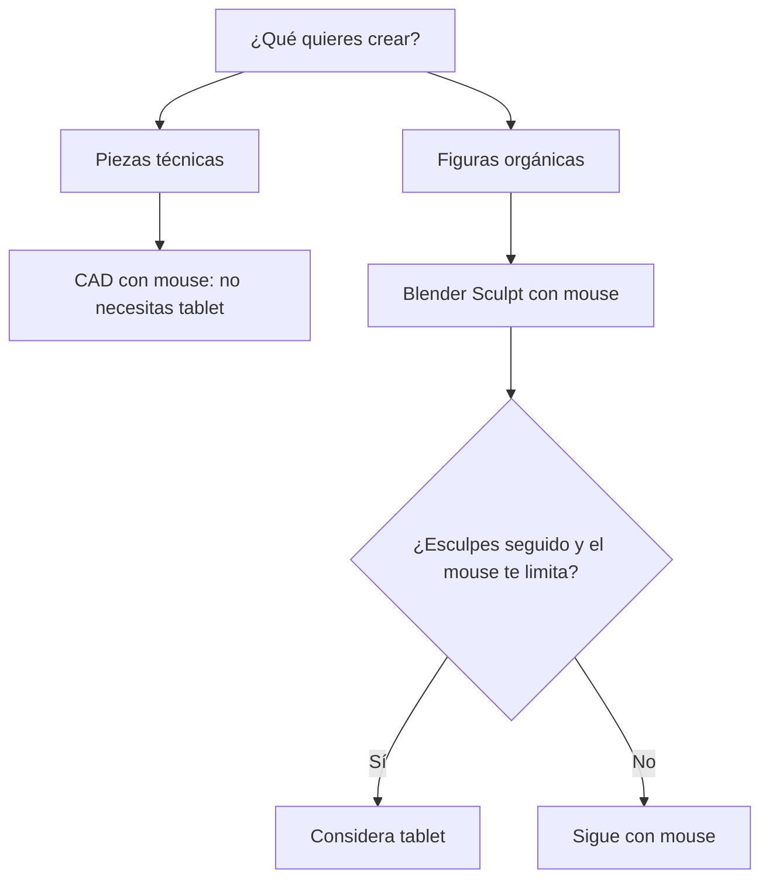

# Tablet para escultura digital (opcional)

Parte de: [[36-Impresion-3D/06 Herramientas y compras/_Índice Herramientas y compras|Herramientas y compras]]

> [!info] Cómo avanzar
> `progreso`: **pendiente** → **viendo** (estudiando) → **visto** (contestaste la autoevaluación sin abrir las respuestas) → **dominado** (hiciste el laboratorio o lo aplicaste de verdad).

## Contenido

### Qué es
Una **tablet de dibujo** (con lápiz sensible a la presión) o una tablet tipo iPad con lápiz permite **esculpir** modelos digitales de forma más natural, como si modelaras plastilina. Es una herramienta **opcional**: no la necesitas para imprimir ni para diseñar la mayoría de piezas.

### Cómo funciona
Hay dos formas principales de crear modelos propios, y cada una pide herramientas distintas:

| | Modelado técnico (CAD) | Escultura digital |
|---|---|---|
| Qué haces | Bocetos con cotas, extrusiones, agujeros exactos | Empujas, jalas y alisas una malla como arcilla |
| Para qué | Soportes, cajas, piezas que encajan | Figuras, personajes, formas orgánicas |
| Herramienta | Mouse y teclado | Mouse funciona; **lápiz con presión** es mucho más cómodo |
| Software gratuito | FreeCAD, Onshape (plan gratuito: condiciones Pendiente de confirmar) | **Blender** (modo Sculpt) |

**Qué aporta el lápiz:**
- **Presión**: más presión = trazo más fuerte o más grande, como en la vida real.
- **Trazos largos y fluidos**: con mouse cuesta mantener la mano estable.
- **Menos cansancio** en sesiones largas.

**Tipos:**
- **Tableta de dibujo sin pantalla** (se conecta a la PC, dibujas mirando el monitor): la opción más económica; requiere acostumbrarse.
- **Tableta con pantalla**: dibujas directamente sobre la imagen; más cara.
- **iPad u otra tablet con lápiz** con apps de escultura propias: portátil, pero las apps suelen ser de pago.

Tu PC con GTX 1660 Ti (6 GB) maneja bien Blender para escultura de nivel aficionado; con mallas de millones de polígonos notarás límites.

### Ejemplo
Quieres hacer un ajolote (guiño a tus proyectos Xolotl) para imprimir. Empiezas en Blender con mouse: esfera, modo Sculpt, pinceles *Draw*, *Smooth* y *Grab*. Después de varias semanas notas que los trazos largos para las branquias te cuestan y que pasas mucho tiempo alisando. En ese punto una tableta sin pantalla de gama de entrada mejora mucho la experiencia. Exportas a STL o 3MF y laminas como siempre (ver [[Archivos para imprimir (STL, 3MF, OBJ y STEP)]]).

Si te interesa el modelado técnico, empieza por un CAD paramétrico: defines medidas con números (por ejemplo, la holgura de tu [[Prueba de tolerancias]]) y el modelo se actualiza solo cuando cambias una cota. Eso no se beneficia de una tablet en absoluto.

### Cuándo vale la pena
- Ya esculpes **seguido** y el mouse te limita (presión, trazos largos).
- Haces figuras, personajes o texturas orgánicas.
- No vale la pena si solo haces piezas funcionales o apenas empiezas: primero aprende lo básico del software.

### Errores comunes
1. **Comprar tablet antes de probar Blender con mouse**: muchos descubren que no esculpen tanto.
2. **Comprar la más cara** pensando que suplirá la práctica.
3. **Esculpir sin pensar en la impresión**: detalles más finos que tu boquilla (0.4 mm) no saldrán; partes delgadas se rompen.
4. **Exportar mallas gigantes**: el laminador se vuelve lento; reduce polígonos (*decimate*) antes.

### Para profundizar
- [Blender — sitio oficial](https://www.blender.org/)
- [Manual de Blender: modo Sculpt](https://docs.blender.org/manual/en/latest/sculpt_paint/sculpting/index.html)
- [FreeCAD — sitio oficial](https://www.freecad.org/)

## Autoevaluación

Contesta primero en voz alta o en papel; luego despliega la respuesta.

> [!question]- ¿Necesito tablet para hacer mis propios modelos?
> No. Para piezas técnicas se usa CAD con mouse, y para escultura orgánica puedes empezar en **Blender** (gratis) con mouse. La tablet con lápiz solo hace más cómodo y natural el esculpido.

> [!question]- ¿Cuándo vale la pena?
> Cuando ya esculpes seguido y el mouse te limita (presión, trazos largos). Primero aprende lo básico.

